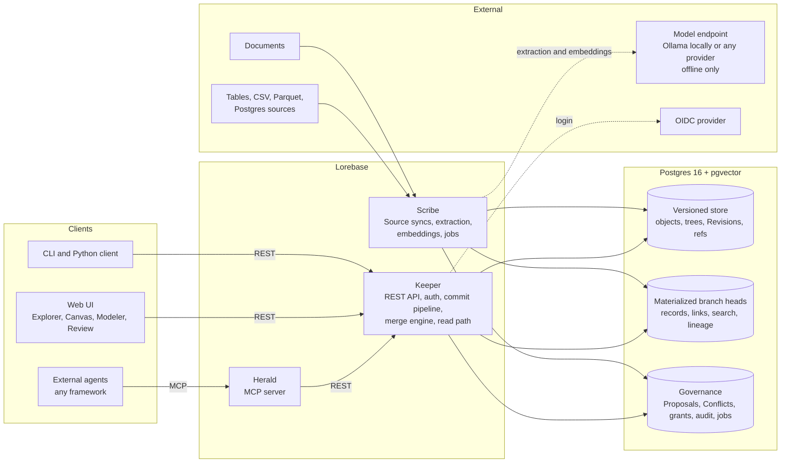

# Lorebase

**Git for company knowledge: an open-source ontology platform that gives AI agents a versioned, governed knowledge graph they can read in milliseconds.**

[](LICENSE)

[](https://github.com/aantenore/lorebase/actions/workflows/ci.yaml)


> Status: pre-alpha, M1 in progress. The founding design is in [docs/design.md](docs/design.md) and the first milestone plan in [docs/plan/m1.md](docs/plan/m1.md). The feature lists below describe the target product; see [Status](#status) for what exists today.

## What is Lorebase

Lorebase is an **open-source ontology platform** and a **versioned knowledge graph for AI agents**, built for enterprise teams and self-hosted on Postgres. It is one system to:

- **model** company knowledge as a typed ontology: Kinds, Attributes, Relations, Traits, Operations, Derivations;
- **fill** it from structured sources (CSV, Parquet, Postgres tables) and from documents through offline extraction that produces **reviewable Proposals**, never direct writes;
- **version** schema and data together with Branches, immutable Revisions, three-way merge and Conflict resolution, like **git for knowledge**;
- **explore** it in a web UI with search, record pages, Lineage and a graph Canvas;
- **expose** it to external agents through a REST API and an **MCP server**, with governed write Operations and a read path that never calls an LLM.

Agents live outside Lorebase, in any framework or language. Lorebase is their knowledge system of record.

## Why

- **Versioned knowledge for agents.** When an agent answers wrongly, you need to know what it knew and since when. Every change in Lorebase is a Revision with author, reason and Lineage down to the attribute value. Time travel and diffs come for free.
- **An open-source alternative to proprietary ontology platforms.** Typed objects, links, governed actions and an object explorer should not require a closed enterprise suite. Lorebase is Apache-2.0, with security, audit and RBAC in the open-source core.
- **Git-like branching for knowledge.** Work on a Branch, open a Proposal, review the schema and data diff, resolve Conflicts at attribute level, merge. Schema and data are merged together with consistency rules, so a merge never leaves the knowledge base invalid.
- **MCP-native.** Herald, the built-in MCP server, gives any MCP-capable agent typed tools: describe the Domain, search, query, traverse, Lineage, and execute governed Operations with dry run.
- **LLM-free read path.** Agent reads are deterministic SQL over materialized branch heads: milliseconds, reproducible, cheap. Language models are used only offline, to propose knowledge that people or policies accept.
- **Runs free on your laptop, scales to any paid model.** One OpenAI-compatible inference abstraction. Local by default: Ollama (or vLLM, LM Studio, llama.cpp) for LLM extraction, fastembed on CPU for embeddings, GLiNER and GLiREL for zero-cost entity and relation extraction. Hosted models from OpenAI, Azure OpenAI, Anthropic, Google, Amazon Bedrock or Mistral plug into the same abstraction, directly or through a LiteLLM proxy. Switching provider is configuration only. The full demo needs zero API keys.
- **Self-hosted on Postgres only.** One required store: Postgres 16 (with pgvector for optional semantic search). No graph database, search cluster or queue broker to run.
- **A GraphRAG alternative for the enterprise.** Instead of letting a model write a graph you cannot audit, Lorebase keeps a reviewed, typed, versioned graph and hands agents precise answers with provenance.

## Key features

| Area | Features |
|------|----------|
| Modeling | Kinds, typed Attributes with constraints and sensitivity tags, directional Relations with cardinality, Traits, Derivations, Source mappings; Modeler UI and YAML |
| Versioning | Content-addressed Revisions on Postgres, Branches and tags, diff between any two Revisions, three-way merge of schema and data, Conflict taxonomy and resolution flows, time travel reads |
| Ingestion | CSV, Parquet and Postgres Sources with rule-based schema inference (no model needed); snapshot and incremental syncs; tiered document extraction (rules, local GLiNER and GLiREL, then any LLM with JSON schema output) with verified evidence and entity resolution; everything lands as Proposals |
| Inference | Vendor-agnostic and local-first: `LLM_BASE_URL`, `LLM_MODEL`, optional `LLM_API_KEY`; Ollama by default; any hosted provider by configuration; fastembed embeddings on CPU; deterministic fake provider for tests; never used on the agent read path |
| Review | Proposals with checks and approvals, per-item accept and reject with highlighted evidence, side-by-side Conflict resolver, merge policies such as Source authority |
| Exploration | Explorer (search, filters, record pages, Lineage, history), Canvas graph visualization (Sigma.js), schema graph, diff overlay |
| Agent access | REST API with OpenAPI 3.1, MCP server (stdio and Streamable HTTP), Python client, governed Operations with dry run and idempotency |
| Search | Postgres full-text search, trigram matching, optional pgvector embeddings computed offline, hybrid ranking |
| Governance | OIDC single sign-on, API keys for agents, RBAC per Domain, Kind and Operation, sensitivity masking, hash-chained audit log |
| Operations | OpenTelemetry traces and metrics, structured JSON logs, Docker images, docker compose, Helm chart (planned) |

## Quickstart

Lorebase is pre-alpha. Today you can build and test the engine, bring up Postgres with migrations and the Keeper skeleton, and run the web shell against a mock API. The REST API, CLI and MCP server do not exist yet, so there is no end-to-end flow to try; see [Status](#status).

Requirements: Python 3.12 with [uv](https://docs.astral.sh/uv/), Docker with compose, and Node.js 24 with pnpm for the web app.

```bash
git clone https://github.com/aantenore/lorebase.git
cd lorebase

# Python workspace: install, then lint, type-check and run the unit tests
uv sync --all-packages
make lint type test-unit

# Postgres, migrations and Keeper (builds the backend image on first run)
cp .env.example .env     # set POSTGRES_PASSWORD and review the other values
docker compose --env-file .env -f deploy/compose/docker-compose.yaml up postgres migrate keeper

# in a second terminal
curl http://localhost:8080/readyz
```

Web app, in mock mode (no backend needed):

```bash
cd apps/web
cp .env.example .env     # VITE_API_MODE=mock
pnpm install
pnpm dev                 # http://localhost:5173
```

Configuration is external: `.env` for compose, `config/lorebase.example.yaml` for the services, `apps/web/.env.example` for the web app. See [apps/web/README.md](apps/web/README.md) for the web variables and the mock API.

## Architecture



The agent read path is `agent -> Herald -> Keeper -> materialized head`. It never touches a model of any kind; only Scribe, offline, uses the inference abstraction.

## How it compares

Lorebase sits between proprietary operational ontology platforms, versioned databases, graph databases and agent memory engines. The honest, detailed comparison with Palantir Foundry Ontology, TerminusDB, Dolt, Neo4j, Cognee, Graphiti and Zep, Mem0, LinkML and Protégé is in [docs/comparison.md](docs/comparison.md).

| | Typed ontology | Branch and merge schema plus data | Reviewed extraction | MCP | LLM-free reads | Open source, Postgres only |
|---|:-:|:-:|:-:|:-:|:-:|:-:|
| Lorebase | yes | yes | yes | yes | yes | yes |

## Status

M1 (engine and API) is in progress. Nothing is released and interfaces may change.

Done:

- **Core engine** (`lorebase_core`): canonical JSON and hashing, type system, schema element models with static validation, data validation, canonical HAMT trees, tree diff, Revisions, changesets and ancestry.
- **Three-way merge**: schema merge, attribute-level data merge, consistency rules under the merged schema, the full Conflict taxonomy, resolutions and merge policies (`prefer`, cascade of dangling Links, defaults). The `authority` and `newest_wins` policies are not implemented yet. Implementation notes: [docs/design.md](docs/design.md#615-implementation-notes).
- **Schema as code**: load and dump a Domain schema as YAML, with the demo Domain in [examples/supply](examples/supply).
- **Postgres schema**: Alembic migrations for the versioned store, materialized heads, governance tables and row-level security ([notes](docs/store-schema-notes.md)).
- **Keeper skeleton**: settings, structured logging and telemetry, error format, liveness and readiness endpoints.
- **Web shell**: Explorer, Canvas, schema overview and Review screens over a mock API.
- Inference interfaces with a deterministic fake provider, docker compose for Postgres, migrations and Keeper, and CI.

Next: the commit pipeline and materializer, the REST API, then the CLI. The MCP server (Herald) follows in M3. Ingestion, extraction and semantic search are later milestones; none of them exist yet.

## Roadmap

| Milestone | Theme | Highlights |
|-----------|-------|-----------|
| M1 | Engine and API | Versioning engine, Keeper REST API, CLI, docker compose, CI |
| M2 | Structured ingestion and exploration | Postgres, CSV and Parquet Sources, schema inference, OIDC, Explorer, Canvas, Review basics |
| M3 | Governance and agents | Custom Operations, full RBAC, Herald MCP server, Modeler, Conflict resolver UI |
| M4 | Documents and semantic search | Tiered offline extraction into Proposals with evidence (local models by default, any provider by configuration), entity resolution, fastembed embeddings, hybrid search, Derivations |
| M5 | Enterprise hardening, 1.0 | Overlay branches, PII vault and erasure, Helm chart, 10M-record performance, LinkML import and export |

Details and acceptance criteria: [docs/design.md](docs/design.md#18-roadmap).

## Documentation

- [Design](docs/design.md): intent, domain model, versioning engine, storage, APIs, UI, security, roadmap
- [Glossary](docs/glossary.md): the Lorebase vocabulary with examples
- [Comparison](docs/comparison.md): Lorebase next to similar products
- [M1 plan](docs/plan/m1.md): ordered implementation tasks for the first milestone

## Contributing

Contributions are welcome: design feedback, issues, and code once M1 work starts. Read [CONTRIBUTING.md](CONTRIBUTING.md) and the [Code of Conduct](CODE_OF_CONDUCT.md). Security issues: see [SECURITY.md](SECURITY.md).

## License

Apache License 2.0. See [LICENSE](LICENSE). Copyright 2026 Antonio Antenore.
