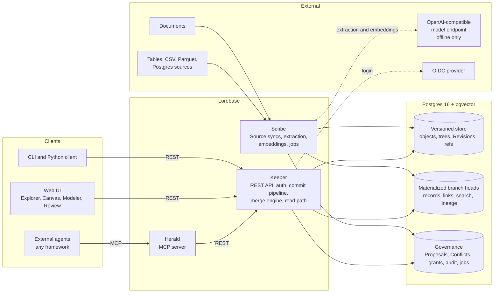

# Lorebase

**Git for company knowledge: an open-source ontology platform that gives AI agents a versioned, governed knowledge graph they can read in milliseconds.**

[](LICENSE)


> Status: Lorebase is in the design phase. The founding design is in [docs/design.md](docs/design.md) and the first milestone plan in [docs/plan/m1.md](docs/plan/m1.md). Commands below describe the M1 experience and are marked accordingly.

## What is Lorebase

Lorebase is an **open-source ontology platform** and a **versioned knowledge graph for AI agents**, built for enterprise teams and self-hosted on Postgres. It is one system to:

- **model** company knowledge as a typed ontology: Kinds, Attributes, Relations, Traits, Operations, Derivations;
- **fill** it from structured sources (CSV, Parquet, Postgres tables) and from documents through offline extraction that produces **reviewable Proposals**, never direct writes;
- **version** schema and data together with Branches, immutable Revisions, three-way merge and Conflict resolution, like **git for knowledge**;
- **explore** it in a web UI with search, record pages, Lineage and a graph Canvas;
- **expose** it to external agents through a REST API and an **MCP server**, with governed write Operations and a read path that never calls an LLM.

Agents live outside Lorebase, in any framework or language. Lorebase is their knowledge system of record.

## Why

- **Versioned knowledge for agents.** When an agent answers wrongly, you need to know what it knew and since when. Every change in Lorebase is a Revision with author, reason and Lineage down to the attribute value. Time travel and diffs come for free.
- **An open-source alternative to proprietary ontology platforms.** Typed objects, links, governed actions and an object explorer should not require a closed enterprise suite. Lorebase is Apache-2.0, with security, audit and RBAC in the open-source core.
- **Git-like branching for knowledge.** Work on a Branch, open a Proposal, review the schema and data diff, resolve Conflicts at attribute level, merge. Schema and data are merged together with consistency rules, so a merge never leaves the knowledge base invalid.
- **MCP-native.** Herald, the built-in MCP server, gives any MCP-capable agent typed tools: describe the Domain, search, query, traverse, Lineage, and execute governed Operations with dry run.
- **LLM-free read path.** Agent reads are deterministic SQL over materialized branch heads: milliseconds, reproducible, cheap. Language models are used only offline, to propose knowledge that people or policies accept.
- **Self-hosted on Postgres only.** One required store: Postgres 16 (with pgvector for optional semantic search). No graph database, search cluster or queue broker to run.
- **A GraphRAG alternative for the enterprise.** Instead of letting a model write a graph you cannot audit, Lorebase keeps a reviewed, typed, versioned graph and hands agents precise answers with provenance.

## Key features

| Area | Features |
|------|----------|
| Modeling | Kinds, typed Attributes with constraints and sensitivity tags, directional Relations with cardinality, Traits, Derivations, Source mappings; Modeler UI and YAML |
| Versioning | Content-addressed Revisions on Postgres, Branches and tags, diff between any two Revisions, three-way merge of schema and data, Conflict taxonomy and resolution flows, time travel reads |
| Ingestion | CSV, Parquet and Postgres Sources with schema inference; snapshot and incremental syncs; document extraction with a pluggable OpenAI-compatible endpoint, verified evidence and entity resolution; everything lands as Proposals |
| Review | Proposals with checks and approvals, per-item accept and reject with highlighted evidence, side-by-side Conflict resolver, merge policies such as Source authority |
| Exploration | Explorer (search, filters, record pages, Lineage, history), Canvas graph visualization (Sigma.js), schema graph, diff overlay |
| Agent access | REST API with OpenAPI 3.1, MCP server (stdio and Streamable HTTP), Python client, governed Operations with dry run and idempotency |
| Search | Postgres full-text search, trigram matching, optional pgvector embeddings computed offline, hybrid ranking |
| Governance | OIDC single sign-on, API keys for agents, RBAC per Domain, Kind and Operation, sensitivity masking, hash-chained audit log |
| Operations | OpenTelemetry traces and metrics, structured JSON logs, Docker images, docker compose, Helm chart (planned) |

## 60-second quickstart

> Coming in M1. Images and the CLI are not published yet; the commands show the intended experience.

```bash
git clone https://github.com/aantenore/lorebase.git
cd lorebase
cp deploy/compose/.env.example deploy/compose/.env
docker compose -f deploy/compose/docker-compose.yaml up -d

# create an admin API key (printed once)
docker compose -f deploy/compose/docker-compose.yaml run --rm cli admin bootstrap --name admin

# load the demo Domain: schema, data and a first Revision
docker compose -f deploy/compose/docker-compose.yaml run --rm cli domain create supply
docker compose -f deploy/compose/docker-compose.yaml run --rm cli schema apply supply examples/supply/schema.yaml
docker compose -f deploy/compose/docker-compose.yaml run --rm cli records import supply examples/supply/data/

# branch, change, diff, merge
lorebase branch create supply cleanup/tiers
lorebase op run supply update_supplier --branch cleanup/tiers --param ref=Supplier/S-1001 --param tier=1
lorebase diff supply main cleanup/tiers
lorebase proposal open supply cleanup/tiers --title "Tier cleanup"
```

Then open the API docs at `http://localhost:8080/api/v1/docs`. The web UI (`http://localhost:3000`) and the MCP server (`http://localhost:8090/mcp`) arrive in M2 and M3.

## Architecture



The agent read path is `agent -> Herald -> Keeper -> materialized head`. It never touches a language model.

## How it compares

Lorebase sits between proprietary operational ontology platforms, versioned databases, graph databases and agent memory engines. The honest, detailed comparison with Palantir Foundry Ontology, TerminusDB, Dolt, Neo4j, Cognee, Graphiti and Zep, Mem0, LinkML and Protégé is in [docs/comparison.md](docs/comparison.md).

| | Typed ontology | Branch and merge schema plus data | Reviewed extraction | MCP | LLM-free reads | Open source, Postgres only |
|---|:-:|:-:|:-:|:-:|:-:|:-:|
| Lorebase | yes | yes | yes | yes | yes | yes |

## Roadmap

| Milestone | Theme | Highlights |
|-----------|-------|-----------|
| M1 | Engine and API | Versioning engine, Keeper REST API, CLI, docker compose, CI |
| M2 | Structured ingestion and exploration | Postgres, CSV and Parquet Sources, schema inference, OIDC, Explorer, Canvas, Review basics |
| M3 | Governance and agents | Custom Operations, full RBAC, Herald MCP server, Modeler, Conflict resolver UI |
| M4 | Documents and semantic search | Offline extraction into Proposals with evidence, entity resolution, embeddings, hybrid search, Derivations |
| M5 | Enterprise hardening, 1.0 | Overlay branches, PII vault and erasure, Helm chart, 10M-record performance, LinkML import and export |

Details and acceptance criteria: [docs/design.md](docs/design.md#18-roadmap).

## Documentation

- [Design](docs/design.md): intent, domain model, versioning engine, storage, APIs, UI, security, roadmap
- [Glossary](docs/glossary.md): the Lorebase vocabulary with examples
- [Comparison](docs/comparison.md): Lorebase next to similar products
- [M1 plan](docs/plan/m1.md): ordered implementation tasks for the first milestone

## Contributing

Contributions are welcome: design feedback, issues, and code once M1 work starts. Read [CONTRIBUTING.md](CONTRIBUTING.md) and the [Code of Conduct](CODE_OF_CONDUCT.md). Security issues: see [SECURITY.md](SECURITY.md).

## License

Apache License 2.0. See [LICENSE](LICENSE). Copyright 2026 Antonio Antenore.
