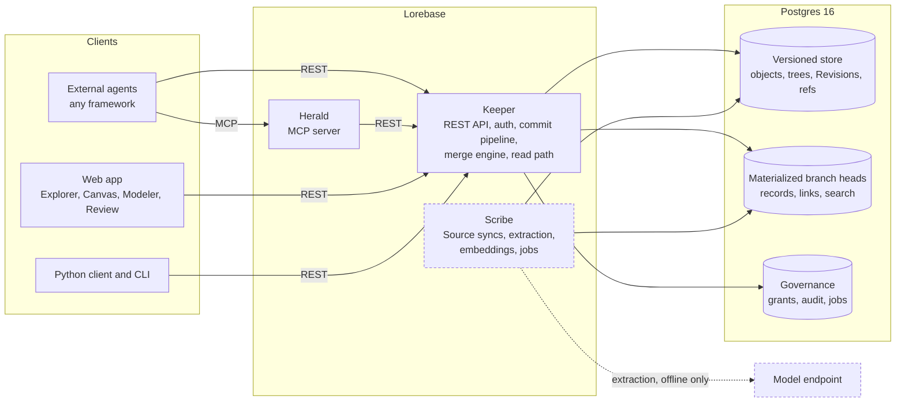

# Lorebase

**Git for knowledge: an open-source ontology platform where AI agents read a versioned, governed knowledge graph in milliseconds.**

[](LICENSE)

[](https://github.com/aantenore/lorebase/actions/workflows/ci.yaml)
[](https://github.com/aantenore/lorebase/actions/workflows/codeql.yaml)
[](https://scorecard.dev/viewer/?uri=github.com/aantenore/lorebase)


> **Pre-alpha.** The versioning and merge engine and the Keeper REST API, Proposals included, run today, and so do the MCP server (Herald), the Python client and the `lorebase` CLI. Source syncs and document extraction do not exist yet. [Status and roadmap](#status-and-roadmap) says exactly what is done.

## What it is

Lorebase is an open-source ontology platform: a versioned knowledge graph for AI agents, self-hosted on Postgres and nothing else. Teams model what the company knows as a typed ontology (Kinds, Attributes, Relations, Operations), keep it in Postgres, and change it the way developers change code: on a branch, reviewed, merged, traceable. It brings git-like branching and merging for knowledge, covering the schema and the data together, with three-way conflicts resolved per attribute. Agents live outside Lorebase, in any framework. They read through a REST API that never calls a language model, so answers are deterministic and arrive in milliseconds, and they write only through governed Operations. Lorebase is MCP-native by design: the MCP server (Herald) wraps the REST API for any MCP host. It is meant as an open-source alternative to proprietary ontology platforms, small enough to run on a laptop with `docker compose`.


<sub>The web app walking through Explorer, Canvas and a Conflict in Review. It runs on a mock API with sample data; see the [visual tour](docs/tour.md).</sub>

## 30-second demo

The core engine runs in memory, with no services. This script loads the sample `supply` Domain into `main`, branches `model/risk` (analysts change the schema and data) and `source/erp` (a nightly feed changes data), merges both, lists the Conflicts, resolves them and diffs.

```bash
git clone https://github.com/aantenore/lorebase.git && cd lorebase
uv sync --all-packages
uv run python examples/merge_demo.py
```

```text
== 5. merge source/erp into main
merge base 7ad4a553: 5 Conflicts

DV1 ATTRIBUTE_VALUE (1)
  where            attribute   base  ours  theirs  choices
  -----            ---------   ----  ----  ------  -------
  Supplier S-1001  risk_score  32    80    45      ours/theirs/base/custom

DV2 DELETE_MODIFY (1)
  where         attribute  base      ours      theirs    choices
  -----         ---------  ----      ----      ------    -------
  Part P-10003  -          {record}  (absent)  {record}  ours/theirs/base/custom
...
== 7. merge again
merged: Revision 2cacd1bb, parents 60f665d3, 4d5440a3
validation: 72 Records against the merged schema, 0 issues
```

The analysts say 80, the ERP says 45, and someone has to decide. That decision is a recorded resolution, not a silent overwrite. The walkthrough of the whole output is in the [quickstart](docs/quickstart.md#3-run-the-core-demo).

## Why Lorebase

- **Branch and merge schema and data, with three-way conflicts.** Change the model and the data on a branch, merge, and get typed Conflicts (attribute value, delete or modify, type coercion, cardinality, dangling link and more) instead of a corrupted knowledge base. The merge engine checks the merged data against the merged schema before it commits.
- **Milliseconds reads for agents.** Reads are deterministic SQL over materialized branch heads, with no model in the path. This is enforced by the build: Keeper cannot import the inference package. Every response names the Revision it was served from. [Measured numbers](#read-performance) are below.
- **Governed writes through Operations and Proposals.** Agents change knowledge only through Operations with validation, permissions, dry run, idempotency and audit. Writes to a protected branch go through a Proposal, with reviews, required approvals and Conflict resolution over REST. Both are there today.
- **Schema as code.** The ontology is a YAML document you review in a pull request and apply as one schema change set. Attribute ids are stable, so renames merge cleanly.
- **Runs free on a laptop, scales out when you need it.** One `docker compose`, Postgres 16, no API keys. Add Keepers behind a load balancer and Postgres read replicas with a freshness guard for read load. Model-backed ingestion will use one OpenAI-compatible abstraction, local or paid, selected by configuration; it is not built yet.

## Features

| Area | Feature | Status | Milestone |
|------|---------|--------|-----------|
| Modeling | Typed ontology as YAML: Kinds, Attributes, Relations with cardinality, Traits, Operations, Derivations, Sources, with static validation | Done | M1 |
| Modeling | Expressions (CEL) in Operations and Derivations | In progress: the engine and its schema checks are done and stored Operations evaluate CEL behind `keeper.operations.expressions_enabled` (off by default), but schema change sets still refuse schemas that use expressions and Derivations are not computed | M3, M4 |
| Versioning | Content-addressed Revisions, branches, tags, diff, time travel reads | Done | M1 |
| Versioning | Three-way merge of schema and data, full Conflict taxonomy, resolutions, merge policies (`prefer`, cascade, defaults) | Done | M1 |
| Versioning | Proposals, reviews, required approvals, merge and Conflict resolution over REST | Done | M1 |
| Reads | Records, Links, query DSL, traversal, neighborhood, lexical search, log and diff over REST, with ETags | Done | M1 |
| Reads | Per-Attribute indexes, one-statement read primitives, performance harness and a 100k-Record baseline ([docs/performance.md](docs/performance.md)) | Done; the 1M-Record baseline is not | M1 |
| Reads | Semantic and hybrid search with caller-supplied vectors | Planned (nothing computes embeddings yet) | M4 |
| Governance | Built-in Operations (create, update, delete, link, unlink, bulk import) with dry run and idempotency | Done | M1 |
| Governance | API keys, OIDC bearer tokens, role grants per Domain, Kind, Operation and branch, hash-chained audit log | Done | M1 |
| Governance | Custom Operations, review policies, sensitivity masking | Partly: the executor and the review policy gate exist, custom Operations wait on the CEL item above; masking is planned | M3 |
| Operations | Docker compose, CI, CodeQL, Scorecard, SBOM, OpenTelemetry | Done | M1 |
| Operations | Several Keepers and Postgres read replicas with a freshness guard | Done, endpoints adopt it incrementally | M1 |
| Operations | Garbage collection, Domain backup and restore bundles, a Postgres job queue ([docs/operations.md](docs/operations.md)) | Done | M5, landed early |
| Agent access | Context packs within a token budget (JSON or markdown), Record explanations, change feed (Server-Sent Events and polling) and signed webhooks ([docs/agents.md](docs/agents.md)) | Done | M3, landed early |
| Agent access | Python client (sync and async) and the `lorebase` CLI over the REST API, Proposals, context packs and explanations included; the OpenAPI document is committed as [docs/openapi.json](docs/openapi.json) | Done | M1 |
| Agent access | MCP server (Herald) on stdio and Streamable HTTP ([docs/mcp.md](docs/mcp.md)) | Done | M3, landed early |
| Ingestion | Schema inference from CSV files and Postgres tables (`POST .../schema:infer`, [docs/inference.md](docs/inference.md)) | Done | M2 |
| Ingestion | CSV, Parquet and Postgres Sources with snapshot and incremental syncs | Planned | M2 |
| Ingestion | Offline document extraction into reviewable Proposals | Planned | M4 |
| Web app | Explorer, Canvas, Modeler, Review with Conflict resolver | Done; runs on the mock API or on Keeper, with end-to-end tests against a real Keeper | M2, M3 |
| Scale | Overlay branches, PII vault, Helm chart, 10M-Record performance | Planned | M5 |

The milestone breakdown with checkboxes is in the [roadmap](docs/roadmap.md).

### Read performance

p95 latency in milliseconds of the agent reads on a materialized head of 99,900 Records and 302,940 Links, one laptop with Postgres in Docker, measured by `tests/perf/bench.py` for a database role not subject to row-level security ([docs/performance.md](docs/performance.md)):

| Read | Budget | p95 |
|------|-------:|----:|
| Record by key | 5 | 2.43 |
| Page of 50 | 20 | 5.64 |
| Links of a Record | 10 | 4.25 |
| Neighborhood, 2 hops | 30 | 20.46 |
| Query on an indexed Attribute | 25 | 4.61 |
| Full-text search | 50 | 6.39 |

Caveat: production runs Keeper as a role subject to row-level security, and there Links of a Record (28 ms), the neighborhood (137 ms) and search (68 ms) are over budget, because Postgres cannot use non-leakproof operators as index conditions under RLS. The [performance page](docs/performance.md) has both columns and the plans; the 1M-Record baseline is still to do.

## See it

Screens of the web app, running on a real Keeper with the supply sample loaded. The [visual tour](docs/tour.md) says what is live and what is not served yet.

| Explorer | Canvas | Conflict resolver |
|----------|--------|-------------------|
| [](docs/tour.md#explorer) | [](docs/tour.md#canvas) | [](docs/tour.md#review) |

## Quickstart

Requirements: Python 3.12 with [uv](https://docs.astral.sh/uv/), Docker with compose, and Node.js 24 with pnpm for the web app.

```bash
git clone https://github.com/aantenore/lorebase.git && cd lorebase
uv sync --all-packages

# Core engine demo: branches, three-way merge, Conflicts, resolutions, diff (no services)
uv run python examples/merge_demo.py

# Postgres, migrations and Keeper (builds the backend image on first run)
cp .env.example .env     # set POSTGRES_PASSWORD
docker compose --env-file .env -f deploy/compose/docker-compose.yaml up -d postgres migrate keeper
curl http://localhost:8080/readyz
```

The [quickstart](docs/quickstart.md) continues from there: create the `supply` Domain, apply its schema, import the sample data through the REST API and run the web app in mock mode. Scale-out with replicas is in [docs/deployment.md](docs/deployment.md). Configuration is external: `.env` for compose, `config/lorebase.example.yaml` for the services, `apps/web/.env.example` for the web app.

## Architecture



Dashed boxes do not exist yet. The agent read path is `agent -> Keeper -> materialized head`, or `agent -> Herald -> Keeper -> materialized head` over MCP. It never touches a model; only Scribe, offline, will. Postgres is the only required store, with pgvector for optional semantic search. Details: [docs/design.md](docs/design.md).

## How it compares

Lorebase sits between proprietary ontology platforms, versioned databases, graph databases and agent memory engines. The full comparison, including where each of them is the better choice, is in [docs/comparison.md](docs/comparison.md).

| Product | What it is | Branch and merge of knowledge | Choose it instead when |
|---------|-----------|-------------------------------|------------------------|
| **Lorebase** | Typed ontology as a shared system of record, Postgres only | Yes, schema and data together, three-way | You want agents to read a reviewed, versioned knowledge base and change it only through governed Operations |
| Palantir Foundry Ontology | Proprietary operational ontology inside a full data platform | Within the platform | You need the whole platform and a vendor to run it |
| TerminusDB | Versioned document and graph database | Yes, on its own storage engine | You want a general versioned graph database to build on |
| Dolt | SQL database with git semantics | Yes, on tables | Your data is tabular and you want versioned SQL |
| Neo4j | Property graph database | No | You need graph algorithms and pattern queries at scale |
| Cognee | Agent memory built by LLM pipelines | No | You want automated memory for a single agent |
| Graphiti and Zep | Temporal knowledge graph for agent memory | No (facts carry validity time) | You need conversational memory with temporal reasoning |
| Mem0 | Per-user memory layer | No | You want personalization memory for assistants |

## Who is it for

- **Platform teams** that need one governed place for company knowledge that many agents and applications read, with SSO, roles, audit and no new proprietary platform to buy.
- **Data teams** that own the definitions (suppliers, parts, contracts) and want them modeled, reviewed and versioned like code, with structured sources mapped in.
- **Agent builders** who are tired of agents answering from stale chunks, and want typed entities, provenance, a deterministic read API and a safe write path.
- **Consultancies** that deliver the same kind of knowledge system to several clients and want an open, self-hostable base with a clean multi-Domain model, instead of reselling a closed suite.

## Status and roadmap

Pre-alpha. Nothing is released and interfaces may change. M1 (engine and API) is in progress: the engine, the REST API (Proposals included), the Python client and the CLI are done; lineage and history endpoints and the 1M-Record performance baseline are not.

Done on `main`: the core engine (canonical JSON and hashing, type system, schema models, HAMT trees, Revisions, diff, three-way merge with the Conflict taxonomy); schema as YAML; the CEL expression engine; the Postgres store with materialized heads, row-level security and per-Attribute indexes; the Keeper REST API for Domains, branches, schema change sets, schema inference, Operations, Proposals with reviews, merge and Conflict resolution, Records, Links, query, traversal, neighborhood, search, log, Revisions and diff; authentication with API keys and OIDC, roles and audit log; Postgres read replicas with a freshness guard; context packs, Record explanations, the change feed and signed webhooks for agents; Herald, the MCP server over the REST API; the Python client and the `lorebase` CLI, checked against the committed OpenAPI document; garbage collection, Domain bundles and a job queue; a performance harness with a 100k-Record baseline; docker compose; CI with CodeQL; the web app on a mock API.

Next: lineage and history endpoints and the 1M-Record baseline (finishing M1), expressions accepted in schema change sets, Source ingestion (M2), custom Operations (M3), document extraction and semantic search (M4), and hardening to 1.0 (M5).

| Milestone | Theme | Highlights |
|-----------|-------|-----------|
| M1 | Engine and API | Versioning engine, Keeper REST API, CLI, docker compose, CI |
| M2 | Structured ingestion and exploration | Postgres, CSV and Parquet Sources, schema inference, Explorer, Canvas, Review basics |
| M3 | Governance and agents | Custom Operations, full RBAC, Herald MCP server, Modeler, Conflict resolver UI |
| M4 | Documents and semantic search | Offline extraction into Proposals with evidence, entity resolution, embeddings, hybrid search |
| M5 | Enterprise hardening, 1.0 | Overlay branches, PII vault, Helm chart, 10M-Record performance, LinkML import and export |

The public [roadmap](docs/roadmap.md) tracks every item. The reasoning behind the project is in [docs/why.md](docs/why.md), common questions in the [FAQ](docs/faq.md).

## Documentation

- [Why Lorebase](docs/why.md): the case for git-like knowledge
- [FAQ](docs/faq.md)
- [Quickstart](docs/quickstart.md): what runs today, step by step
- [Visual tour](docs/tour.md): every screen of the web app
- [Design](docs/design.md): intent, domain model, versioning engine, storage, APIs, security, roadmap
- [Deployment and scale-out](docs/deployment.md): topology, read replicas, sizing
- [Operations](docs/operations.md): garbage collection, backup and restore of a Domain
- [Schema inference](docs/inference.md): Kinds, Attributes, keys and Relations proposed from CSV files or Postgres tables
- [Performance](docs/performance.md): read latency baseline and how to reproduce it
- [Agents](docs/agents.md): how an agent reads, writes and follows a Domain: context packs, explanations, Operations, change feed and webhooks
- [MCP server](docs/mcp.md): Herald, its tools and its configuration for MCP hosts
- [Comparison](docs/comparison.md): Lorebase next to similar products
- [Roadmap](docs/roadmap.md)
- [Glossary](docs/glossary.md), [examples](examples/README.md), [M1 plan](docs/plan/m1.md)

## Community

- [Issues](https://github.com/aantenore/lorebase/issues): bug reports, feature requests and questions
- [Discussions](https://github.com/aantenore/lorebase/discussions): ideas, use cases and design conversations
- [CONTRIBUTING.md](CONTRIBUTING.md): workflow, commit conventions, labels. Design feedback and real use cases are as valuable as code at this stage.
- [SECURITY.md](SECURITY.md): how to report a vulnerability privately
- [Code of Conduct](CODE_OF_CONDUCT.md)

## License

Apache License 2.0. See [LICENSE](LICENSE). Copyright 2026 Antonio Antenore.
