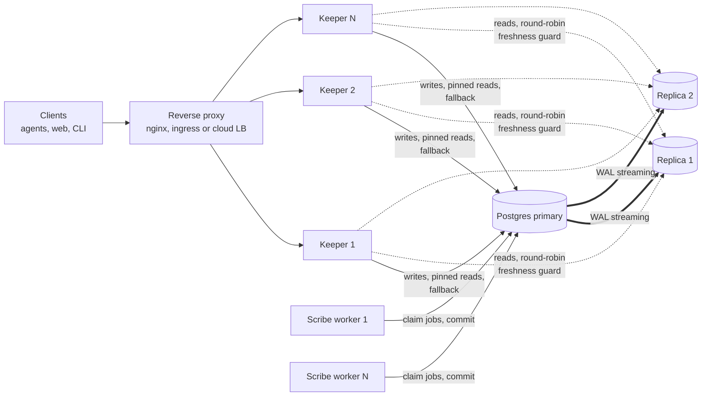

# Deployment and scale-out

How to run several Keeper replicas and read replicas of Postgres without giving up correctness.
Design references: [6.5](design.md#65-branches-and-refs) (refs, advisory locks),
[6.6](design.md#66-the-commit-pipeline), [8](design.md#8-read-path-and-search) (read path),
[15](design.md#15-deployment) (deployment), [13](design.md#13-security-and-multi-tenancy).

Status: Keeper is the only service so far. Scribe and Herald are described where they matter
and join the same topology when they exist. The read endpoints do not call `read_session` yet,
so `keeper.reads.prefer_replica` takes effect endpoint by endpoint as they adopt it.

## Topology



Everything that matters is in Postgres: a Keeper holds no state it cannot rebuild, so replicas
are added, removed and restarted freely behind any load balancer, without session affinity.

## What scales where

| Part | How it scales | Why it stays correct |
|------|---------------|----------------------|
| Keeper | N identical stateless processes behind a load balancer | Coordination happens in Postgres: branch advisory locks, compare-and-swap on refs, the audit chain lock |
| Writes | One primary. Throughput comes from batching (one Revision holds thousands of changes) and from using several branches | Writers to one branch are serialized by a transaction-scoped advisory lock on `hash(domain_id, branch)`; two Keepers writing the same branch queue on that lock, and a wait beyond `store.commit.lock_timeout_ms` answers 503 `branch-busy` with `Retry-After`. Locks die with the transaction, so a crashed Keeper never leaves one behind |
| Reads | Read replicas (`database.read_dsn`), round-robin | Freshness guard, below |
| Caches | In-process, per Keeper | Tree nodes and compiled schemas are keyed by hash, so an entry can never be stale. The only time-based caches are authorization ones (`keeper.auth.authz.grants_cache_ttl_s`, principal cache): a grant change is seen by every Keeper after at most that TTL |
| Scribe workers | N workers pulling from the `jobs` table with `SELECT ... FOR UPDATE SKIP LOCKED`, no broker | A job is claimed by exactly one worker; workers commit through the same pipeline as Keeper |

### Read replicas and the freshness guard

A streaming replica trails the primary by a small, variable delay. A read that must not go back
in time (read your own write, or `min_revision` from a client) is checked before it is served:

1. The caller names the branch head it must see: `expected_head` (the `min_revision` query
   parameter in `read_session`), or `read_your_writes`, which reads the current head from the
   primary.
2. On the replica, in the transaction the read will use, one query returns the `refs` row of the
   branch and the replication lag.
3. If the head differs from the expected one, the replica has not replayed the commit: the next
   replica is tried, then the primary. A commit is one transaction (design 6.6), so a replica
   that shows the head shows everything the commit wrote.
4. A replica above `database.read_max_lag_ms`, or unreachable within
   `database.read_probe_timeout_ms`, serves nothing. With `database.read_fallback_to_primary:
   false` a read nobody can serve answers 503 instead of loading the primary.

The check is an equality, so when the branch has moved on since the caller learned its head the
read goes to the primary: conservative, never wrong. Reads without a pin are eventually
consistent by design (default: any replica within the lag limit). Lag is estimated as zero when
the standby replayed all the WAL it received, otherwise as the age of the last replayed
transaction, so it needs primary and standby clocks to agree; it is advisory, correctness of
pinned reads rests on the head check.

```yaml
database:
  dsn: secret://env/LOREBASE_DB_DSN
  read_dsn: [secret://env/LOREBASE_DB_READ_DSN_1, secret://env/LOREBASE_DB_READ_DSN_2]
  read_max_lag_ms: 5000
  read_fallback_to_primary: true
keeper:
  reads:
    prefer_replica: true      # default false: behaviour is unchanged until enabled
```

Observability: `/readyz` adds a `database_replicas` check when `read_dsn` is set (`ok`,
`degraded` when a replica is unreachable or lagging while the primary can still serve, `failed`
only when `prefer_replica` is on, fallback is off and no replica is usable). Metrics:
`lorebase.db.reads{source,reason}` (where each read went and why),
`lorebase.db.replica.lag` (ms) and `lorebase.db.replica.up` per replica.

## Docker compose profile `scale-out`

Adds a second Keeper (`keeper-2`), a Postgres streaming replica (`postgres-replica`), a one-shot
`replica-prep` and an unprivileged nginx (`proxy`) in front of the Keepers.

```bash
cp .env.example .env      # set POSTGRES_PASSWORD and REPLICATION_PASSWORD
# route reads to the replica: uncomment/set in .env
#   LOREBASE_DB_READ_DSN=postgresql+asyncpg://lorebase:<password>@postgres-replica:5432/lorebase
#   KEEPER_PREFER_REPLICA=true
docker compose --env-file .env -f deploy/compose/docker-compose.yaml --profile scale-out up -d
curl http://127.0.0.1:8088/readyz        # through the proxy; PROXY_HOST_PORT
```

Choices:

- **Replica image: the official `pgvector/pgvector` image plus two small scripts**
  (`deploy/compose/postgres/`). The replica needs the same pgvector build as the primary
  (the image everyone already pulls), `pg_basebackup` ships with Postgres, and there is no
  second image or init framework to track. A Bitnami image was rejected because it does not ship pgvector.
- `replica-prep` appends one `pg_hba.conf` rule to the primary's data directory (the official
  image accepts replication connections from localhost only), creates a `REPLICATION` role that
  can do nothing else, and reloads. It is idempotent and works on a volume created earlier, so
  the base stack is untouched.
- The replica takes a base backup through its own replication slot on first start (empty volume)
  and resumes streaming afterwards. A slot keeps WAL for a replica that is down: drop the
  replica for good (`DROP` the slot) or the primary's disk fills.
- nginx spreads requests round-robin, skips a Keeper that fails and retries idempotent requests
  on the other one after an error or timeout (POST and PATCH are not replayed once sent). Terminate TLS
  here or in front of it; production uses the cluster's ingress instead.

Verified on this change (docker compose v5, Postgres 16): `docker compose config` with and
without the profile; stack up in about 15 seconds after the image build; `/readyz` through the
proxy reported `database_replicas: ok, replica-0 ... lag 0 ms`; requests kept answering 200 with
`keeper-2` stopped; with the replica stopped `/readyz` stayed 200 and reported
`degraded ... unreachable`, and returned to `ok` after restart (streaming resumed). Against the
real replica, 40 commits each followed by a read-your-writes read always saw the new head; with
WAL replay paused on the replica for 10 of them, 9 of those reads fell back to the primary
(`primary/stale`) and every other read was served by the replica.

## Kubernetes

The Helm chart in `deploy/helm/lorebase` runs this topology on a cluster: stateless Keeper
Deployment with HPA and PDB, Scribe workers, read replica DSNs, the migration as a hook Job and an
Ingress in front. Install steps and the minimal, production and scale-out profiles are in
[kubernetes.md](kubernetes.md).

## Sizing hints

Starting points to measure against, not benchmarks.

- **Keepers**: two for availability, then add on CPU or p95 latency. Memory is mostly the node
  cache (`store.nodes.cache_bytes`, 64 MiB by default, per process).
- **Connections**: each Keeper may open `pool_size + max_overflow` connections (20 by default) to
  the primary, and the same to each replica. Keep `Keepers x 20` below the server's
  `max_connections` with headroom for Scribe, migrations and admin. A pooler in front of
  Postgres is untested here; verify prepared statement and advisory lock behaviour before using
  one.
- **Primary**: size memory for the hot part of the indexes (`mat_records` and its indexes), then
  IOPS for commits. Commit throughput per branch is bounded by the lock: split independent work
  across branches and batch changes into fewer, larger Revisions.
- **Replicas**: one per 2 to 3 Keepers of read-heavy traffic is a reasonable start. Long queries
  on a standby can conflict with replay; keep `database.statement_timeout_ms` at or below
  `max_standby_streaming_delay`, or accept `hot_standby_feedback` and its bloat on the primary.
- **Scribe**: workers are CPU and model bound, not database bound; scale them on queue depth.
- **Backups and failover**: standard PITR on the primary (see design 15.3). Promoting a replica
  needs only a DSN change; pools re-validate connections (`pool_pre_ping`).

## Deliberately not done

- **Distributed Postgres** (Citus, CockroachDB, Yugabyte): the engine relies on advisory locks,
  a transactional commit pipeline and one consistent view for merges and the audit chain.
  Revisit if a single primary with replicas stops being enough for the data volume, measured
  after the 10M-Record performance work.
- **Sharding inside a Domain** and an **external broker or cache**: see below and design AC-18.

## Sharding: decided not now, prepared by Domain

**Why not inside a Domain.** Three-way merge, per-branch advisory locks, compare-and-swap on refs
and the hash-chained audit log all need one transaction and one global view of the Domain. Split
a Domain over several databases and each becomes a distributed protocol (two-phase commit or
sagas) for little gain: a single primary with read replicas is expected to carry hundreds of
millions of rows (to be confirmed by the performance work).

**Search-engine ideas already applied** (no engine needed):

- inverted index: `tsvector` with GIN for lexical search, trigram for typos;
- vector search: HNSW indexes in pgvector, per configured model;
- immutable, content-addressed tree nodes behave like index segments: cacheable forever, never
  invalidated, shared across branches and Revisions;
- the materialized head is a read model that can be rebuilt from the tree at any time;
- replica fan-out for reads, with the freshness guard above;
- hash partitioning by `domain_id` for objects, tree nodes and materialized rows.

**The path if one primary stops being enough: the Domain is the shard unit.** No Relation crosses
Domains (design AC-04), so a routing table `domain -> database` lets each Domain live on its own
Postgres with no cross-shard joins, merges or locks. What stays installation-wide, in a control
database: principals, groups, grants and API keys; the Domain registry itself (the routing
table); the installation-level audit chain (per-Domain chains already travel with their Domain);
the job queue and outbox. Routing would be configuration, not code paths:

```yaml
database:
  dsn: secret://env/LOREBASE_DB_DSN          # control database, and default for every Domain
  domains:                                   # not implemented
    supply: {dsn: secret://env/SUPPLY_DSN, read_dsn: [secret://env/SUPPLY_RO_DSN]}
```

A Domain absent from the map uses the default DSN, so adoption is incremental. Moving a Domain
is an export of its Revision graph (content-addressed, so portable) plus a routing switch with a
short write freeze. Revisit for per-tenant data residency or isolation, or when several large
Domains outgrow one primary; one very large Domain is not helped by this and needs a bigger
primary.

**Optional external full-text engine.** If lexical search outgrows Postgres, OpenSearch can be
added later as an adapter behind the search port, fed from the outbox events, with Postgres
remaining the source of truth. It is an optimization behind an interface, not a prerequisite.
