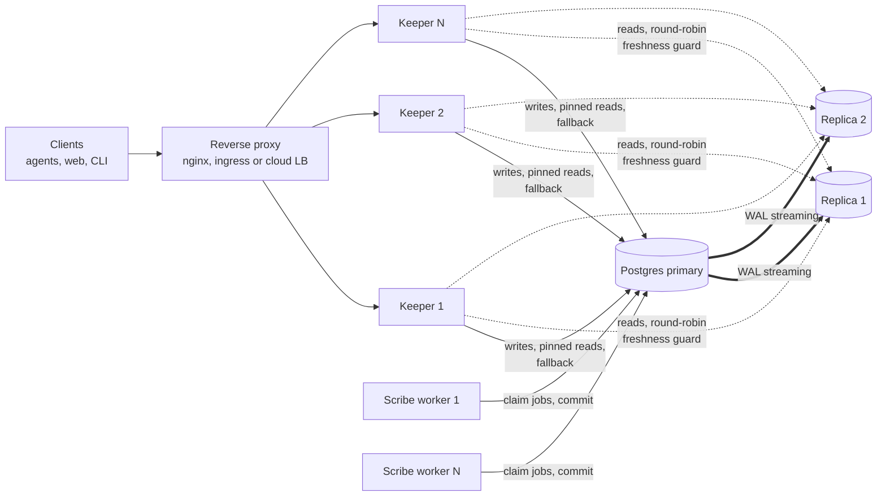

# Deployment and scale-out

How to run several Keeper replicas and read replicas of Postgres without giving up correctness.
Design references: [6.5](design.md#65-branches-and-refs) (refs, advisory locks),
[6.6](design.md#66-the-commit-pipeline), [8](design.md#8-read-path-and-search) (read path),
[15](design.md#15-deployment) (deployment), [13](design.md#13-security-and-multi-tenancy).

Status: Keeper, Scribe ([scribe](scribe.md): job worker and scheduler) and Herald exist; the
compose stack runs Keeper and Scribe. The read endpoints do not call `read_session` yet,
so `keeper.reads.prefer_replica` takes effect endpoint by endpoint as they adopt it.

## Topology



Everything that matters is in Postgres: a Keeper holds no state it cannot rebuild, so replicas
are added, removed and restarted freely behind any load balancer, without session affinity.

Keeper takes the client address from the socket peer and ignores forwarding headers unless the
peer is listed in `keeper.trusted_proxies` (the server's own proxy header handling is off).
Behind a proxy or load balancer, list its networks there so that API key allowlists see the real
client (`docs/operations.md`); list only addresses that clients cannot reach Keeper from directly.

## What scales where

| Part | How it scales | Why it stays correct |
|------|---------------|----------------------|
| Keeper | N identical stateless processes behind a load balancer | Coordination happens in Postgres: branch advisory locks, compare-and-swap on refs, the audit chain lock |
| Writes | One primary. Throughput comes from batching (one Revision holds thousands of changes) and from using several branches | Writers to one branch are serialized by a transaction-scoped advisory lock on `hash(domain_id, branch)`; two Keepers writing the same branch queue on that lock, and a wait beyond `store.commit.lock_timeout_ms` answers 503 `branch-busy` with `Retry-After`. Locks die with the transaction, so a crashed Keeper never leaves one behind |
| Reads | Read replicas (`database.read_dsn`), round-robin | Freshness guard, below |
| Caches | In-process, per Keeper | Tree nodes and compiled schemas are keyed by hash, so an entry can never be stale. The only time-based caches are authorization ones (`keeper.auth.authz.grants_cache_ttl_s`, principal cache): a grant change is seen by every Keeper after at most that TTL |
| Scribe workers | N workers pulling from the `jobs` table with `SELECT ... FOR UPDATE SKIP LOCKED`, no broker | A job is claimed by exactly one worker; workers commit through the same pipeline as Keeper |

### Read replicas and the freshness guard

A streaming replica trails the primary by a small, variable delay. A read that must not go back
in time (read your own write, or `min_revision` from a client) is checked before it is served:

1. The caller names the branch head it must see: `expected_head` (the `min_revision` query
   parameter in `read_session`), or `read_your_writes`, which reads the current head from the
   primary.
2. On the replica, in the transaction the read will use, one query returns the `refs` row of the
   branch and the replication lag.
3. If the head differs from the expected one, the replica has not replayed the commit: the next
   replica is tried, then the primary. A commit is one transaction (design 6.6), so a replica
   that shows the head shows everything the commit wrote.
4. A replica above `database.read_max_lag_ms`, or unreachable within
   `database.read_probe_timeout_ms`, serves nothing. With `database.read_fallback_to_primary:
   false` a read nobody can serve answers 503 instead of loading the primary.

The check is an equality, so when the branch has moved on since the caller learned its head the
read goes to the primary: conservative, never wrong. Reads without a pin are eventually
consistent by design (default: any replica within the lag limit). Lag is estimated as zero when
the standby replayed all the WAL it received, otherwise as the age of the last replayed
transaction, so it needs primary and standby clocks to agree; it is advisory, correctness of
pinned reads rests on the head check.

```yaml
database:
  dsn: secret://env/LOREBASE_DB_DSN
  read_dsn: [secret://env/LOREBASE_DB_READ_DSN_1, secret://env/LOREBASE_DB_READ_DSN_2]
  read_max_lag_ms: 5000
  read_fallback_to_primary: true
keeper:
  reads:
    prefer_replica: true      # default false: behaviour is unchanged until enabled
```

Observability: `/readyz` adds a `database_replicas` check when `read_dsn` is set (`ok`,
`degraded` when a replica is unreachable or lagging while the primary can still serve, `failed`
only when `prefer_replica` is on, fallback is off and no replica is usable). Metrics:
`lorebase.db.reads{source,reason}` (where each read went and why),
`lorebase.db.replica.lag` (ms) and `lorebase.db.replica.up` per replica.

## Database roles

Row-level security (design 13.3) is the second line of defence behind Keeper's authorization,
and Postgres skips it for superusers and roles with `BYPASSRLS`. The services therefore never
connect as the role that owns the tables.

| Role | Used by | Rights |
|------|---------|--------|
| Owner (compose: `POSTGRES_USER`, a superuser of the stack's own Postgres; Helm: `db-maintenance-dsn`) | `migrate` (`alembic upgrade head`), `database.maintenance_dsn` (index jobs run by Scribe, `python -m lorebase_keeper bootstrap` and `principal create`) | Owns the schema, tables and the security definer read functions |
| Application (compose: `LOREBASE_APP_USER`, default `lorebase_app`; Helm: `db-dsn`, `database.appRole.name`) | Keeper and Scribe (`database.dsn`), read replicas (`database.read_dsn`) | `LOGIN NOSUPERUSER NOBYPASSRLS NOCREATEDB NOCREATEROLE NOREPLICATION`; `SELECT, INSERT, UPDATE, DELETE` on the tables except `audit_log`, which is append-only (`SELECT, INSERT`, revision `0015`), `USAGE, SELECT` on the sequences, `CONNECT, TEMPORARY` on the database, `EXECUTE` on the read functions; no `CREATE` anywhere |

On compose, the one-shot `db-roles` (`deploy/compose/postgres/app-role.sh`) runs before the
migrations on every `up`: it creates or updates the application role with the password of
`LOREBASE_APP_PASSWORD`, revokes `CREATE` on `public` from `PUBLIC`, grants the rights above
on the existing tables and, through default privileges of the owner, on every table later
migrations create, takes `UPDATE` and `DELETE` on `audit_log` back, and grants the read functions when an earlier migration already created
them. It is idempotent, so a volume created before the role existed is converted on the next
`up`. `migrate` runs as the owner with `database.application_role` set to the application role,
so revisions `0005` and `0008` grant it `EXECUTE` on the read functions. Index DDL needs the owner, so
`LOREBASE_DB_MAINTENANCE_DSN` defaults to it.

Elsewhere, create the same two roles before the first migration: an owner (not necessarily a
superuser; it needs `CREATE` on the schema and the extensions `vector` and `pg_trgm`, see
[store schema notes](store-schema-notes.md)) and an application role with the grants above,
then set `database.application_role` for the migration. The Helm chart does the same with two
DSNs: the migration Job runs as the owner (`db-maintenance-dsn`) after an init container that
creates or checks the application role and applies the grants above, and Keeper and Scribe connect
as the application role (`db-dsn`); it refuses one role for both unless `database.allowSharedRole`
is set for development ([kubernetes.md](kubernetes.md#database-roles)).
Check the role a service uses with
`SELECT rolsuper, rolbypassrls FROM pg_roles WHERE rolname = current_user`: both must be false.

## Web sign-in

People sign in to the web app through Keeper, which acts as backend-for-frontend (design 13.2):
Keeper runs the OpenID Connect authorization code flow with PKCE, keeps the provider's tokens
server-side and gives the browser an opaque session cookie. The app never sees a token. Agents
and scripts keep using API keys and bearer tokens, which work as before.

Requirements: `keeper.auth.mode` `oidc` or `api_key+oidc` (the `oidc` section names the issuer;
the same claims, group mapping and `auto_provision` apply to signed-in users), the `database`
section (sessions live in the `web_sessions` table of migration `0013`), and a client registered
at the provider:

- redirect URI: the public URL of `<api_prefix>/auth/callback`, for example
  `https://lorebase.example.com/api/v1/auth/callback`; Keeper sends exactly
  `keeper.auth.sessions.redirect_uri`, so register that string;
- post-logout redirect URI: `post_logout_redirect_uri`, or `app_url` when unset;
- a confidential client (`client_secret_basic` or `client_secret_post`) or a public client with
  `token_endpoint_auth_method: none`; PKCE S256 is always used;
- the groups claim (`keeper.auth.oidc.groups_claim`) in the ID token, when grants name groups.

```yaml
keeper:
  auth:
    mode: oidc
    oidc:
      issuer: https://idp.example.com/realms/acme
      audience: [lorebase-api]
    sessions:
      enabled: true
      client_id: lorebase-web
      client_secret: secret://env/LOREBASE_OIDC_CLIENT_SECRET
      redirect_uri: https://lorebase.example.com/api/v1/auth/callback
      app_url: https://lorebase.example.com/
      encryption_key: secret://env/LOREBASE_SESSION_KEY   # openssl rand -base64 48
```

The web app runs with `VITE_AUTH_MODE=session` (`authMode: 'session'` in `/config.js`). Serve
it and Keeper on the same origin, with the reverse proxy sending `/api/` to Keeper: the session
cookie is then first-party and no CORS is involved. A Keeper on another origin of the same site
also works with `keeper.cors.allow_origins` listing the app, `allow_credentials: true`, and the
app origin in `sessions.allowed_origins` if it is neither `app_url`'s nor `redirect_uri`'s
origin. A Keeper on another site does not: browsers do not send `SameSite=Lax` cookies there.

What the browser holds and what Keeper checks:

| Item | Detail |
|------|--------|
| Session cookie | `__Host-lorebase_session` (`cookie_name`): 256 random bits, `HttpOnly`, `Secure`, `SameSite=Lax` (`same_site: strict` is possible), `Path=/`, no `Domain`, `Max-Age` = `absolute_timeout_s` |
| Sign-in cookie | `__Host-lorebase_login`, for `login_timeout_s`: state, nonce, PKCE verifier and return path, AES-256-GCM encrypted; cleared by the callback |
| Stored session | SHA-256 of the id, principal, subject, provider groups, timestamps, refresh and ID tokens encrypted with a key derived from `encryption_key`; never the id itself |
| Lifetime | Ends after `idle_timeout_s` without use or `absolute_timeout_s` after sign-in; a new id at every sign-in; sign-out deletes it |
| Refresh | When the access token expires, one request uses the refresh token (`refresh_tokens`); a refusal ends the session, new group claims apply; an unreachable provider postpones the refresh by `refresh_lease_s` |
| CSRF | POST, PUT, PATCH and DELETE with the cookie need `X-CSRF-Token` (`csrf_header`) with the token of `GET /auth/session` (an HMAC of the session id), an `Origin` among the trusted origins when present, and no `Sec-Fetch-Site: cross-site`; otherwise 403 with `reason: csrf` |
| Return path | `return_to` of `/auth/login` must be a path (one leading `/`, no scheme, host, backslash or control character); the callback redirects only to `app_url`'s origin |

Operations: several Keeper processes share the sessions through the database, so no session
affinity is needed. Expired sessions are deleted when met and, `purge_batch` at a time, at each
sign-in. To end every session of a user at once, delete their rows:
`DELETE FROM web_sessions WHERE principal_id = 'usr_...'`. Changing `encryption_key` voids
sign-ins in progress and ends each session at its next refresh. Sign-ins and sign-outs are in
the audit log (`auth.session.create`, `auth.session.delete`); failed sign-ins redirect to
`error_path` with `?error=login_expired|login_failed|access_denied|no_account|provider_unavailable`
and are logged by Keeper with the reason.

Trying it locally: run any OpenID Connect provider on loopback (Keycloak in development mode,
or a mock provider for tests) and register a client with the redirect URI
`http://localhost:5173/api/v1/auth/callback`. Start Keeper with the provider's issuer,
`sessions.cookie_secure: false` (plain http), `redirect_uri` as registered and `app_url:
http://localhost:5173/`; http is accepted for loopback hosts. Start the app with Vite's proxy so
that app and API share the origin: `LOREBASE_KEEPER_PROXY=http://127.0.0.1:8080
VITE_API_MODE=live VITE_KEEPER_BASE_URL=/ VITE_AUTH_MODE=session pnpm dev` in `apps/web`.

The compose `web` service is the same arrangement without Node.js: it serves the app on
`http://127.0.0.1:8090` (`LOREBASE_WEB_PORT`) and forwards `/api/` to Keeper, the sign-in routes
(`/api/v1/auth/login`, `/callback`, `/logout`, `/session`) included, so cookies stay on one origin.
Set `WEB_AUTH_MODE=session` in `.env`, and register `http://127.0.0.1:8090/api/v1/auth/callback`
with `app_url: http://127.0.0.1:8090/`. The overlay `deploy/compose/oidc-mock.yaml` does all of
this against a mock provider for a local try ([quickstart](quickstart.md#26-open-the-web-app)).

## Security headers

Keeper adds `X-Content-Type-Options`, `X-Frame-Options`, a `frame-ancestors` Content-Security-Policy and
`Referrer-Policy` to every response, and `Strict-Transport-Security` when the request came over https
(`keeper.security_headers`; a header a route sets itself is kept). Keeper runs without the server's proxy header
handling, so behind a TLS-terminating proxy `hsts.enabled: auto` needs the proxy in `keeper.trusted_proxies` and an
`X-Forwarded-Proto: https` header from it; otherwise set `hsts.enabled: always`, or `never` when the proxy sends
the header itself.

The web image (`lorebase-web`) writes its headers when the container starts, from the environment:

| Variable | Effect |
| --- | --- |
| `VITE_KEEPER_BASE_URL` | Its origin (`scheme://host[:port]`) is added to the `connect-src` of the policy; a relative URL adds nothing. Read at run time, not the build argument |
| `LOREBASE_WEB_CSP_CONNECT_SRC` | Further `connect-src` sources, space separated |
| `LOREBASE_WEB_CSP` | The whole policy, replacing the default |
| `LOREBASE_WEB_HSTS` | `Strict-Transport-Security` value, e.g. `max-age=31536000`; empty (default): not sent, as TLS is usually terminated before the container |

The default policy is `default-src 'self'; script-src 'self'; worker-src 'self' blob:; connect-src 'self'
<Keeper origin>; style-src 'self' 'unsafe-inline'; img-src 'self' data: blob:; font-src 'self'; object-src 'none';
base-uri 'self'; frame-ancestors 'none'; form-action 'self'`. Values cannot contain a double quote, `$`, a backslash,
a brace or a newline; the container refuses to start otherwise. The Helm chart renders the same headers from
`web.security` ([Kubernetes](kubernetes.md#web-security-headers)).

## Webhook signing keys

Keeper stores the signing key of each webhook sealed under `webhooks.encryption_key` (32 characters or
more, the same for Keeper and Scribe) and refuses to create a webhook without it (409,
`encryption_key_required`). The compose stack passes it as `secret://env/LOREBASE_WEBHOOK_KEY`, which
`make env` generates; the Helm chart reads it from the Secret (`secrets.keys.webhookEncryptionKey`).
`webhooks.allow_unsealed_keys: true` stores new keys usable instead, for local development only.
Webhooks created before the key was set keep working: each delivery pass seals their keys. Rotation goes
through `webhooks.previous_encryption_keys` ([agents](agents.md)).

## Secret references

Every secret in the settings is a reference, never a value: `secret://env/NAME` reads an
environment variable and `secret://file/PATH` a file (a mounted Kubernetes or Docker secret).
Another secret store plugs in as a provider: `lorebase_platform.secrets.register_secret_provider(name,
resolver)`, called before the settings load, makes `secret://<name>/TARGET` resolve through
`resolver` (`TARGET` in, the secret value out). `env` and `file` cannot be replaced, and a name
registered twice is refused unless `replace=True` ([design 13.4](design.md#134-secrets)).

## Docker compose images and migrations

The compose file builds the backend, backend-ml and web images from the checkout on every `up`
(`pull_policy: build`, `LOREBASE_PULL_POLICY` in `.env`): unchanged layers come from the build
cache, so a rebuild after no change takes seconds, and an image left over from an older checkout
under the same tag (`lorebase:dev`) is never started against a newer database. Build explicitly
with

```bash
docker compose --env-file .env -f deploy/compose/docker-compose.yaml build
```

To run prebuilt images instead (a registry, a CI artifact), set `LOREBASE_IMAGE`,
`LOREBASE_ML_IMAGE`, `LOREBASE_WEB_IMAGE` and `LOREBASE_TAG` to them and
`LOREBASE_PULL_POLICY=missing` (or `always`); `up --no-build` also skips the build for one run.

`migrate` refuses a database that a newer Lorebase already migrated, before changing anything:
it exits 1 with `FAILED: the database is at revision <db revision>, which this code does not
know (its newest revision is <code head>) ...` and names the fix: run the version that migrated
it (rebuild the images from that checkout), or restore a backup taken before that upgrade.
Keeper, which waits for `migrate`, does not start. `alembic stamp --purge` stays available for a
manual repair of the version table.

### Keeper settings from the environment file

Keeper reads its settings from the mounted YAML file (`LOREBASE_CONFIG_FILE`) and from
`LOREBASE__KEEPER__...` variables. The compose file forwards a documented set of them from `.env`
(or the shell) to `keeper` and `keeper-2` under their own names, and only when they are set, so
the YAML file decides otherwise:

| Variable | Setting |
|----------|---------|
| `LOREBASE__KEEPER__AUTH__MODE` | `keeper.auth.mode` |
| `LOREBASE__KEEPER__PROPOSALS__ALLOW_SELF_APPROVAL` | `keeper.proposals.allow_self_approval` |
| `LOREBASE__KEEPER__PROPOSALS__REQUIRED_APPROVALS` | `keeper.proposals.required_approvals` |
| `LOREBASE__KEEPER__OPERATIONS__DIRECT_COMMIT_ON_PROTECTED` | `keeper.operations.direct_commit_on_protected` |
| `LOREBASE__KEEPER__CORS__ALLOW_ORIGINS` | `keeper.cors.allow_origins` (JSON list) |
| `LOREBASE__KEEPER__CORS__ALLOW_HEADERS` | `keeper.cors.allow_headers` (JSON list) |
| `LOREBASE__KEEPER__CORS__EXPOSE_HEADERS` | `keeper.cors.expose_headers` (JSON list) |
| `LOREBASE__KEEPER__CORS__ALLOW_CREDENTIALS` | `keeper.cors.allow_credentials` |

For a single-operator demo, for example:

```bash
# in .env
LOREBASE__KEEPER__PROPOSALS__ALLOW_SELF_APPROVAL=true
LOREBASE__KEEPER__OPERATIONS__DIRECT_COMMIT_ON_PROTECTED=true
```

Any other setting goes into a copy of `config/lorebase.example.yaml` named by
`LOREBASE_CONFIG_FILE`, or into an overlay compose file (`COMPOSE_OVERLAYS`).

## Docker compose profile `scale-out`

Adds a second Keeper (`keeper-2`), a Postgres streaming replica (`postgres-replica`), a one-shot
`replica-prep` and an unprivileged nginx (`proxy`) in front of the Keepers.

```bash
cp .env.example .env      # set POSTGRES_PASSWORD, LOREBASE_APP_PASSWORD and REPLICATION_PASSWORD
# share the rate limits of both Keepers (keeper.limits.rate.backend): set in .env
#   KEEPER_RATE_LIMIT_BACKEND=postgres
# route reads to the replica as the application role: uncomment/set in .env
#   LOREBASE_DB_READ_DSN=postgresql+asyncpg://lorebase_app:<password>@postgres-replica:5432/lorebase
#   KEEPER_PREFER_REPLICA=true
docker compose --env-file .env -f deploy/compose/docker-compose.yaml --profile scale-out up -d
curl http://127.0.0.1:8088/readyz        # through the proxy; PROXY_HOST_PORT
```

Choices:

- **Replica image: the official `pgvector/pgvector` image plus two small scripts**
  (`deploy/compose/postgres/`). The replica needs the same pgvector build as the primary
  (the image everyone already pulls), `pg_basebackup` ships with Postgres, and there is no
  second image or init framework to track. A Bitnami image was rejected because it does not ship pgvector.
- `replica-prep` appends one `pg_hba.conf` rule to the primary's data directory (the official
  image accepts replication connections from localhost only), creates a `REPLICATION` role that
  can do nothing else, and reloads. It is idempotent and works on a volume created earlier, so
  the base stack is untouched.
- The replica takes a base backup through its own replication slot on first start (empty volume)
  and resumes streaming afterwards. A slot keeps WAL for a replica that is down: drop the
  replica for good (`DROP` the slot) or the primary's disk fills.
- **Rate limits.** With the default `local` backend each Keeper keeps its own buckets, so two
  Keepers allow twice the limits; `KEEPER_RATE_LIMIT_BACKEND=postgres` makes them share the
  buckets through the primary ([operations](operations.md#rate-limits-and-quotas)).
- nginx spreads requests round-robin, skips a Keeper that fails and retries idempotent requests
  on the other one after an error or timeout (POST and PATCH are not replayed once sent). Terminate TLS
  here or in front of it; production uses the cluster's ingress instead.

Verified on this change (docker compose v5, Postgres 16): `docker compose config` with and
without the profile; stack up in about 15 seconds after the image build; `/readyz` through the
proxy reported `database_replicas: ok, replica-0 ... lag 0 ms`; requests kept answering 200 with
`keeper-2` stopped; with the replica stopped `/readyz` stayed 200 and reported
`degraded ... unreachable`, and returned to `ok` after restart (streaming resumed). Against the
real replica, 40 commits each followed by a read-your-writes read always saw the new head; with
WAL replay paused on the replica for 10 of them, 9 of those reads fell back to the primary
(`primary/stale`) and every other read was served by the replica.

## BM25 search overlay

`deploy/compose/search-bm25.yaml` runs Postgres on the ParadeDB image, whose `pg_search`
extension ranks lexical search by BM25 ([search](search.md#bm25-ranking)). It is optional:
`pg_search` is licensed under AGPL-3.0, unlike Lorebase (Apache-2.0); read the
[licence note](search.md#licence) before you use it. The default stack never pulls the image.

```bash
docker compose --env-file .env -f deploy/compose/docker-compose.yaml \
  -f deploy/compose/search-bm25.yaml up -d
docker compose --env-file .env -f deploy/compose/docker-compose.yaml \
  -f deploy/compose/search-bm25.yaml --profile maintenance run --rm storage apply
curl -s http://127.0.0.1:8080/readyz     # "search_backend": {"status": "ok", "detail": "bm25"}
```

(`make up COMPOSE_OVERLAYS=deploy/compose/search-bm25.yaml` for the first command.) The overlay:

- runs `postgres` on `paradedb/paradedb:0.26.3-pg16`, pinned by digest (`POSTGRES_BM25_IMAGE`
  replaces it), with `pg_search` first in `shared_preload_libraries` (`POSTGRES_PRELOAD_LIBRARIES`
  adds others, `pg_prewarm` for example), and hides the image's own initialization scripts,
  which create extensions Lorebase does not use;
- sets `search.backend: bm25` on the Keepers and `store.storage.bm25_index: true` on the
  `storage` service, whose `apply` creates the extension and builds the index;
- with profile `scale-out`, runs the standby on the same image with `pg_search` preloaded, so
  that reads routed to it are ranked by BM25 too.

Until `storage apply` has built the index, and after the overlay is removed, search ranks the
default way and `/readyz` reports `search_backend` as `degraded` (the service stays ready). The
ParadeDB image is built on a newer Debian release than `pgvector/pgvector:pg16`: start it on a
new volume, or move an existing database with `pg_dump` and `pg_restore`, rather than pointing
it at a volume the default image initialized ([search](search.md#operations)).

## Kubernetes

The Helm chart in `deploy/helm/lorebase` runs this topology on a cluster: stateless Keeper
Deployment with HPA and PDB, Scribe workers, read replica DSNs, the migration as a hook Job and an
Ingress in front. Install steps and the minimal, production and scale-out profiles are in
[kubernetes.md](kubernetes.md).

## Sizing hints

Starting points to measure against, not benchmarks.

- **Keepers**: two for availability, then add on CPU or p95 latency. Memory is mostly the node
  cache (`store.nodes.cache_bytes`, 64 MiB by default, per process).
- **Connections**: each Keeper may open `pool_size + max_overflow` connections (20 by default) to
  the primary, and the same to each replica. Keep `Keepers x 20` below the server's
  `max_connections` with headroom for Scribe, migrations and admin. A pooler in front of
  Postgres is untested here; verify prepared statement and advisory lock behaviour before using
  one.
- **Primary**: size memory for the hot part of the indexes (`mat_records` and its indexes), then
  IOPS for commits. Commit throughput per branch is bounded by the lock: split independent work
  across branches and batch changes into fewer, larger Revisions.
- **Replicas**: one per 2 to 3 Keepers of read-heavy traffic is a reasonable start. Long queries
  on a standby can conflict with replay; keep `database.statement_timeout_ms` at or below
  `max_standby_streaming_delay`, or accept `hot_standby_feedback` and its bloat on the primary.
- **Scribe**: workers are CPU and model bound, not database bound; scale them on queue depth.
- **Backups and failover**: standard PITR on the primary (see design 15.3). Promoting a replica
  needs only a DSN change; pools re-validate connections (`pool_pre_ping`).

## Deliberately not done

- **Distributed Postgres** (Citus, CockroachDB, Yugabyte): the engine relies on advisory locks,
  a transactional commit pipeline and one consistent view for merges and the audit chain.
  Revisit if a single primary with replicas stops being enough for the data volume, measured
  after the 10M-Record performance work.
- **Sharding inside a Domain** and an **external broker or cache**: see below and design AC-18.

## Sharding: decided not now, prepared by Domain

**Why not inside a Domain.** Three-way merge, per-branch advisory locks, compare-and-swap on refs
and the hash-chained audit log all need one transaction and one global view of the Domain. Split
a Domain over several databases and each becomes a distributed protocol (two-phase commit or
sagas) for little gain: a single primary with read replicas is expected to carry hundreds of
millions of rows (to be confirmed by the performance work).

**Search-engine ideas already applied** (no engine needed):

- inverted index: `tsvector` with GIN for lexical search, trigram for typos;
- vector search: HNSW indexes in pgvector, per configured model;
- immutable, content-addressed tree nodes behave like index segments: cacheable forever, never
  invalidated, shared across branches and Revisions;
- the materialized head is a read model that can be rebuilt from the tree at any time;
- replica fan-out for reads, with the freshness guard above;
- hash partitioning by `domain_id` for objects, tree nodes and materialized rows.

**The path if one primary stops being enough: the Domain is the shard unit.** No Relation crosses
Domains (design AC-04), so a routing table `domain -> database` lets each Domain live on its own
Postgres with no cross-shard joins, merges or locks. What stays installation-wide, in a control
database: principals, groups, grants and API keys; the Domain registry itself (the routing
table); the installation-level audit chain (per-Domain chains already travel with their Domain);
the job queue and outbox. Routing would be configuration, not code paths:

```yaml
database:
  dsn: secret://env/LOREBASE_DB_DSN          # control database, and default for every Domain
  domains:                                   # not implemented
    supply: {dsn: secret://env/SUPPLY_DSN, read_dsn: [secret://env/SUPPLY_RO_DSN]}
```

A Domain absent from the map uses the default DSN, so adoption is incremental. Moving a Domain
is an export of its Revision graph (content-addressed, so portable) plus a routing switch with a
short write freeze. Revisit for per-tenant data residency or isolation, or when several large
Domains outgrow one primary; one very large Domain is not helped by this and needs a bigger
primary.

**Optional external full-text engine.** If lexical search outgrows Postgres, OpenSearch can be
added later as an adapter behind the search port, fed from the outbox events, with Postgres
remaining the source of truth. It is an optimization behind an interface, not a prerequisite.
