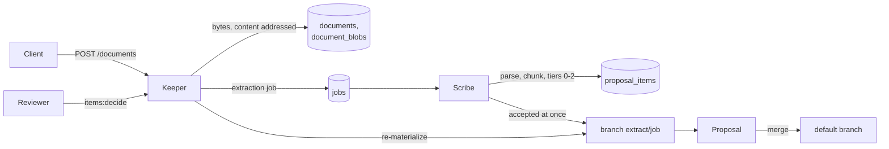

# Document extraction

A client drops documents (Markdown, plain text, PDF, DOCX) into a Domain; Lorebase proposes
Records, Links and Attribute values grounded in the Domain's schema and existing Records, as
items of a Proposal that reviewers accept or reject. Nothing extracted reaches the default
branch without a merge. The read path for agents (Keeper, Herald) never calls a model.

Design references: [9.2](design.md#92-unstructured-extraction) (tiers, pipeline, evidence),
[5.11](design.md#511-lineage) (Lineage origin `extraction`), [12.3](design.md#123-screen-inventory)
(Review: extraction items).

## Flow



1. **Intake** (Keeper, `POST /api/v1/domains/{d}/documents`, permission `document.write`).
   A multipart upload (`file`, optional `extract` and `tiers`) or JSON naming a URL on an
   allowlisted host. The media type comes from the file name suffix and is checked against the
   content. Bytes are stored content addressed (SHA-256) through the blob store interface
   (default backend: Postgres `document_blobs`); uploading the same bytes again returns the
   stored document. An `extraction` job is queued unless `extract` is false. An upload may
   name a `source_key` (a path, URL or external id): new bytes under the same key are a new
   version of its document ([below](#document-versions-and-lifecycle)). Retired and purged
   documents are not extracted.
2. **Parse and chunk** (Scribe). Markdown and text natively; PDF with `pypdf` and DOCX with
   `python-docx` (the `documents` extra of `lorebase-scribe`), each in a child process without
   network access and with a wall-clock limit, CPU and address-space limits and a size limit
   (`scribe.extraction.parser`); a document that breaks one fails its job with a message
   naming the setting, and the job is not retried. Chunks follow the structure
   (headings, paragraphs, list items, table rows) with overlap; chunk offsets index the parsed
   text and are stored in `document_chunks`. The parsed text itself goes to the blob store;
   `GET /api/v1/domains/{d}/documents/{id}/text` (permission `document.read`) serves it, 404
   until it is parsed, cut at `keeper.documents.max_text_chars` (`truncated`, `length`), with
   an `ETag` that changes only with the text. Offsets count Unicode code points.
3. **Mentions and entity resolution.** Keys found by the `pattern` constraint of a Kind's key
   Attribute, titles of existing Records by dictionary matching (tier 0), spans of a local
   model (tier 1). Each mention is resolved against the default branch: exact key, exact
   title, title after case and punctuation folding, trigram similarity
   (`lorebase_store.reads.similar_titles`). Outcomes: `matched`, `ambiguous` (candidates kept
   for the reviewer; a key named in the same sentence settles it), `new` (a key no Record has,
   of a Kind that allows new Records), `unresolved` (dropped).
4. **Values and Links.** Tier 0 rules give dates, numbers and enum values to the Attributes
   whose cue words precede them in the sentence, for the Records the sentence names (or the
   Record of the section heading). Links come from co-occurrence in a sentence or table row,
   from a heading's Record to the Records of its section, and (tier 1) from a local relation
   model. Tier 2 asks a chat model, chunk by chunk, with a JSON schema generated from the
   relevant part of the ontology and the candidate Records as grounding.
5. **Items.** Candidates become items of three types: `record` (a new Record with its key and
   values), `value` (an Attribute value of an existing Record) and `link`. Values equal to the
   current one and Links that exist are dropped. Every item carries evidence (document,
   chunk, offsets, quote), confidence, tier and model.
6. **Proposal.** Branch `extract/<job id>` is created from the default branch, a Proposal with
   origin `extraction` is opened, and the items at or above `auto_accept_threshold` (complete
   new Records only, Links only between Records that exist or are accepted too) are committed
   on the branch through the commit pipeline, with `extraction` Lineage per value (job,
   document, evidence offsets, model, prompt version, and the value's validity period when the
   item states one). The rest wait for review, and so do value items that contradict the
   current value's source (`scribe.reconciliation.hold_auto_accept`, [Scribe](scribe.md#reconciliation)).
   A value item over a value a person set last (an Operation, or a Conflict resolution or
   reconciliation decision by a principal rather than a policy; agents count) is never accepted
   at once, whatever its confidence: it stays pending with `"hold": "local_edit"` in its match
   (`held_local_edit` in the job stats). A reviewer may still accept it
   ([design 9.1](design.md#91-structured-sources), "Corrections that stick").
   The Domain's [ingestion mode](#ingestion-modes) may accept nothing at once (`review_all`)
   or let Scribe merge an all-rules job with nothing pending (`direct`).
7. **Review** (`GET .../proposals/{p}/items`, `POST .../proposals/{p}/items:decide`).
   Reviewers accept, reject or reset items, one by one with edits or in bulk by filter. After
   each decision the branch is re-materialized to hold exactly the accepted items (a rejected
   item is reverted) and the Proposal's summary and merge preview are refreshed. Merging is the
   normal Proposal merge.

## Tiers and cost

| Tier | What runs | Models | Cost | Notes |
|------|-----------|--------|------|-------|
| 0 | Key patterns, title dictionary, value cues, co-occurrence, headings | none | zero | Always available; deterministic |
| 1 | Span extractor (GLiNER) with labels from Kind names and title Attributes; relation extractor (GLiREL) with Relation names constrained to endpoint Kinds | local, CPU | zero | Configured in `inference.local_extractors`; when not installed the job warns and continues with tier 0 |
| 2 | One structured-output call per chunk | any OpenAI-compatible endpoint (`inference.llm`, task `extraction`) | zero locally, per token hosted | Answers cached by model, prompt version, schema hash and chunk hash; token budget per job |

Default tiers are `[0, 1]` (`scribe.extraction.tiers`); add `2` once `inference.llm` points at
a model. A request may name its own tiers. Only tier 2 can spend money; re-running an unchanged
job reads tier 2 answers from `extraction_cache` and makes no call.

Tier 2 is grounded and verified: the prompt holds only the Kinds mentioned in the chunk (or all
of them when none is), the Relations between them, their extractable Attributes, and the
candidate Records by key and title; the model answers with `ref` (a candidate key) for known
Records. Every fact must quote its evidence verbatim from the chunk (whitespace-insensitive),
and a value must appear in its quote (dates and numbers compared by value). Facts that fail are
discarded and counted in the job's stats.

A Relation with link Attributes (`stocked_at` carries `quantity`) has its own branch in the
answer schema: the link's `values`, each with a verbatim `evidence`, the required ones listed as
required, and the prompt asks the model to propose such a link only when the text states its
required Attributes. Link values are verified and grounded like record values and become the
Link item's values. A Link item still missing a required link Attribute stays pending whatever
its confidence, with the names in `match.missing`. The model has no tools; document text can only
influence proposed values, which reviewers see with their evidence.

Attributes that are derived or sensitive (`pii`, `confidential`, `restricted`) are never
extracted.

## Review API

`GET /api/v1/domains/{d}/proposals/{p}/items` (permission `document.read`) lists items in
proposal order with filters `status` (`pending`, `accepted`, `rejected`), `kind` (Kind or
Relation api name), `type` (`record`, `value`, `link`), `min_confidence`, `max_confidence`.
Each item names its Kind, Relation and Attributes by api name, shows the current value for
`value` items, the evidence, the match details (`status`, `method`, `candidates`; for new
Records `complete`, `missing`, `missing_links`) and, for accepted items that could not be
applied, `not_applied`.

`POST /api/v1/domains/{d}/proposals/{p}/items:decide` (permission `proposal.review` on the
target branch):

```json
{
  "decisions": [
    {"item": "pit_01...", "decision": "accepted",
     "edits": {"values": {"title": "Framework Supply Agreement C-3025", "status": "active"}}},
    {"item": "pit_02...", "decision": "rejected"}
  ],
  "where": {"type": ["link"], "kind": ["supplied_by"], "min_confidence": 0.5},
  "decision": "accepted"
}
```

Edits: `record` items take `values`; `value` items take `value` and `key` (pick another Record
for an ambiguous match); `link` items take `from`, `to` and `values`. When the accepted items
do not form a valid branch (for example a new Contract without its required `with_supplier`
Link), the answer is 422 with the validation issues and nothing changes: accept the Record and
its Link together. Decisions are audited (`proposal.items.decide`); uploads too
(`document.upload`).

The Proposal's `checks.extraction` holds the item counts per decision, type and Kind, and the
accepted items that could not be applied; Proposal details show it as the `extraction` check.

With the client: `client.documents.upload(...)`, `client.proposals.items(...)`,
`client.proposals.decide_items(...)`; with the CLI: `lorebase documents upload|list|get|text`,
`lorebase proposal items|decide`.

## Example

Extracting `examples/supply/documents/contract-c-3025-kavvik-filtration.md` into a Domain that
does not hold contract C-3025 yields, with rules only:

```text
record  pending  0.425  Contract C-3025  contract_number=C-3025, title="Framework Supply Agreement C-3025",
                        start_date=2024-02-08, end_date=2026-02-07, annual_value=1596000.00,
                        currency=EUR, incoterm=DDP, payment_terms_days=60
                        match: new, complete
link    pending  0.6    with_supplier C-3025 -> S-1025   (heading; evidence "**Supplier:** Kavvik
                        Filtration A.S., Izmir, Turkey (supplier code S-1025).")
```

The record's confidence is that of its weakest rule-found value, so it waits for review;
accepting both items commits the Contract and its Link on `extract/<job id>` with Lineage
pointing at the evidence offsets.

## Schema suggestions

Extraction also reports what it sees outside the schema. Each sighting is an observation; the
Domain's observations aggregate by name and place into **schema suggestions**: a new Kind, a new
Attribute of a Kind, or a new Relation, with a support count, the documents it came from,
evidence examples, sample values and the techniques that saw it. Suggestions are only listed and
reviewed: accepting them opens a schema change Proposal, never a direct schema change.

| Tier | What is observed |
|------|------------------|
| 0 | A `**Label:** value` field line or a table column no Attribute of the described Record matches: an Attribute, or a Relation when the label names a Kind or the value names Records of another Kind. A heading naming a thing by a code no Kind's key pattern matches (`# Quality notice QN-2025-114`): a Kind, which then owns the fields of its section |
| 1 | Spans of `discovery.span_labels` (a Kind of that name) and relations of `discovery.relation_labels` between Records of known Kinds (a Relation) |
| 2 | The answer schema gains an `unlisted` list for facts the schema has no place for; records, values and links the model names outside the schema are observed too. Every one needs verified evidence, and an Attribute value must appear in its quote |
| Discovery pass | Optional (`discovery.llm_pass`, off by default): one extra call per chunk through the `inference.llm.tasks.schema_discovery` route, independent of tier 2, asks a model that sees the Kinds and their Attribute names for Kinds and Attributes the text implies. It runs after tier 2 of each document and has a token cap of its own (`discovery.llm_max_tokens`, input estimated before each call and the answer capped to what is left), so it never takes tokens from `max_tokens_per_job`. The same evidence rules apply, and quotes longer than `llm_max_quote_chars` or covering more than `llm_max_quote_share` of a chunk of at least `llm_quote_share_min_chunk_chars` characters (400) are discarded, as are a Kind's examples its quote does not hold. The document text is sent between a random delimiter and declared untrusted. A provider error costs that chunk (`discovery_errors` in the job stats). Answers are cached |

The record a field describes is the one its section heading names; a table row describes the
first Record it names. Observations are matched against the default branch's schema before they
are kept: names are compared after `snake_case` normalization and singular, through synonym
groups (`supplier`/`vendor`, `contract`/`agreement`, ...) and by similarity
(`schema.suggestions.name_similarity`); a field named like its Kind's key (`Code` for
`supplier_code`) or like another Kind (`Supplier:` on a Contract, which `with_supplier` already
links) counts as known. Extracting a document again replaces its share of every suggestion, so
support counts documents' observations once.

**Variants and noise.** Models name one fact differently from one document to the next. Two
Attribute suggestions of the same Kind are folded into one when their names share at least
`schema.suggestions.merge_similarity` of their words (Jaccard index of the singular snake_case
words; 0.6 by default) and their samples have a value type in common (number, date, boolean or
text): `renewal_notice_days` and `renewal_proposal_notice_days` (sample 90), or
`termination_notice_days` and `termination_for_cause_notice_days` (sample 30), become one
suggestion under the better supported name, the other kept among its labels. `start_date` and
`end_date` (one word of three in common) stay apart. A Kind named by a generic word of documents or
workflows (`schema.suggestions.kind_stoplist`: section, clause, annex, page, table, proposal,
...) is not suggested. Neither is one that only restates a free-text Attribute (a Kind `Buyer`
beside the `string` or `text` Attribute `buyer` that no Relation models), unless its evidence
shows an entity of its own: `kind_independent_instances` distinct codes or names seen for it
(2 by default) or `kind_independent_attributes` Attribute suggestions it owns (2). A typed
Attribute (a date, a number, an enum) or a `ref` never hides a Kind. A proposed Kind is listed
only once it has `kind_min_attributes` Attribute suggestions (2 by default) or as many
observations.

`lorebase schema suggestions merge` (`POST .../schema/suggestions:merge`, permission
`schema.write`) applies the variant folding to suggestions stored earlier: pending Attribute
suggestions of one Kind that pass the same similarity test are folded into the best supported
one (documents, support, examples, samples and labels united) and the others removed. It is
safe to repeat.

**Sensitivity.** An observation that matches a sensitive Attribute (`pii`, `confidential`,
`restricted`, carried through Derivations) is never kept, and an observation whose quote or
sample holds a stored value of a sensitive Attribute of a Record the job read, or a vaulted
value of any vault Attribute in the Domain, is kept without its evidence and sample. Vaulted
values are found without decrypting them: word sequences of the quote (up to
`discovery.vault_match_max_words`, as written and with edge punctuation stripped) are
fingerprinted like stored values (the matching form: case, compatibility characters and
white space ignored, plus the form without a possessive `'s`) and compared with the live vault
rows under every configured token key; a value spelled differently from its canonical form (a
date in words, a reordered name) is not found. The check fails closed: a quote or sample over
`vault_match_max_text_words` or `vault_match_max_text_chars`, or past
`vault_match_max_candidates` word sequences in the job, loses its evidence as if it held a
value, and so does every quote of a Domain that has vaulted values when Scribe has no vault
keys. Nothing tells the submitter: a suggestion without evidence looks like one that never had
any, and the job report, the API and the logs carry no flag, count or reason; operators see only
the counter `lorebase.extraction.evidence_withheld` (a reader of suggestions can still infer a
match from the absence of evidence for a quote they chose, see the
[threat model](threat-model.md)). Listings compare suggestions with the current schema again: one that
matches a sensitive Attribute the caller may not read (the same clearances as reads, see
[design 10.2](design.md#102-rbac)) is listed without examples and samples (`withheld`).

**Review.**

- `GET /api/v1/domains/{d}/schema/suggestions` (permission `document.read`) lists suggestions,
  the most supported first, with filters `status` (`pending`, `accepted`, `rejected`) and `type`
  (`kind`, `attribute`, `relation`). Pending suggestions are listed from
  `schema.suggestions.min_support` observations (`all=true` lists them all), at most
  `max_suggestions` in all. An Attribute suggestion carries `type_guess`, the type schema
  inference gives its samples (`date` for `2026-02-07`, `integer`, `string`, an enum...); a
  suggestion the schema has meanwhile carries `duplicate_of`.
- `POST /api/v1/domains/{d}/schema/suggestions:decide` with
  `{"decisions": [{"suggestion": "ssg_...", "decision": "accepted", "name": "buyer_entity"}]}`
  rejects, resets (`pending`) or accepts suggestions. The suggestions accepted by one request
  become one schema change set, committed on a new branch
  (`keeper.schema_suggestions.branch_prefix` and the first suggestion's id) and proposed into
  the default branch; the answer names the Proposal and the element changes. New Kinds get a
  key Attribute `<kind>_code` with a pattern from the sampled codes (or a `name` title when
  there are none) and, like new Relations, are drafts a modeler describes and activates; new
  Attributes of existing Kinds are typed from their samples. A Relation or Attribute of a
  proposed Kind (`+QualityNotice`) needs that Kind accepted in the same request or merged
  before. Accepting needs `schema.write` on the new branch, `branch.create` and
  `proposal.create`; rejecting needs `schema.write`. An invalid change set is a 422 and nothing
  is decided; an accepted suggestion cannot be decided again (409). Decisions are audited
  (`schema.suggestions.decide`).

The web app lists them in the Schema suggestions tab of Review. The CLI has
`lorebase schema suggestions list` (`--status`, `--type`, `--weak` for pending ones below
`min_support`, `--limit`/`--all`, `--json`), `accept ID... [--name API_NAME]` (one change set
and Proposal for all the ids), `reject ID...` and `merge`. The Python client has
`client.schema.suggestions(...)`, `iterate_suggestions(...)`, `decide_suggestions(...)` and
`merge_suggestions()`.

A suggestion is listed from `min_support` observations, and one document counts once, so
uploading a single document lists nothing (`--weak`, or `all=true`, shows the pending ones). The
quickstart's `make example-documents` uploads the contract C-3099 and the four example documents
with the rules tier so that suggestions appear ([quickstart](quickstart.md#27-guide-scribe-and-the-example-documents)).

On the four example documents, with the rules only and `min_support: 2`, the supplier review
suggests an Attribute `ends` of Supplier (three table rows, typed `date`) and a Relation
`sole_source_parts` from Supplier to Part; the quality notice suggests a Kind `QualityNotice`
(key sample `QN-2025-114`) with Relations `part`, `supplier`, `received_at` (to Plant) and
`purchase_order`, and the contract an Attribute `buyer` of Contract, each listed with `all=true`
until another document supports it.

## Document versions and lifecycle

Documents change upstream like any Source ([design 9.2](design.md#92-unstructured-extraction),
AC-35). A keyless upload keeps the content addressing above. A keyed one
(`source_key`, multipart field or JSON member; trimmed, compared exactly, at most
`keeper.documents.max_source_key_chars`, default 1024) is a version of the document of that
key:

| Upload under a key | Answer |
|--------------------|--------|
| first bytes | 201, `version` 1 |
| bytes of the active version | 200, `duplicate`, the active version (a no-op) |
| other bytes (an older version's included, an upstream revert) | 201, `version` n + 1, `replaces` the previous version, which becomes `superseded`; audited `document.version` (key, version, replaced id, sizes and hashes) |

The same bytes under two keys are two documents sharing one blob. Each document has a
`status`: `active`, `superseded`, `retired` or `purged`.
`GET .../documents?source_key=K` lists the versions of a key, and
`GET .../documents/{id}/versions` the versions of a document's key, newest first.

**Evidence check of a new version.** A new version does not change any value by itself. Its
own extraction proposes what it says, as for any document; then a `document_version_check`
job (queued by that extraction job once it finished, or at upload when nothing is extracted)
looks at every value whose current provenance is `extraction` from an earlier version of the
key, on the branch its Proposal targeted. A value the new version's extraction proposes again
is left alone. For the others the old evidence quote is looked for verbatim in the new
version's parsed text, white space aside (the match of evidence verification). Found: nothing
happens. Gone, or no longer readable (purged): a reconciliation `stale` candidate with signal
`evidence_gone` (`{document, from_version, to_version, quote}`), and a person decides
([Scribe](scribe.md#reconciliation)). Nothing is retracted, changed or hidden, and no model is
called. The quotes of sensitive Attributes are masked in candidates by clearance. The check
follows the Domain's reconciliation options (`enabled`, `triggers.document_versions`) and looks
at `scribe.extraction.versions.max_values_per_job` values per job (default 5000), continuing in
a new job. Link values and derived, vault and key Attributes are not checked.

**Retire.** `POST .../documents/{id}/retirement {"reason": "..."}` (permission
`document.retire`: `maintainer`, `admin`) runs the same check with empty text, so every value
whose evidence was this document (and, for the active version of a key, its earlier versions)
raises a `stale` candidate. A retired document stays listed and readable, and is never
extracted again: an upload asking to extract it (`extract=true`) answers 409
`document-retired`, and an extraction job naming it fails. A later upload under its key starts
a new active version. Audited `document.retire`; retiring again changes nothing.

**Purge.** `POST .../documents/{id}/purge {"reason": "...", "confirm": "<document id>"}`
(permission `document.purge`, `admin` only) retires the document if needed, then deletes its
bytes and parsed text (unless another document holds the same blob), its chunks and the cached
model answers of chunk hashes no other document holds. Provenance rows stay (document id,
offsets, quote hash); the evidence quotes of its Proposal items, reconciliation candidates and
schema suggestion examples read `[erased]` (`keeper.reads.sensitivity.erased_value`). It is
irreversible, audited `document.purge` in the same transaction (counts only, never content),
and purging again erases nothing. See [operations](operations.md#document-purge).

Client: `client.documents.upload(..., source_key=)`, `versions`, `retire`, `purge`. CLI:
`lorebase documents upload FILE --key KEY`, `lorebase documents versions ID`,
`lorebase documents retire ID --reason TEXT`, `lorebase documents purge ID --reason TEXT
--confirm ID`. The Documents screen shows the key, version and status, the versions, the open
`stale` candidates of a document, and Retire and Purge for those who hold the permissions.

## Ingestion modes

How much of an extraction a person sees is a Domain choice, within bounds the installation
sets ([design 9.2](design.md#92-unstructured-extraction), AC-36). `extraction.mode`:

| Mode | Accepted at once on `extract/<job>` | Proposal merge |
|------|-------------------------------------|----------------|
| `review_all` | nothing | by a person |
| `doubts_only` (default) | complete, unambiguous items at or above `auto_accept_threshold` that are not held | by a person |
| `direct` | as `doubts_only` | by Scribe, when the conditions below hold; otherwise by a person |

- **Installation.** `scribe.extraction.mode` is `doubts_only` (default) or `review_all`;
  `direct` there is refused at startup. Without a Domain setting a job runs exactly as before.
- **Domain.** `PATCH /api/v1/domains/{d}` with `{"settings": {"extraction": {...}}}`
  (`domain.settings`; `null` removes it) sets `mode`, `auto_accept_threshold`,
  `min_confidence` and `rules`. The change is audited as `domain.update` with the member's
  values before and after. Tightening always applies (a stricter mode, a higher threshold, a
  lower `min_confidence`); loosening below the installation's values applies only to the
  members listed in `scribe.extraction.domain_may_loosen` (default `[mode]`, `[]` forbids
  it). A value that does not apply is ignored on its own and listed by `GET /domains/{d}` in
  `ignored_settings` (for example `extraction.auto_accept_threshold`). Keeper reports it with
  the `scribe.extraction` values of its own configuration, so give both services the same file.
- **Rules.** `rules: [{source_key_prefix, mode, auto_accept_threshold, min_confidence}]` set
  the members for keyed documents whose `source_key` starts with the prefix; the longest
  prefix wins, members a rule leaves out come from the Domain, keyless documents use the
  Domain's. A job over several documents runs at the strictest mode, the highest threshold and
  the lowest `min_confidence` among them.
- **Tier cap.** A `direct` job whose Proposal holds any item a model produced (tier 1 or 2,
  whatever its decision) runs as `doubts_only` and says `mode_capped: tier`: text a model read
  never reaches a branch without a person.
- **Direct merge.** Scribe merges the Proposal through the normal merge only when no item is
  pending, the target accepts it (a protected target only with
  `scribe.extraction.direct_merge_protected`, default true), the merge has no Conflict and the
  `reconciliation` check does not block it. It is audited as `proposal.merge` with
  `mode: direct`, the job id and the new head. Otherwise the Proposal waits for review and the
  job's result says why in `direct_blocked`: `tier`, `pending_items`, `protected`,
  `reconciliation` or `conflicts` (the first that applies).
- **Job result.** The `extraction` job records `mode` (after the cap), `mode_capped`,
  `direct_blocked`, `direct_merged`, `merged_revision` and the `ignored_settings` it met.

```http
PATCH /api/v1/domains/supply
Content-Type: application/json

{"settings": {"extraction": {"mode": "review_all",
  "rules": [{"source_key_prefix": "feeds/erp/", "mode": "direct"}]}}}
```

Whatever the mode, a value item over a value a person set is held (`local_edit`).

## Configuration

`scribe.extraction` (tiers, auto-accept threshold, ingestion `mode`, `domain_may_loosen`,
`direct_merge_protected`, chunking, matching thresholds, confidence
per technique, budgets, prompt version, cache, `discovery` with the optional `llm_pass`, `versions`), `schema.suggestions` (support,
listing, examples, name matching, variants and noise), `keeper.schema_suggestions` (review branch prefix) and
`keeper.documents` (size limit, accepted
suffixes, URL allowlist, extraction on upload, longest text served, longest `source_key`) are documented with their defaults in
[config/lorebase.example.yaml](../config/lorebase.example.yaml). Models are configured in the
`inference` section ([inference.md](inference.md)).

## Limits

- Rule-based values are heuristics: a value is given to the Attribute whose cue word precedes
  it; their confidence stays below the default auto-accept threshold, so they are reviewed.
- New Records need their key in the text (a match of the key Attribute's `pattern`); Kinds
  with minted keys get no new-Record candidates.
- Co-occurrence and heading Links propose every Relation the endpoint Kinds allow; on a
  many-to-one Relation several candidates may compete and the reviewer picks.
- Schema suggestions come from field lines, table columns, headings with codes, configured
  tier 1 labels, tier 2 answers and the optional discovery pass; free prose suggests nothing
  to tier 0.
- Header-mapped tables, embedding-based
  entity resolution and OCR of scanned PDFs are not implemented.
- Trigram matching scans the titles of the named Kinds under row-level security (no index), and
  dictionary matching loads at most `matching.dictionary_max_titles` titles per job.
- One job per uploaded document; a document extracted twice opens two Proposals.
- The version check is literal: a reworded passage that still supports a value raises a
  `stale` candidate, which a reviewer dismisses. Documents are not diffed, and nothing
  watches upstream locations for new versions (a Source or the caller uploads them).
- Model answers cached before migration `0041` do not name their chunk, so a purge does not
  reach them; clear `extraction_cache` if they must go too ([operations](operations.md#document-purge)).
- With `inference.local_extractors.relation_provider: cooccurrence` (or `fake`) tier 1 adds no
  relation model: tier 0 already links Records that share a sentence. The provider runs only
  when a job skips tier 0.
