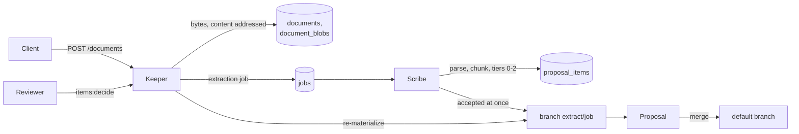

# Document extraction

A client drops documents (Markdown, plain text, PDF, DOCX) into a Domain; Lorebase proposes
Records, Links and Attribute values grounded in the Domain's schema and existing Records, as
items of a Proposal that reviewers accept or reject. Nothing extracted reaches the default
branch without a merge. The read path for agents (Keeper, Herald) never calls a model.

Design references: [9.2](design.md#92-unstructured-extraction) (tiers, pipeline, evidence),
[5.11](design.md#511-lineage) (Lineage origin `extraction`), [12.3](design.md#123-screen-inventory)
(Review: extraction items).

## Flow



1. **Intake** (Keeper, `POST /api/v1/domains/{d}/documents`, permission `document.write`).
   A multipart upload (`file`, optional `extract` and `tiers`) or JSON naming a URL on an
   allowlisted host. The media type comes from the file name suffix and is checked against the
   content. Bytes are stored content addressed (SHA-256) through the blob store interface
   (default backend: Postgres `document_blobs`); uploading the same bytes again returns the
   stored document. An `extraction` job is queued unless `extract` is false.
2. **Parse and chunk** (Scribe). Markdown and text natively; PDF with `pypdf` and DOCX with
   `python-docx` (the `documents` extra of `lorebase-scribe`). Chunks follow the structure
   (headings, paragraphs, list items, table rows) with overlap; chunk offsets index the parsed
   text and are stored in `document_chunks`. The parsed text itself goes to the blob store;
   `GET /api/v1/domains/{d}/documents/{id}/text` (permission `document.read`) serves it, 404
   until it is parsed, cut at `keeper.documents.max_text_chars` (`truncated`, `length`), with
   an `ETag` that changes only with the text. Offsets count Unicode code points.
3. **Mentions and entity resolution.** Keys found by the `pattern` constraint of a Kind's key
   Attribute, titles of existing Records by dictionary matching (tier 0), spans of a local
   model (tier 1). Each mention is resolved against the default branch: exact key, exact
   title, title after case and punctuation folding, trigram similarity
   (`lorebase_store.reads.similar_titles`). Outcomes: `matched`, `ambiguous` (candidates kept
   for the reviewer; a key named in the same sentence settles it), `new` (a key no Record has,
   of a Kind that allows new Records), `unresolved` (dropped).
4. **Values and Links.** Tier 0 rules give dates, numbers and enum values to the Attributes
   whose cue words precede them in the sentence, for the Records the sentence names (or the
   Record of the section heading). Links come from co-occurrence in a sentence or table row,
   from a heading's Record to the Records of its section, and (tier 1) from a local relation
   model. Tier 2 asks a chat model, chunk by chunk, with a JSON schema generated from the
   relevant part of the ontology and the candidate Records as grounding.
5. **Items.** Candidates become items of three types: `record` (a new Record with its key and
   values), `value` (an Attribute value of an existing Record) and `link`. Values equal to the
   current one and Links that exist are dropped. Every item carries evidence (document,
   chunk, offsets, quote), confidence, tier and model.
6. **Proposal.** Branch `extract/<job id>` is created from the default branch, a Proposal with
   origin `extraction` is opened, and the items at or above `auto_accept_threshold` (complete
   new Records only, Links only between Records that exist or are accepted too) are committed
   on the branch through the commit pipeline, with `extraction` Lineage per value (job,
   document, evidence offsets, model, prompt version). The rest wait for review.
7. **Review** (`GET .../proposals/{p}/items`, `POST .../proposals/{p}/items:decide`).
   Reviewers accept, reject or reset items, one by one with edits or in bulk by filter. After
   each decision the branch is re-materialized to hold exactly the accepted items (a rejected
   item is reverted) and the Proposal's summary and merge preview are refreshed. Merging is the
   normal Proposal merge.

## Tiers and cost

| Tier | What runs | Models | Cost | Notes |
|------|-----------|--------|------|-------|
| 0 | Key patterns, title dictionary, value cues, co-occurrence, headings | none | zero | Always available; deterministic |
| 1 | Span extractor (GLiNER) with labels from Kind names and title Attributes; relation extractor (GLiREL) with Relation names constrained to endpoint Kinds | local, CPU | zero | Configured in `inference.local_extractors`; when not installed the job warns and continues with tier 0 |
| 2 | One structured-output call per chunk | any OpenAI-compatible endpoint (`inference.llm`, task `extraction`) | zero locally, per token hosted | Answers cached by model, prompt version, schema hash and chunk hash; token budget per job |

Default tiers are `[0, 1]` (`scribe.extraction.tiers`); add `2` once `inference.llm` points at
a model. A request may name its own tiers. Only tier 2 can spend money; re-running an unchanged
job reads tier 2 answers from `extraction_cache` and makes no call.

Tier 2 is grounded and verified: the prompt holds only the Kinds mentioned in the chunk (or all
of them when none is), the Relations between them, their extractable Attributes, and the
candidate Records by key and title; the model answers with `ref` (a candidate key) for known
Records. Every fact must quote its evidence verbatim from the chunk (whitespace-insensitive),
and a value must appear in its quote (dates and numbers compared by value). Facts that fail are
discarded and counted in the job's stats. The model has no tools; document text can only
influence proposed values, which reviewers see with their evidence.

Attributes that are derived or sensitive (`pii`, `confidential`, `restricted`) are never
extracted.

## Review API

`GET /api/v1/domains/{d}/proposals/{p}/items` (permission `document.read`) lists items in
proposal order with filters `status` (`pending`, `accepted`, `rejected`), `kind` (Kind or
Relation api name), `type` (`record`, `value`, `link`), `min_confidence`, `max_confidence`.
Each item names its Kind, Relation and Attributes by api name, shows the current value for
`value` items, the evidence, the match details (`status`, `method`, `candidates`; for new
Records `complete`, `missing`, `missing_links`) and, for accepted items that could not be
applied, `not_applied`.

`POST /api/v1/domains/{d}/proposals/{p}/items:decide` (permission `proposal.review` on the
target branch):

```json
{
  "decisions": [
    {"item": "pit_01...", "decision": "accepted",
     "edits": {"values": {"title": "Framework Supply Agreement C-3025", "status": "active"}}},
    {"item": "pit_02...", "decision": "rejected"}
  ],
  "where": {"type": ["link"], "kind": ["supplied_by"], "min_confidence": 0.5},
  "decision": "accepted"
}
```

Edits: `record` items take `values`; `value` items take `value` and `key` (pick another Record
for an ambiguous match); `link` items take `from`, `to` and `values`. When the accepted items
do not form a valid branch (for example a new Contract without its required `with_supplier`
Link), the answer is 422 with the validation issues and nothing changes: accept the Record and
its Link together. Decisions are audited (`proposal.items.decide`); uploads too
(`document.upload`).

The Proposal's `checks.extraction` holds the item counts per decision, type and Kind, and the
accepted items that could not be applied; Proposal details show it as the `extraction` check.

With the client: `client.documents.upload(...)`, `client.proposals.items(...)`,
`client.proposals.decide_items(...)`; with the CLI: `lorebase documents upload|list|get|text`,
`lorebase proposal items|decide`.

## Example

Extracting `examples/supply/documents/contract-c-3025-kavvik-filtration.md` into a Domain that
does not hold contract C-3025 yields, with rules only:

```text
record  pending  0.425  Contract C-3025  contract_number=C-3025, title="Framework Supply Agreement C-3025",
                        start_date=2024-02-08, end_date=2026-02-07, annual_value=1596000.00,
                        currency=EUR, incoterm=DDP, payment_terms_days=60
                        match: new, complete
link    pending  0.6    with_supplier C-3025 -> S-1025   (heading; evidence "**Supplier:** Kavvik
                        Filtration A.S., Izmir, Turkey (supplier code S-1025).")
```

The record's confidence is that of its weakest rule-found value, so it waits for review;
accepting both items commits the Contract and its Link on `extract/<job id>` with Lineage
pointing at the evidence offsets.

## Configuration

`scribe.extraction` (tiers, auto-accept threshold, chunking, matching thresholds, confidence
per technique, budgets, prompt version, cache) and `keeper.documents` (size limit, accepted
suffixes, URL allowlist, extraction on upload, longest text served) are documented with their defaults in
[config/lorebase.example.yaml](../config/lorebase.example.yaml). Models are configured in the
`inference` section ([inference.md](inference.md)).

## Limits

- Rule-based values are heuristics: a value is given to the Attribute whose cue word precedes
  it; their confidence stays below the default auto-accept threshold, so they are reviewed.
- New Records need their key in the text (a match of the key Attribute's `pattern`); Kinds
  with minted keys get no new-Record candidates.
- Co-occurrence and heading Links propose every Relation the endpoint Kinds allow; on a
  many-to-one Relation several candidates may compete and the reviewer picks.
- Header-mapped tables, schema discovery (suggesting new Kinds or Attributes), embedding-based
  entity resolution and OCR of scanned PDFs are not implemented.
- Trigram matching scans the titles of the named Kinds under row-level security (no index), and
  dictionary matching loads at most `matching.dictionary_max_titles` titles per job.
- One job per uploaded document; a document extracted twice opens two Proposals.
- With `inference.local_extractors.relation_provider: cooccurrence` (or `fake`) tier 1 adds no
  relation model: tier 0 already links Records that share a sentence. The provider runs only
  when a job skips tier 0.
