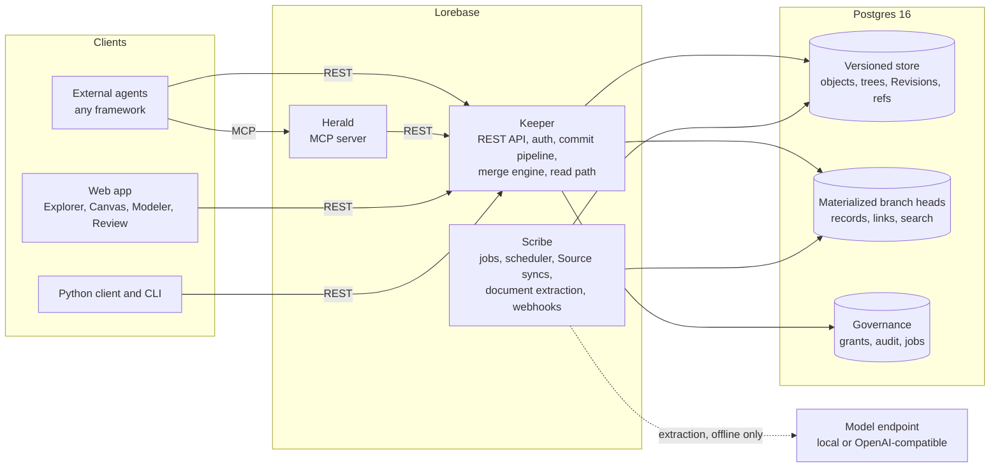

# Lorebase

**Git for knowledge: an open-source ontology platform where AI agents read a versioned, governed knowledge graph in milliseconds.**

[](../LICENSE)


> **Pre-alpha, v0.2.3.** The versioning and merge engine, the Keeper REST API, the MCP server (Herald), the Python client, the `lorebase` CLI, Scribe (Sources, document extraction, embeddings) and the web app run today, and interfaces may change before 1.0. [Status and roadmap](#status-and-roadmap) lists what is open. The [quickstart](quickstart.md) is the place to start and the [validation record](validation.md) the place to check the claims.

## What it is

Lorebase is an open-source ontology platform: a versioned knowledge graph for AI agents, self-hosted on Postgres and nothing else. You model what your organization knows as a typed ontology (Kinds, Attributes, Relations, Operations) and change it the way developers change code: on a branch, reviewed, merged, traceable. Schema and data branch and merge together, with three-way Conflicts resolved per Attribute. Agents live outside Lorebase, in any framework. They read through a REST API or the MCP server, neither of which calls a language model, so answers are deterministic and fast, and they write only through governed Operations and Proposals. It is meant as an open-source alternative to proprietary ontology platforms and runs on a laptop with `docker compose`.


<sub>The web app walking through Explorer, Canvas and a Conflict in Review. It runs on a mock API with sample data; see the [visual tour](tour.md).</sub>

## 30-second demo

The core engine runs in memory, with no services. This script loads the sample `supply` Domain into `main`, branches `model/risk` (analysts change the schema and data) and `source/erp` (a nightly feed changes data), merges both, lists the Conflicts, resolves them and diffs.

```bash
git clone https://github.com/aantenore/lorebase.git && cd lorebase
uv sync --all-packages
uv run python examples/merge_demo.py
```

```text
== 5. merge source/erp into main
merge base 7ad4a553: 5 Conflicts

DV1 ATTRIBUTE_VALUE (1)
  where            attribute   base  ours  theirs  choices
  -----            ---------   ----  ----  ------  -------
  Supplier S-1001  risk_score  32    80    45      ours/theirs/base/custom

DV2 DELETE_MODIFY (1)
  where         attribute  base      ours      theirs    choices
  -----         ---------  ----      ----      ------    -------
  Part P-10003  -          {record}  (absent)  {record}  ours/theirs/base/custom
...
== 7. merge again
merged: Revision 2cacd1bb, parents 60f665d3, 4d5440a3
validation: 72 Records against the merged schema, 0 issues
```

The analysts say 80, the ERP says 45, and someone has to decide. That decision is a recorded resolution, not a silent overwrite. The walkthrough of the whole output is in the [quickstart](quickstart.md#7-run-the-core-demo).

## Try the five-day demo

The [proof scenario](design.md#32-the-5-day-proof-scenario) of the design as one command, against a real stack: schema inferred from CSV files, data loaded, two teams editing the same suppliers on two branches, Conflicts resolved from the command line, a Source sync, a signed webhook, an agent reading and writing through the MCP server, rate limits and a backup restored into a second database. It needs Docker and uv.

```bash
make demo                # builds the stack under its own project name, runs the five days, removes it
make demo KEEP=1         # leave the stack running afterwards; `make demo-down` removes it
```

The stack is the compose project `lorebase-demo` with Keeper on port 18080 and Postgres on 15432 (`DEMO_KEEPER_PORT`, `DEMO_POSTGRES_PORT` change them), so it does not touch a stack you already run. The first run builds the image; the five days themselves take under a minute. Each command is printed before its output. [demo.md](demo.md) tells the story day by day with the transcript; `examples/five_day_demo/run.sh` runs the same days against any Keeper.

## Why Lorebase

- **Branch and merge schema and data, with three-way conflicts.** Change the model and the data on a branch, merge, and get typed Conflicts (attribute value, delete or modify, type coercion, cardinality, dangling link and more) instead of a corrupted knowledge base. The merge engine checks the merged data against the merged schema before it commits.
- **Milliseconds reads for agents.** Reads are deterministic SQL over materialized branch heads, with no model in the path. This is enforced by the build: Keeper cannot import the inference package. Every response names the Revision it was served from. [Measured numbers](#read-performance) are below.
- **Governed writes through Operations and Proposals.** Agents change knowledge only through Operations with validation, permissions, dry run, idempotency and audit. Writes to a protected branch go through a Proposal, with reviews, required approvals and Conflict resolution over REST. Both are there today.
- **Schema as code.** The ontology is a YAML document you review in a pull request and apply as one schema change set. Attribute ids are stable, so renames merge cleanly.
- **Runs free on a laptop, scales out when you need it.** One `docker compose`, Postgres 16, no API keys. Add Keepers behind a load balancer and Postgres read replicas with a freshness guard for read load. Document extraction uses one OpenAI-compatible interface, local (Ollama, fastembed, GLiNER, GLiREL) or paid, selected by configuration, and only Scribe calls it.

## Features

| Area | What is there |
|------|---------------|
| Modeling | Typed ontology as YAML: Kinds, Attributes, Relations with cardinality, Traits, Operations, Derivations and Sources, validated statically. CEL expressions in Operations and Derivations are type checked when a schema is applied. [LinkML](linkml.md) schemas import and export. |
| Derivations | Expression and aggregate Derivations recomputed in the materialized head; path Derivations composed from Relations at read time, or stored and kept current when `materialized` ([design 5.8](design.md#58-derivation)). |
| Versioning | Content-addressed Revisions, branches, tags, diff, three-way merge of schema and data with the full Conflict taxonomy and merge policies, and time travel reads at any Revision. Overlay branches store only the rows they change and are created in milliseconds. |
| Review | Proposals with reviews, required approvals, branch protection and Conflict resolution over REST, CLI and the web app. Agent writes that need review run on a task branch and open a Proposal ([agents](agents.md#writes-that-need-review)). |
| Reconciliation | Values on which Sources disagree, Records that may be duplicates, stale and superseded values go to a review queue instead of the newest write winning unnoticed. Nothing is decided automatically: a person takes a claim, keeps the current value, applies a policy or merges duplicates, written through Operations with provenance and audit ([design 10.6](design.md#106-reconciliation-of-source-contradictions), [Scribe](scribe.md#reconciliation)). |
| Reads | Records, Links, query DSL, traversal, neighborhood, lexical and typo-tolerant search, hybrid search over embeddings computed by Scribe, Record history and lineage, all with ETags. Context packs within a token budget and Record explanations ([agents](agents.md)). |
| Governance | API keys and OIDC, role grants per Domain, Kind, Operation and branch, a hash-chained audit log with signed checkpoints, shared rate limits, signed webhooks and a change feed. |
| PII vault | Attributes tagged `pii`, `confidential` or `restricted` are masked without clearance on every read path and kept out of search. `vault: true` Attributes store encrypted values that `lorebase admin erase` removes from every Revision ([design 13.5](design.md#135-personal-data-and-erasure)). |
| Connectors | CSV, JSON, JSON Lines, Parquet, HTTP JSON, Postgres, MySQL/MariaDB and SQL Server Sources with snapshot and incremental syncs into Source branches, Proposals or direct merges, with per-row Lineage ([Scribe](scribe.md#sources)). Schema inference from files and tables ([inference](inference.md)). |
| Documents | Markdown, text, PDF and DOCX extracted into reviewable Proposals by rules, local span and relation models, or any LLM with JSON schema output, with verified evidence and schema suggestions ([extraction](extraction.md)). Any OpenAI-compatible endpoint or local model, chosen by configuration ([providers](inference-providers.md)). |
| Agent access | Herald, the MCP server, on stdio and Streamable HTTP ([MCP](mcp.md)). Python client (sync and async) and CLI, checked against the committed [OpenAPI document](openapi.json). |
| Guide and Explore | An optional assistant answers questions about a Domain by reading it through Keeper, streamed step by step with links to the cited Records ([guide](guide.md)). |
| Agent trace | The steps of an agent session and the Records it touched are recorded and shown on the Canvas ([agent trace](agent-trace.md)). |
| Retrieval lab | Two search settings compared side by side, with the resulting context pack ([retrieval lab](retrieval-lab.md)). |
| Web app | Explorer, Canvas, Modeler, Review, Reconciliation, Documents, Sources, Explore, Agent activity, Retrieval lab and Admin basics, on a mock API or on Keeper ([tour](tour.md)). |
| Storage profiles | `compact`, `balanced` and `fast` decide which secondary indexes exist and how lineage is stored; `python -m lorebase_store.storage apply` switches a running install ([performance](performance.md#working-set)). |
| Operations | docker compose and a Helm chart, read replicas with a freshness guard, garbage collection, Domain backup and restore bundles, a Postgres job queue, metrics, Grafana dashboards and alert rules, CI with CodeQL and signed images ([operations](operations.md), [Kubernetes](kubernetes.md)). |

The milestone breakdown with checkboxes is in the [roadmap](roadmap.md).

### Read performance

p95 latency in milliseconds of the agent reads on a materialized head of 99,900 Records and 302,940 Links, one laptop with Postgres in Docker, measured by `tests/perf/bench.py` ([performance.md](performance.md)). `owner` is a database role not subject to row-level security; `rls` is subject to it, like the role Keeper runs as in production:

| Read | Budget | owner p95 | rls p95 |
|------|-------:|----------:|--------:|
| Record by key | 5 | 1.07 | 1.25 |
| Page of 50 | 20 | 1.57 | 1.65 |
| Links of a Record | 10 | 1.30 | 1.58 |
| Neighborhood, 2 hops | 30 | 5.67 | 5.11 |
| Query on an indexed Attribute | 25 | 1.71 | 1.86 |
| Full-text search | 50 | 2.58 | 2.75 |
| Full-text search, typo-tolerant titles | 50 | 22.32 | 22.64 |

Under row-level security Postgres cannot use non-leakproof operators (`->>`, casts, `@@`) as index conditions, so search, incoming Links, neighborhoods and attribute queries run inside security definer functions that pin the Domain they are given ([store schema notes](store-schema-notes.md#security-definer-read-functions)), and search reads an index scoped by Domain and branch (migration `0011`). Every read of both roles is within its budget; as plain SQL the `rls` role measured 28 ms, 137 ms and 68 ms for Links of a Record, the neighborhood and search. Reads on an overlay branch stay within 30% of a full copy at p50. At 1M Records every read on `main` is within budget; the neighborhood on other branches is just over it when the working set does not fit in memory. The 1M and 10M runs, with the storage profiles, are in the [validation record](validation.md#performance-baselines).

## See it

Screens of the web app on a running demo stack with the supply sample: real data, a real answer of the guide service and its trace. The Conflict resolver and the Reconciliation queue come from the mock API. The [visual tour](tour.md) shows every screen and says where each picture comes from.

[](tour.md#dark-theme)

| Explore | Agent activity | Retrieval lab |
|---------|----------------|---------------|
| [](tour.md#explore) | [](tour.md#agent-activity) | [](tour.md#retrieval-lab) |
| **Explorer** | **Canvas** | **Record history** |
| [](tour.md#explorer) | [](tour.md#canvas) | [](tour.md#record-page) |
| **Extraction items** | **Schema suggestions** | **Conflict resolver** |
| [](tour.md#extraction-items) | [](tour.md#schema-suggestions) | [](tour.md#merge-attempt-and-conflict-resolver) |
| **Reconciliation queue** | **A contradiction** | **Duplicate merge** |
| [](tour.md#reconciliation) | [](tour.md#reconciliation) | [](tour.md#reconciliation) |

## Getting started

Requirements: [uv](https://docs.astral.sh/uv/) (it installs Python 3.12), Docker with compose, `make`, `curl` and `openssl`; no Node.js needed (the web app runs in a container). Keeper uses port 8080, the web app port 8090 and Postgres port 5432 on `127.0.0.1`; change `KEEPER_HOST_PORT`, `LOREBASE_WEB_PORT` and `POSTGRES_HOST_PORT` in `.env` if they are taken. The [prerequisites](quickstart.md#1-prerequisites) list versions, memory and disk.

```bash
git clone https://github.com/aantenore/lorebase.git && cd lorebase
uv sync --all-packages

make env            # .env from .env.example, with generated database passwords
make up             # build the images, start Postgres, migrations, Keeper and the web app; prints the web URL
make example-data   # Domain `supply`: schema, 185 Records with their Links, merged into main

export LOREBASE_URL=http://localhost:8080 LOREBASE_DOMAIN=supply
uv run lorebase search bearing --kind Part     # first query
```

Then open the web app at `http://127.0.0.1:8090` (the URL `make up` printed). It is served by the `web` container, which forwards `/api/` to Keeper, so nothing else is installed or configured. Contributors changing the app use the [dev server](quickstart.md#26-open-the-web-app) instead.

There is nothing to sign in to: the example configuration runs with authentication off, on loopback only. `make down` stops the stack and `make clean-stack` deletes its data.

The first `make up` builds the backend and web images (a few minutes); the rest takes about a minute ([timings](quickstart.md#timings)). Next steps, in the [quickstart](quickstart.md):

1. [Connect an agent over MCP](quickstart.md#3-connect-an-agent-over-mcp): one `mcpServers` entry that starts Herald.
2. [Use a real model](quickstart.md#4-use-a-real-model): Ollama by default, or any hosted OpenAI-compatible endpoint with its key in a file.
3. [Stop and clean up](quickstart.md#5-stop-and-clean-up), and [troubleshooting](quickstart.md#6-troubleshooting) for every failure seen on a fresh clone.
4. [The REST API one call at a time](quickstart.md#10-create-a-domain-and-apply-the-supply-schema), with curl and the CLI.

Scale-out with replicas is in [deployment.md](deployment.md), and the Kubernetes install in [kubernetes.md](kubernetes.md). Configuration is external: `.env` for compose, `config/lorebase.example.yaml` for the services, `apps/web/.env.example` for the web app.

## Architecture



The agent read path is `agent -> Keeper -> materialized head`, or `agent -> Herald -> Keeper -> materialized head` over MCP. It never touches a model; only Scribe does, offline, to extract documents. Postgres is the only required store, with pgvector for optional semantic search. Details: [design.md](design.md).

## How it compares

Lorebase sits between proprietary ontology platforms, versioned databases, graph databases and agent memory engines. The full comparison, including where each of them is the better choice, is in [comparison.md](comparison.md).

| Product | What it is | Branch and merge of knowledge | Choose it instead when |
|---------|-----------|-------------------------------|------------------------|
| **Lorebase** | Typed ontology as a shared system of record, Postgres only | Yes, schema and data together, three-way | You want agents to read a reviewed, versioned knowledge base and change it only through governed Operations |
| Palantir Foundry Ontology | Proprietary operational ontology inside a full data platform | Within the platform | You need the whole platform and a vendor to run it |
| TerminusDB | Versioned document and graph database | Yes, on its own storage engine | You want a general versioned graph database to build on |
| Dolt | SQL database with git semantics | Yes, on tables | Your data is tabular and you want versioned SQL |
| Neo4j | Property graph database | No | You need graph algorithms and pattern queries at scale |
| Cognee | Agent memory built by LLM pipelines | No | You want automated memory for a single agent |
| Graphiti and Zep | Temporal knowledge graph for agent memory | No (facts carry validity time) | You need conversational memory with temporal reasoning |
| Mem0 | Per-user memory layer | No | You want personalization memory for assistants |

## Who is it for

- **Platform teams** that need one governed place for company knowledge that many agents and applications read, with SSO, roles, audit and no new proprietary platform to buy.
- **Data teams** that own the definitions (suppliers, parts, contracts) and want them modeled, reviewed and versioned like code, with structured sources mapped in.
- **Agent builders** who are tired of agents answering from stale chunks, and want typed entities, provenance, a deterministic read API and a safe write path.
- **Consultancies** that deliver the same kind of knowledge system to several clients and want an open, self-hostable base with a clean multi-Domain model, instead of reselling a closed suite.

## Status and roadmap

Pre-alpha. [v0.2.3](https://github.com/aantenore/lorebase/releases/tag/v0.2.3) is the current release (the first was [v0.1.0](https://github.com/aantenore/lorebase/releases/tag/v0.1.0)); see the [CHANGELOG](project/changelog.md) and the [release process](release.md). Interfaces may change, and before 1.0 any minor version may change them.

What runs on `main` is described above. The [validation record](validation.md) lists the runs behind it: performance at 100k, 1M and 10M Records, the five-day scenario (79 checks in CI), the security reviews and live runs with language models.

Open:

- Performance targets of design 6.14 on the 32 GB reference hardware. On a shared laptop with an 8 GiB Docker VM, 10M Records meet the budget for key, page, Link and attribute reads but not for the 2-hop neighborhood, full-text search, history and lineage.
- API stability guarantees for `/api/v1`: the policy is written ([API stability](api-stability.md)) and binds from 1.0.

Next up: the benchmark run on reference hardware.

| Milestone | Theme | Highlights |
|-----------|-------|-----------|
| M1 | Engine and API | Versioning engine, Keeper REST API, CLI, docker compose, CI |
| M2 | Structured ingestion and exploration | Postgres, CSV and Parquet Sources, schema inference, Explorer, Canvas, Review basics |
| M3 | Governance and agents | Custom Operations, full RBAC, Herald MCP server, Modeler, Conflict resolver UI, reconciliation queue |
| M4 | Documents and semantic search | Offline extraction into Proposals with evidence, entity resolution, embeddings, hybrid search |
| M5 | Enterprise hardening, 1.0 | Overlay branches, PII vault, Helm chart, storage profiles, LinkML import and export, 10M-Record performance, API stability |

The public [roadmap](roadmap.md) tracks every item. The reasoning behind the project is in [why.md](why.md), common questions in the [FAQ](faq.md).

## Documentation

The pages are also in the [repository](https://github.com/aantenore/lorebase/tree/main/docs), and the reference pages are generated from the code.

- **Start**: this page, the [quickstart](quickstart.md), the [five-day demo](demo.md) and the [visual tour](tour.md).
- **Concepts**: [why versioned knowledge](why.md), the [glossary](glossary.md), the [design](design.md), the [FAQ](faq.md) and the [comparison](comparison.md) with similar products.
- **Guides**: [agents](agents.md), the [MCP server](mcp.md), [schema inference](inference.md), [inference providers](inference-providers.md), [document extraction](extraction.md), [Scribe](scribe.md), [operations](operations.md), [metrics](metrics.md), [deployment](deployment.md), [Kubernetes](kubernetes.md), [performance](performance.md), the [security review](security-review.md) and the [validation record](validation.md).
- **Reference**: the [REST API](reference/api.md), the [command line](reference/cli.md) and the [configuration](reference/configuration.md).
- **Project**: the [roadmap](roadmap.md), the [changelog](project/changelog.md), [contributing](project/contributing.md), the [security policy](project/security.md) and the [release process](release.md).

## Community

- [Issues](https://github.com/aantenore/lorebase/issues): bug reports, feature requests and questions
- [Discussions](https://github.com/aantenore/lorebase/discussions): ideas, use cases and design conversations
- [Contributing](project/contributing.md): workflow, commit conventions, labels. Design feedback and real use cases are as valuable as code at this stage.
- [Security policy](project/security.md): how to report a vulnerability privately
- [Code of Conduct](../CODE_OF_CONDUCT.md)

## License

Apache License 2.0. See [LICENSE](../LICENSE). Copyright 2026 Antonio Antenore.
