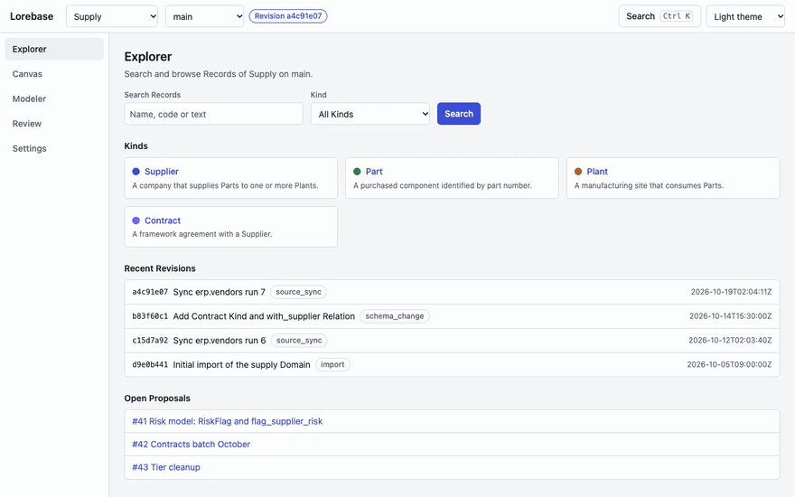
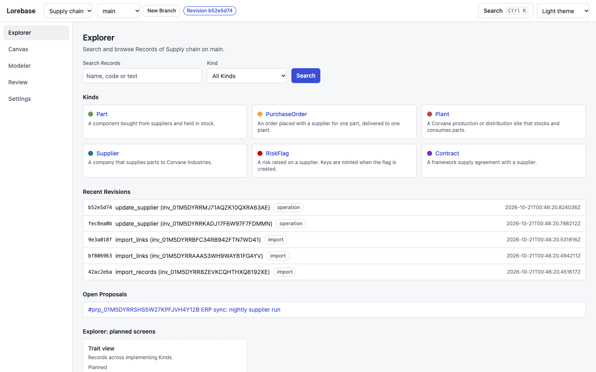
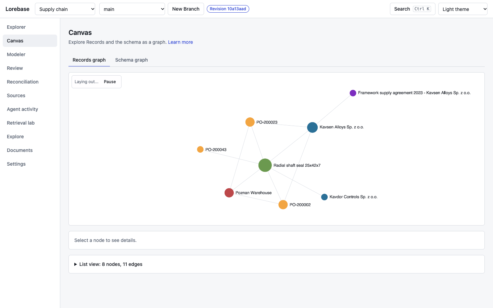
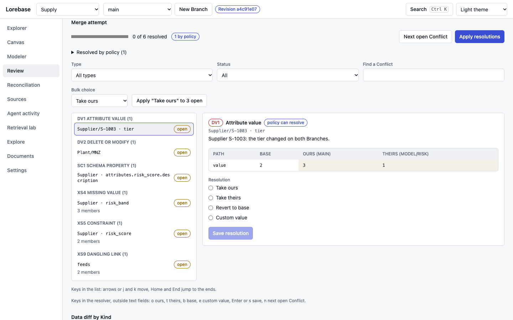
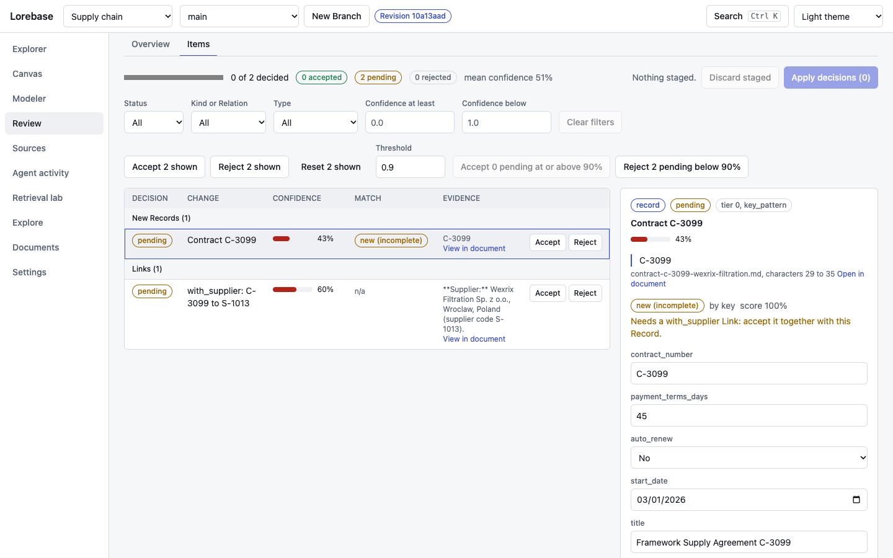
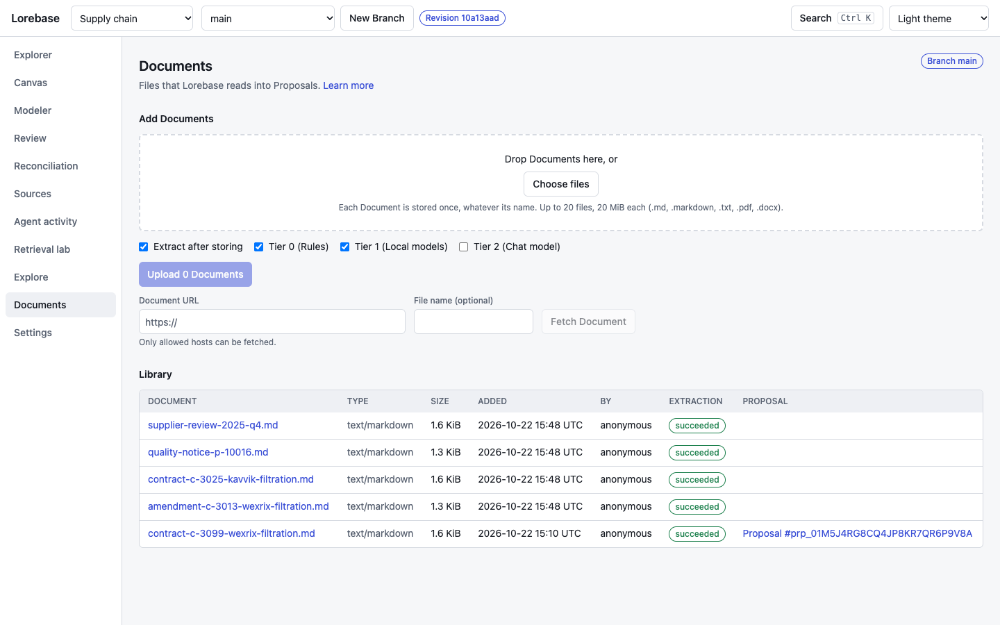
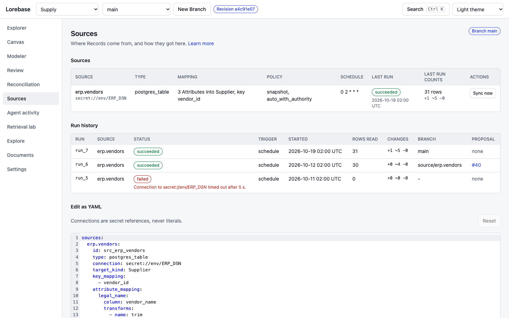
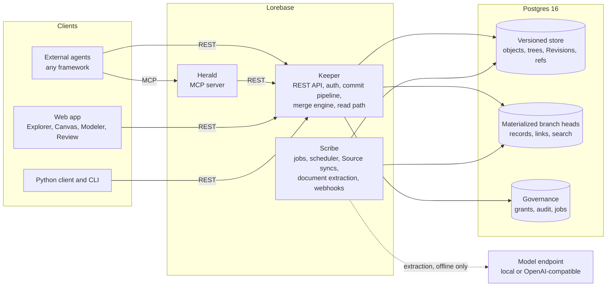

# Lorebase

**Git for knowledge: an open-source ontology platform where AI agents read a versioned, governed knowledge graph in milliseconds.**

[](../LICENSE)

[](https://github.com/aantenore/lorebase/actions/workflows/ci.yaml)
[](https://github.com/aantenore/lorebase/actions/workflows/codeql.yaml)
[](https://scorecard.dev/viewer/?uri=github.com/aantenore/lorebase)


> **Pre-alpha.** The versioning and merge engine and the Keeper REST API, Proposals included, run today, and so do the MCP server (Herald), the Python client and the `lorebase` CLI. Source syncs run, documents are extracted into Proposals that people review item by item, and agent writes that need review become Proposals. Semantic search ranks stored vectors against a vector the caller supplies; nothing computes embeddings yet. [Status and roadmap](#status-and-roadmap) says exactly what is done.

## What it is

Lorebase is an open-source ontology platform: a versioned knowledge graph for AI agents, self-hosted on Postgres and nothing else. Teams model what the company knows as a typed ontology (Kinds, Attributes, Relations, Operations), keep it in Postgres, and change it the way developers change code: on a branch, reviewed, merged, traceable. It brings git-like branching and merging for knowledge, covering the schema and the data together, with three-way conflicts resolved per attribute. Agents live outside Lorebase, in any framework. They read through a REST API that never calls a language model, so answers are deterministic and arrive in milliseconds, and they write only through governed Operations. Lorebase is MCP-native by design: the MCP server (Herald) wraps the REST API for any MCP host. It is meant as an open-source alternative to proprietary ontology platforms, small enough to run on a laptop with `docker compose`.



<sub>The web app walking through Explorer, Canvas and a Conflict in Review. It runs on a mock API with sample data; see the [visual tour](tour.md).</sub>

## 30-second demo

The core engine runs in memory, with no services. This script loads the sample `supply` Domain into `main`, branches `model/risk` (analysts change the schema and data) and `source/erp` (a nightly feed changes data), merges both, lists the Conflicts, resolves them and diffs.

```bash
git clone https://github.com/aantenore/lorebase.git && cd lorebase
uv sync --all-packages
uv run python examples/merge_demo.py
```

```text
== 5. merge source/erp into main
merge base 7ad4a553: 5 Conflicts

DV1 ATTRIBUTE_VALUE (1)
  where            attribute   base  ours  theirs  choices
  -----            ---------   ----  ----  ------  -------
  Supplier S-1001  risk_score  32    80    45      ours/theirs/base/custom

DV2 DELETE_MODIFY (1)
  where         attribute  base      ours      theirs    choices
  -----         ---------  ----      ----      ------    -------
  Part P-10003  -          {record}  (absent)  {record}  ours/theirs/base/custom
...
== 7. merge again
merged: Revision 2cacd1bb, parents 60f665d3, 4d5440a3
validation: 72 Records against the merged schema, 0 issues
```

The analysts say 80, the ERP says 45, and someone has to decide. That decision is a recorded resolution, not a silent overwrite. The walkthrough of the whole output is in the [quickstart](quickstart.md#3-run-the-core-demo).

## Try the five-day demo

The [proof scenario](design.md#32-the-5-day-proof-scenario) of the design as one command, against a real stack: schema inferred from CSV files, data loaded, two teams editing the same suppliers on two branches, Conflicts resolved from the command line, a Source sync, a signed webhook, an agent reading and writing through the MCP server, rate limits and a backup restored into a second database. It needs Docker and uv.

```bash
make demo                # builds the stack under its own project name, runs the five days, removes it
make demo KEEP=1         # leave the stack running afterwards; `make demo-down` removes it
```

The stack is the compose project `lorebase-demo` with Keeper on port 18080 and Postgres on 15432 (`DEMO_KEEPER_PORT`, `DEMO_POSTGRES_PORT` change them), so it does not touch a stack you already run. The first run builds the image; the five days themselves take under a minute. Each command is printed before its output. [demo.md](demo.md) tells the story day by day with the transcript; `examples/five_day_demo/run.sh` runs the same days against any Keeper.

## Why Lorebase

- **Branch and merge schema and data, with three-way conflicts.** Change the model and the data on a branch, merge, and get typed Conflicts (attribute value, delete or modify, type coercion, cardinality, dangling link and more) instead of a corrupted knowledge base. The merge engine checks the merged data against the merged schema before it commits.
- **Milliseconds reads for agents.** Reads are deterministic SQL over materialized branch heads, with no model in the path. This is enforced by the build: Keeper cannot import the inference package. Every response names the Revision it was served from. [Measured numbers](#read-performance) are below.
- **Governed writes through Operations and Proposals.** Agents change knowledge only through Operations with validation, permissions, dry run, idempotency and audit. Writes to a protected branch go through a Proposal, with reviews, required approvals and Conflict resolution over REST. Both are there today.
- **Schema as code.** The ontology is a YAML document you review in a pull request and apply as one schema change set. Attribute ids are stable, so renames merge cleanly.
- **Runs free on a laptop, scales out when you need it.** One `docker compose`, Postgres 16, no API keys. Add Keepers behind a load balancer and Postgres read replicas with a freshness guard for read load. Document extraction uses one OpenAI-compatible interface, local (Ollama, fastembed, GLiNER, GLiREL) or paid, selected by configuration, and only Scribe calls it.

## Features

| Area | Feature | Status | Milestone |
|------|---------|--------|-----------|
| Modeling | Typed ontology as YAML: Kinds, Attributes, Relations with cardinality, Traits, Operations, Derivations, Sources, with static validation | Done | M1 |
| Modeling | Expressions (CEL) in Operations and Derivations: type checked when a schema is applied, Operations executed with preconditions, steps and review policies, `expression` and `aggregate` Derivations recomputed in the materialized head | Done (path Derivations are not computed) | M3, M4 |
| Versioning | Content-addressed Revisions, branches, tags, diff, time travel reads | Done | M1 |
| Versioning | Three-way merge of schema and data, full Conflict taxonomy, resolutions, merge policies (`prefer`, cascade, defaults) | Done | M1 |
| Versioning | Proposals, reviews, required approvals, merge and Conflict resolution over REST | Done | M1 |
| Reads | Records, Links, query DSL, traversal, neighborhood, lexical search, log and diff over REST, with ETags | Done | M1 |
| Reads | Per-Attribute indexes, one-statement read primitives, performance harness and a 100k-Record baseline ([performance.md](performance.md)) | Done; the 1M-Record baseline is not | M1 |
| Reads | Semantic and hybrid search with caller-supplied vectors | Done; no job computes embeddings yet | M4 |
| Governance | Built-in Operations (create, update, delete, link, unlink, bulk import) with dry run and idempotency | Done | M1 |
| Governance | API keys, OIDC bearer tokens, role grants per Domain, Kind, Operation and branch, hash-chained audit log | Done | M1 |
| Governance | Custom Operations, review policies, sensitivity masking | Partly: custom Operations run with CEL preconditions, steps and review policies; events declared by Operations and sensitivity masking are planned (signed webhooks on Revision events exist) | M3 |
| Operations | Docker compose, CI, CodeQL, Scorecard, SBOM, OpenTelemetry | Done | M1 |
| Operations | Observability bundle: metrics catalogue, Grafana dashboards for Keeper, Store and Scribe, Prometheus alert rules with runbooks, OpenTelemetry Collector to Prometheus and Jaeger or Tempo, in compose and the Helm chart ([metrics.md](metrics.md), [operations.md](operations.md#dashboards-and-alerts)) | Done | M1 |
| Operations | Several Keepers and Postgres read replicas with a freshness guard | Done, endpoints adopt it incrementally | M1 |
| Operations | Garbage collection, Domain backup and restore bundles, a Postgres job queue ([operations.md](operations.md)) | Done | M5, landed early |
| Agent access | Context packs within a token budget (JSON or markdown), Record explanations, change feed (Server-Sent Events and polling) and signed webhooks ([agents.md](agents.md)) | Done | M3, landed early |
| Agent access | Python client (sync and async) and the `lorebase` CLI over the REST API, Proposals, context packs and explanations included; the OpenAPI document is committed as [openapi.json](openapi.json) | Done | M1 |
| Agent access | MCP server (Herald) on stdio and Streamable HTTP ([mcp.md](mcp.md)) | Done | M3, landed early |
| Agent access | Agent writes that need review run on a task branch and open a Proposal, merged automatically only for roles the Domain allows and with the required approvals ([agents.md](agents.md#writes-that-need-review)) | Done | M3 |
| Ingestion | Schema inference from CSV, JSON, JSON Lines and Parquet files and Postgres tables (`POST .../schema:infer`, [inference.md](inference.md)) | Done | M2 |
| Ingestion | CSV, JSON, JSON Lines, Parquet, HTTP JSON and Postgres Sources with snapshot and incremental syncs into Source branches, Proposals or direct merges, with per-row Lineage; the Scribe worker and scheduler ([scribe.md](scribe.md)) | Done | M2 |
| Ingestion | Inference providers: any OpenAI-compatible chat and embeddings endpoint, local fastembed, GLiNER and GLiREL ([inference-providers.md](inference-providers.md)) | Done | M4 |
| Ingestion | Document extraction into reviewable Proposals: intake of Markdown, text, PDF and DOCX, rules, local span and relation models, any LLM with JSON schema output, verified evidence, item review over REST, CLI and in the web app ([extraction.md](extraction.md)) | Done; schema suggestions planned | M4 |
| Web app | Explorer, Canvas, Modeler with a Start from data wizard, Review with Conflict resolver and extraction Items, Documents, Sources, Admin basics | Done; runs on the mock API or on Keeper, with end-to-end tests against a real Keeper for browsing, Branches, schema changes, Review and Settings | M2, M3 |
| Operations | Helm chart: Keeper, migration hook, optional Scribe, Herald, web app, Ollama, Ingress, HPA, read replica DSNs ([kubernetes.md](kubernetes.md)) | Done, checked by lint, template and kubeconform; not yet run on a live cluster | M5, landed early |
| Scale | Overlay branches that store only the rows they change, created in milliseconds whatever the size of the Domain ([store-schema-notes.md](store-schema-notes.md#overlay-branches)) | Done | M5, landed early |
| Project | Documentation site with generated CLI, configuration and REST API reference ([aantenore.github.io/lorebase](https://aantenore.github.io/lorebase/)) | Done | M5, landed early |
| Scale | PII vault, 10M-Record performance | Planned | M5 |

The milestone breakdown with checkboxes is in the [roadmap](roadmap.md).

### Read performance

p95 latency in milliseconds of the agent reads on a materialized head of 99,900 Records and 302,940 Links, one laptop with Postgres in Docker, measured by `tests/perf/bench.py` ([performance.md](performance.md)). `owner` is a database role not subject to row-level security; `rls` is subject to it, like the role Keeper runs as in production:

| Read | Budget | owner p95 | rls p95 |
|------|-------:|----------:|--------:|
| Record by key | 5 | 1.07 | 1.25 |
| Page of 50 | 20 | 1.57 | 1.65 |
| Links of a Record | 10 | 1.30 | 1.58 |
| Neighborhood, 2 hops | 30 | 5.67 | 5.11 |
| Query on an indexed Attribute | 25 | 1.71 | 1.86 |
| Full-text search | 50 | 2.58 | 2.75 |
| Full-text search, typo-tolerant titles | 50 | 22.32 | 22.64 |

Under row-level security Postgres cannot use non-leakproof operators (`->>`, casts, `@@`) as index conditions, so search, incoming Links, neighborhoods and attribute queries run inside security definer functions that pin the Domain they are given ([store schema notes](store-schema-notes.md#security-definer-read-functions)), and search reads an index scoped by Domain and branch (migration `0011`). Every read of both roles is within its budget; as plain SQL the `rls` role measured 28 ms, 137 ms and 68 ms for Links of a Record, the neighborhood and search. Reads on an overlay branch stay within 30% of a full copy at p50. The 1M-Record baseline is still to do.

## See it

Screens of the web app. The first row runs on a real Keeper with the supply sample loaded, the second on the mock API. The [visual tour](tour.md) says what is live and what is not served yet.

| Explorer | Canvas | Conflict resolver |
|----------|--------|-------------------|
| [](tour.md#explorer) | [](tour.md#canvas) | [](tour.md#review) |
| **Extraction items** | **Documents** | **Sources** |
| [](tour.md#review) | [](tour.md#documents) | [](tour.md#sources) |

## Quickstart

Requirements: Python 3.12 with [uv](https://docs.astral.sh/uv/), Docker with compose, and Node.js 24 with pnpm for the web app.

```bash
git clone https://github.com/aantenore/lorebase.git && cd lorebase
uv sync --all-packages

# Core engine demo: branches, three-way merge, Conflicts, resolutions, diff (no services)
uv run python examples/merge_demo.py

# Postgres, migrations and Keeper (builds the backend image on first run)
cp .env.example .env     # set POSTGRES_PASSWORD and LOREBASE_APP_PASSWORD
docker compose --env-file .env -f deploy/compose/docker-compose.yaml up -d postgres migrate keeper
curl http://localhost:8080/readyz
```

The [quickstart](quickstart.md) continues from there: create the `supply` Domain, apply its schema, import the sample data through the REST API and run the web app in mock mode. Scale-out with replicas is in [deployment.md](deployment.md), and the Kubernetes install in [kubernetes.md](kubernetes.md). Configuration is external: `.env` for compose, `config/lorebase.example.yaml` for the services, `apps/web/.env.example` for the web app.

## Architecture



The agent read path is `agent -> Keeper -> materialized head`, or `agent -> Herald -> Keeper -> materialized head` over MCP. It never touches a model; only Scribe does, offline, to extract documents. Postgres is the only required store, with pgvector for optional semantic search. Details: [design.md](design.md).

## How it compares

Lorebase sits between proprietary ontology platforms, versioned databases, graph databases and agent memory engines. The full comparison, including where each of them is the better choice, is in [comparison.md](comparison.md).

| Product | What it is | Branch and merge of knowledge | Choose it instead when |
|---------|-----------|-------------------------------|------------------------|
| **Lorebase** | Typed ontology as a shared system of record, Postgres only | Yes, schema and data together, three-way | You want agents to read a reviewed, versioned knowledge base and change it only through governed Operations |
| Palantir Foundry Ontology | Proprietary operational ontology inside a full data platform | Within the platform | You need the whole platform and a vendor to run it |
| TerminusDB | Versioned document and graph database | Yes, on its own storage engine | You want a general versioned graph database to build on |
| Dolt | SQL database with git semantics | Yes, on tables | Your data is tabular and you want versioned SQL |
| Neo4j | Property graph database | No | You need graph algorithms and pattern queries at scale |
| Cognee | Agent memory built by LLM pipelines | No | You want automated memory for a single agent |
| Graphiti and Zep | Temporal knowledge graph for agent memory | No (facts carry validity time) | You need conversational memory with temporal reasoning |
| Mem0 | Per-user memory layer | No | You want personalization memory for assistants |

## Who is it for

- **Platform teams** that need one governed place for company knowledge that many agents and applications read, with SSO, roles, audit and no new proprietary platform to buy.
- **Data teams** that own the definitions (suppliers, parts, contracts) and want them modeled, reviewed and versioned like code, with structured sources mapped in.
- **Agent builders** who are tired of agents answering from stale chunks, and want typed entities, provenance, a deterministic read API and a safe write path.
- **Consultancies** that deliver the same kind of knowledge system to several clients and want an open, self-hostable base with a clean multi-Domain model, instead of reselling a closed suite.

## Status and roadmap

Pre-alpha. [v0.1.0](https://github.com/aantenore/lorebase/releases/tag/v0.1.0) is the first pre-alpha release ([CHANGELOG](project/changelog.md), [release process](release.md)); interfaces may change, and before 1.0 any minor version may change them. M1 (engine and API) is nearly done: the engine, the REST API (Proposals included), the Python client and the CLI are done; lineage and history endpoints and the 1M-Record performance baseline are not.

Done on `main`: the core engine (canonical JSON and hashing, type system, schema models, HAMT trees, Revisions, diff, three-way merge with the Conflict taxonomy); schema as YAML; CEL expressions end to end (schema validation, custom Operations, derived values in the materialized head); the Postgres store with materialized heads, row-level security and per-Attribute indexes; the Keeper REST API for Domains, branches, schema change sets, schema inference, Operations, Proposals with reviews, merge and Conflict resolution, Records, Links, query, traversal, neighborhood, search, log, Revisions and diff; authentication with API keys and OIDC, roles and audit log; Postgres read replicas with a freshness guard; context packs, Record explanations, the change feed and signed webhooks for agents; Herald, the MCP server over the REST API; the Python client and the `lorebase` CLI, checked against the committed OpenAPI document; garbage collection, Domain bundles and a job queue; document intake and tiered extraction into Proposals with item review; agent writes that turn a refused Operation into a task branch and a Proposal; overlay branches; a performance harness with a 100k-Record baseline; docker compose and a Helm chart; metrics, Grafana dashboards and Prometheus alert rules; CI with CodeQL, a release workflow with signed images and SBOMs; a security review of the trust boundaries with all 23 findings fixed ([security-review.md](security-review.md)); the five-day demo (`make demo`); the documentation site; the web app on the mock API or a live Keeper.

Next: lineage and history endpoints, the 1M-Record baseline and OIDC login for the web app.

| Milestone | Theme | Highlights |
|-----------|-------|-----------|
| M1 | Engine and API | Versioning engine, Keeper REST API, CLI, docker compose, CI |
| M2 | Structured ingestion and exploration | Postgres, CSV and Parquet Sources, schema inference, Explorer, Canvas, Review basics |
| M3 | Governance and agents | Custom Operations, full RBAC, Herald MCP server, Modeler, Conflict resolver UI |
| M4 | Documents and semantic search | Offline extraction into Proposals with evidence, entity resolution, embeddings, hybrid search |
| M5 | Enterprise hardening, 1.0 | Overlay branches, PII vault, Helm chart, 10M-Record performance, LinkML import and export |

The public [roadmap](roadmap.md) tracks every item. The reasoning behind the project is in [why.md](why.md), common questions in the [FAQ](faq.md).

## Documentation

The pages are also in the [repository](https://github.com/aantenore/lorebase/tree/main/docs), and the reference pages are generated from the code.

- **Start**: this page, the [quickstart](quickstart.md), the [five-day demo](demo.md) and the [visual tour](tour.md).
- **Concepts**: [why versioned knowledge](why.md), the [glossary](glossary.md), the [design](design.md), the [FAQ](faq.md) and the [comparison](comparison.md) with similar products.
- **Guides**: [agents](agents.md), the [MCP server](mcp.md), [schema inference](inference.md), [inference providers](inference-providers.md), [document extraction](extraction.md), [Scribe](scribe.md), [operations](operations.md), [metrics](metrics.md), [deployment](deployment.md), [Kubernetes](kubernetes.md), [performance](performance.md) and the [security review](security-review.md).
- **Reference**: the [REST API](reference/api.md), the [command line](reference/cli.md) and the [configuration](reference/configuration.md).
- **Project**: the [roadmap](roadmap.md), the [changelog](project/changelog.md), [contributing](project/contributing.md), the [security policy](project/security.md) and the [release process](release.md).

## Community

- [Issues](https://github.com/aantenore/lorebase/issues): bug reports, feature requests and questions
- [Discussions](https://github.com/aantenore/lorebase/discussions): ideas, use cases and design conversations
- [Contributing](project/contributing.md): workflow, commit conventions, labels. Design feedback and real use cases are as valuable as code at this stage.
- [Security policy](project/security.md): how to report a vulnerability privately
- [Code of Conduct](../CODE_OF_CONDUCT.md)

## License

Apache License 2.0. See [LICENSE](../LICENSE). Copyright 2026 Antonio Antenore.
