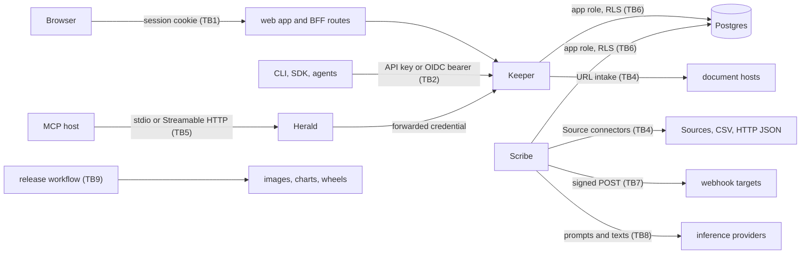

# Threat model

A STRIDE analysis of Lorebase per trust boundary: what crosses each boundary, what an attacker
could do there, what the code does about it, and what risk is left. Every mitigation names the
file that implements it. The [security review](security-review.md) is the companion document: it
lists the findings (F1 to F23) found while reviewing these boundaries and how each was fixed;
this page cites them by number instead of repeating them.

STRIDE letters used in the tables: **S**poofing, **T**ampering, **R**epudiation, **I**nformation
disclosure, **D**enial of service, **E**levation of privilege.

## Scope and assumptions

- One installation serves one organization; Domains are the isolation boundary inside it
  ([design 13.1](design.md#131-tenancy-model)). Hosting several organizations means several
  installations with separate databases.
- The operator who holds the configuration, the secrets and the database owner role is trusted.
  So are installation administrators (`keeper.auth.installation_admins`).
- Keeper is reached over TLS terminated by a reverse proxy or ingress in front of it; Keeper itself
  serves plain HTTP; it sends HSTS when the request came over https (directly or through a
  trusted proxy's `X-Forwarded-Proto`) or when `keeper.security_headers.hsts.enabled: always`.
- Postgres, the model endpoints and the object storage of the deployment are run by the operator.
  Sources, webhook targets, documents and the identity provider are outside the installation.
- Code at the commit of this page. Features that the design describes but the code does not have
  yet are not counted as mitigations.

## Assets

| Asset | Where it lives |
|-------|----------------|
| Domain content: Records, Links, schema, history | Postgres (`mat_*`, Revisions, tree nodes and objects) |
| Credentials: API keys, session ids, provider tokens, webhook secrets, Source secrets, the pepper and the session encryption key | Hashes and ciphertexts in Postgres; secret values in the environment or files referenced by `secret://` |
| Authorization state: principals, groups, grants | Postgres, installation-wide tables |
| The audit log | `audit_log`, one hash chain per Domain plus one installation-wide |
| Documents uploaded for extraction | Postgres, unmasked raw input |
| Availability of Keeper, Scribe and the database | Processes and connection pools |
| Release artifacts | Container images, Python distributions, Helm chart, SBOMs on GitHub |

## Trust boundaries

TB3 is the authorization boundary inside Keeper: between an authenticated principal and the
Domains, branches, Kinds and Operations it may use.

## TB1: Browser and the web sign-in

Keeper acts as backend-for-frontend when `keeper.auth.sessions` is on (off by default, needs an
`oidc` mode). Code: `packages/keeper/src/lorebase_keeper/auth/sessions.py`, `auth/provider.py`,
`auth/keyring.py`, `routes/sessions.py`; storage in `packages/store/src/lorebase_store/auth/sessions.py`.
The security review's [web sign-in section](security-review.md#web-sign-in-a-new-boundary) has
the full table; the summary:

| | Threat | Mitigation | Residual risk |
|-|--------|------------|---------------|
| S | Stolen or fixed session id | Opaque id in an `HttpOnly`, `__Host-`, `Secure`, `SameSite=Lax` cookie; a new id at every sign-in; only its SHA-256 is stored | A browser compromised by malware can still ride the session until a timeout |
| S | Login CSRF, code injection, replayed ID token | `state`, `nonce` and the PKCE verifier in an encrypted 10-minute cookie; the callback checks state before redeeming the code; ID token signature, issuer, audience, `azp`, expiry and nonce checked (`auth/oidc.py`) | None known |
| T | Cross-site request forgery | CSRF header (HMAC of the session id) on unsafe methods, trusted `Origin`, no cross-site `Sec-Fetch-Site` | Any origin listed in `keeper.cors` with credentials can read the CSRF token: list only the app's origins |
| I | Token theft by script in the page | The browser never gets a token; refresh and ID tokens are AES-256-GCM encrypted under an HKDF key from `sessions.encryption_key` ; the web image sends a Content Security Policy (`script-src 'self'`, `worker-src 'self' blob:`, `connect-src` limited to the app and the Keeper origin of the runtime configuration, `object-src 'none'`, `frame-ancestors 'none'`), `nosniff`, `X-Frame-Options: DENY` and `Referrer-Policy: no-referrer` on every response (`deploy/docker/web/40-lorebase-config.sh`, `default.conf`, the chart's `web.security`); Keeper sends `nosniff`, `frame-ancestors 'none'`, `X-Frame-Options`, `Referrer-Policy` and HSTS over https (`packages/keeper/src/lorebase_keeper/middleware.py`, `keeper.security_headers`) | `style-src` allows `'unsafe-inline'` (the code editor injects style elements); HSTS on the web image is off unless `LOREBASE_WEB_HSTS` is set, so set it there or at the proxy that terminates TLS |
| I | Authorization codes in proxy logs | Codes are single use and useless without the PKCE verifier | Proxy logs that keep query strings hold them; protect or strip them |
| D | Session table growth, refresh storms | Idle and absolute timeouts, purge of expired rows, refresh serialized by a lease (`refresh_lease_s`) | A refresh that fails mid-way delays the next one by the lease |
| E | Open redirect after sign-in | `return_to` must be a local path, checked again when the state cookie is opened; redirects only to `app_url`'s origin | None known |

## TB2: API clients, API keys and OIDC bearer tokens

Code: `packages/keeper/src/lorebase_keeper/auth/api_keys.py`, `auth/oidc.py`,
`auth/principals.py`, `auth/config.py`, `client_address.py`, `ratelimit/enforce.py`.

| | Threat | Mitigation | Residual risk |
|-|--------|------------|---------------|
| S | Guessed or brute-forced API key | `lbk_{prefix}_{secret}` with a 256-bit secret; only `HMAC-SHA256(pepper, secret)` is stored and compared in constant time; failed authentications draw from buckets per client address and per key prefix, refused with 429 before any lookup (F20) | Whoever knows a key prefix (not secret) can keep that key throttled; `auth_failures.per_key_prefix_enabled: false` removes the per-prefix bucket |
| S | Forged bearer token | JWKS-validated signatures with asymmetric algorithms only (default `RS256`, `ES256`, `auth/config.py`), issuer, audience, expiry and not-before checked; issuer and JWKS over https unless loopback or `oidc.allow_insecure` (F17) | Trust in the identity provider and its group claims, which map to Lorebase groups |
| S | Stolen key used from elsewhere | Optional `allowed_networks` per key (F16); the client address comes from the socket peer or from `X-Forwarded-For` only behind `keeper.trusted_proxies`; uvicorn does not rewrite the peer (`__main__.py`, `proxy_headers=False`) | Keys without an allowlist work from any address; a wrong `trusted_proxies` list lets clients choose their address |
| S | Anonymous access by misconfiguration | `auth.mode: none` is refused off loopback unless `keeper.auth.allow_insecure` (F3); API key modes need a pepper of 32 characters or more (`_mode_requirements`); `bootstrap` refuses a second administrator key without `--force` | `allow_insecure` is a deliberate switch; compose sets it for a port published on `127.0.0.1` |
| R | Denied or mutating request without a trace | `AuditMiddleware` records every mutating request and every 401 and 403 (`auth/audit.py`, `keeper.auth.audit`) with actor, action, target and outcome | Reads are not audited. Audit writes are best effort: a failed write is logged and counted in `lorebase.audit.write_failures`, the request still succeeds |
| I | Credentials in logs | Key prefixes only; the redaction filter scrubs registered secret values (`packages/platform/src/lorebase_platform/logging.py`); audit entries never hold bodies, headers or credentials | Values not registered as secrets and shorter than `logging.redact_min_length` are not scrubbed |
| D | Flooding, oversized bodies, expensive reads | Rate limits per principal and route class, daily quotas per key (`keeper.limits`), request bodies capped at `limits.max_request_body_bytes` (1 MiB) with chunked bodies counted (`middleware.py`), read caps under `read.*` and a 30 s `statement_timeout_ms` (`packages/store/src/lorebase_store/settings.py`) | With `keeper.limits.rate.backend: local` (the default) each Keeper enforces its own buckets; `postgres` shares them (`ratelimit/shared.py`), and the Helm chart sets it when more than one Keeper runs. The shared buckets are UNLOGGED: a crash of the database server refills them; while the database is unreachable the limits are per process (`postgres.on_error: local`) |

## TB3: Authorization inside Keeper

Code: `packages/keeper/src/lorebase_keeper/auth/rbac.py`, `auth/permissions.py`, `auth/deps.py`,
`reading/`, `services/agent_writes.py`, `services/proposals.py`.

| | Threat | Mitigation | Residual risk |
|-|--------|------------|---------------|
| E | Reading or writing another Domain | Deny by default: a permission needs a grant in that Domain whose role holds it; API keys carry Domain scopes checked first; `*` is an ordinary Domain id (F8); a missing Domain answers like a forbidden one to callers without a Domain-wide grant (`reveals_missing_domain`) | None known |
| E | Widening a narrowed grant | Grants narrowed to a Kind, Operation or branch pattern count only for requests about it; `ReadGuard` leaves other Kinds out of neighborhoods and refuses explicit requests for them; the response cache is consulted only after the read is authorized and holds no per-caller data (`reading/caching.py`) | Grants cached for `authz.grants_cache_ttl_s`: a revocation through another Keeper takes effect within that time; open event streams re-check every `agents.feed.reauthorize_interval_s` (F23) |
| T | Agent writes that bypass review | Agents write only through Operations with preconditions and review policies; protected branches need a Proposal; agent task branches and automatic merges are bounded by `keeper.agent_writes` (`allowed_roles_for_auto_merge` empty by default) and never skip required approvals | A Domain admin can widen `allowed_roles_for_auto_merge` per Domain |
| T | Self-approval | `keeper.proposals.allow_self_approval` is false by default; the author's approvals are refused and not counted | None known |
| E | Installation administration from a Domain role | Installation permissions (`principal.read`, `domain.create`) are held by installation administrators and by Domain-wide grants of roles holding them; API keys limited to Domains never hold them; Domain admins cannot mint keys for installation administrators or for principals without a grant in their Domain (`routes/admin.py`, `_check_key_holder`) | Domain admins see installation-wide principal lists (`principal.read` is in `admin`) |
| I | Raw documents to readers | `document.read` is held by `editor`, `reviewer`, `maintainer` and `admin` only; `viewer`, `explorer` and `agent-reader` never read documents (`auth/permissions.py`) | Documents are unmasked input: whoever reads them reads the sensitive values they hold |
| I | Sensitive values to readers without clearance | Values of `pii`, `confidential` and `restricted` Attributes are masked unless the caller holds `pii.read`, `confidential.read` or `restricted.read` for the read; responses are cached per clearance; filters, ordering and grouping on them need the clearance; sensitive Attributes are out of full-text vectors, the lexicon, snippets and titles; vault references are replaced after the cache and only for cleared callers (`reading/sensitivity.py`) | Validation messages quote values back to their writers; Kind health lists the keys of Records sharing a sensitive unique value (never the value); see residual risks 5 to 8 |
| I | Personal data kept in history | `vault: true` Attributes store a reference in Record objects and the value encrypted in `vault`; erasure (`pii.erase`) clears it for every Revision and is audited in the same transaction (`lorebase_store/vault`, `routes/vault.py`) | Inline sensitive values (no vault) and Record keys stay in history; clients and caches outside Keeper keep what they read |
| D | Expensive queries | DSL depth and fan-out caps, traverse and neighborhood limits, health scan caps, per-class rate limits | Statement timeout is the last line for queries that stay under the caps |

## TB4: Scribe connectors and other outbound reads

Sources are defined in schemas by holders of `schema.write`, so a modeler of one Domain chooses
what Scribe connects to. Code: `packages/scribe/src/lorebase_scribe/sources/connectors.py`,
`sources/access.py`, `sources/http_json.py`, `packages/store/src/lorebase_store/webhooks/delivery.py`
(`check_target`), `packages/platform/src/lorebase_platform/secrets.py`.

| | Threat | Mitigation | Residual risk |
|-|--------|------------|---------------|
| E | A Source reading the Lorebase database or another secret | Scribe resolves only the references listed in `scribe.sources.allowed_connections`, empty by default (F1) | Postgres Sources run SQL written by modelers; give each allowed connection a read-only role of its own |
| I | SSRF through HTTP JSON Sources | Scheme in `http_json.allowed_schemes` (default `https`) and host in `http_json.allowed_hosts` (default none), checked on every page; addresses resolved once per host and run and refused unless global unicast; connections pinned to the checked addresses with the host name kept for TLS; redirects not followed; proxies from the environment ignored (`trust_env=False`) | `http_json.allow_private_targets: true` turns the address check and the pinning off, so DNS answers can change between pages |
| I | SSRF through CSV URLs and local files | URL hosts pass the same `check_target` and the download is pinned (F18); local paths must be under the allowed roots, opened component by component with `O_NOFOLLOW` | The `O_NOFOLLOW` walk is POSIX only |
| I | Secret values in errors and run records | Errors name the setting or reference, never the value (F2); HTTP JSON credential headers must come from `secret://` references in `allowed_connections`, literal values for headers named like credentials are refused (`packages/core/src/lorebase_core/model/source.py`) | HTTP JSON errors name the host (`sources/http_json.py`), which a Source run record shows to Domain readers |
| D | A slow or huge remote | `timeout_s` per request (30 s), `max_bytes` per response (50 MiB), `max_pages` per run (1000, a Source can only lower it), bounded retries honoring `Retry-After` | A Source within its limits can still keep one worker slot busy for the whole run |
| I | SSRF through document URL intake in Keeper | Off unless `keeper.documents.url_hosts` lists hosts (exact match); https only; the host resolved once and refused unless every address is global unicast (`check_target`), the connection pinned to the checked addresses with the host name kept for TLS; no redirects, no proxies, streamed size cap (`packages/keeper/src/lorebase_keeper/services/document_urls.py`) | `keeper.documents.url_allow_private_targets: true` turns the address check and the pinning off |
| D | Malicious document files | Size cap `keeper.documents.max_bytes` (20 MiB), one file per upload, suffix allowlist (`.md`, `.txt`, `.pdf`, `.docx`) checked against the content (PDF and ZIP signatures, UTF-8 text); in Scribe, PDF and DOCX are parsed by pypdf and python-docx in a child process with an empty environment and the socket functions disabled, under `scribe.extraction.parser` limits: wall-clock `timeout_s` (60 s), `RLIMIT_CPU` `cpu_s` (60), `RLIMIT_AS` `memory_mb` (1024), `max_input_bytes` (50 MiB) and a bounded answer; any failure is a permanent job error (`packages/scribe/src/lorebase_scribe/extraction/sandbox.py`) | `RLIMIT_AS` is not enforced on macOS and `resource` limits do not exist on Windows, where only the wall-clock limit holds; the network is denied inside Python, not by the kernel; a crafted file can still use the limits' worth of one worker slot |

## TB5: Herald and MCP agents

Code: `packages/herald/src/lorebase_herald/server.py`, `settings.py`, `keeper.py`, `tools.py`.

| | Threat | Mitigation | Residual risk |
|-|--------|------------|---------------|
| S | Calls to Keeper without the caller's identity | Over Streamable HTTP, Herald requires the credential header (`herald.http.credential_header`) and forwards it unchanged; Keeper authenticates and authorizes it like any request. Over stdio it uses the key of its environment | Herald's HTTP endpoint has no authentication of its own; a missing key over stdio makes requests anonymous, which Keeper refuses unless `auth.mode: none` |
| S | DNS rebinding against a local Herald | Binds `127.0.0.1:8090` by default; `herald.http.allowed_hosts` and `allowed_origins` set the accepted `Host` and `Origin` values | With the lists empty, the protection is the MCP SDK's default for the bind address |
| T | Writes by an agent | `lorebase_execute` is the only writing tool, `dry_run` defaults to true, and writes go through Keeper's Operations and review rules (TB3); read tools are annotated read-only | An agent holding `operation.execute` executes what the grant allows; review policies and protected branches are what stop harmful writes |
| I | Prompt injection through data | Herald returns data, never instructions; outputs are capped (`herald.output.max_chars`, `max_items`, `max_value_chars`) and every cut is marked | Record values written by others reach the agent's model; the agent host must treat tool output as data |
| I | Credential leakage through proxies or logs | Keeper client with `trust_env=False` and an empty environment, TLS verification on by default (`keeper.py`); the credential is never logged | `herald.keeper.verify_tls: false` disables certificate checks |

## TB6: Postgres roles, row-level security and definer functions

Code: `packages/store/migrations/versions/0001_initial_schema.py` (policies), `0005`, `0008`, `0010` (definer
functions), `packages/store/src/lorebase_store/auth/scope.py`, `deploy/compose/postgres/app-role.sh`,
`deploy/helm/lorebase/files/db-roles.py`;
roles in [deployment](deployment.md#database-roles), policies in
[store schema notes](store-schema-notes.md#row-level-security).

| | Threat | Mitigation | Residual risk |
|-|--------|------------|---------------|
| E | A query bug crossing Domains | `ENABLE` and `FORCE ROW LEVEL SECURITY` with `domain_isolation` on every table with `domain_id`; Keeper and Scribe connect as a role with neither `SUPERUSER` nor `BYPASSRLS` nor ownership of the tables, on compose and in the Helm chart, which refuses one role for both unless `database.allowSharedRole` (F6) | RLS reads `lorebase.domain_ids`, a setting any role can change in its own transaction: it stops query bugs, not a compromised application role |
| E | Definer functions widening access | Fixed statement text, the Domain pinned as a literal in every predicate, counts bounded by `store.reads.definer_ceilings`, Domain required and in the transaction scope, `search_path` checked; migrations refuse to run while the application role can create objects in the schema (F12, F13); the services never connect as the owner of the functions (compose `db-roles`, the chart's migration Job) | `database.allowSharedRole` in the Helm chart (development only) runs the services as the owner |
| T | Editing or deleting audit entries | Hash chain per Domain (`packages/store/src/lorebase_store/auth/audit.py`); `python -m lorebase_keeper audit verify`, `GET .../audit/verify` and the daily `audit_verify` job report the first broken entry, and `LorebaseAuditChainBroken` alerts ([operations](operations.md#audit-chain-verification)); the log is append-only for every role but its owner: `UPDATE`, `DELETE` and `TRUNCATE` revoked from `PUBLIC`, the application role and any other holder (`packages/store/migrations/versions/0015_append_only_audit_log.py`, `deploy/compose/postgres/app-role.sh`, `deploy/helm/lorebase/files/db-roles.py`) | Scribe's `audit_checkpoint` jobs publish signed chain heads outside the database (`scribe.audit_checkpoints`, `packages/scribe/src/lorebase_scribe/checkpoints.py`) and `audit verify --checkpoints` reports a checkpointed entry that is missing or changed; entries newer than the latest checkpoint are not covered, and whoever holds Scribe's signing key and can write to the sink can publish false checkpoints. Scribe (index DDL) and, by default, Keeper (`database.maintenanceDsnInKeeper`) hold the owner's DSN for maintenance, so a compromised pod can use it |
| T | Tampering with history | Revisions, tree nodes and objects are content addressed: changing one changes its id; bundle import recomputes every id and hash | A database owner can rewrite content and refs consistently |
| I | Database or backup theft | Only hashes of API keys and session ids; provider tokens encrypted; Source and model secrets are references, never stored; webhook signing keys (`sha256(secret)`, the HMAC key) encrypted with AES-256-GCM under `webhooks.encryption_key`, keys stored before encrypted by the delivery worker (`packages/store/src/lorebase_store/webhooks/keys.py`, revision `0016`) | Without `webhooks.encryption_key` (unset by default) signing keys are stored usable, and a database reader can sign deliveries. Documents and Domain content are stored in clear |
| D | Long statements, lock contention | `statement_timeout_ms` per connection, advisory locks per branch and per audit chain | Garbage collection and index builds run on the maintenance role with their own timeouts |

## TB7: Webhooks

Code: `packages/store/src/lorebase_store/webhooks/`, `packages/scribe/src/lorebase_scribe/webhooks.py`,
`packages/keeper/src/lorebase_keeper/routes/webhooks.py`.

| | Threat | Mitigation | Residual risk |
|-|--------|------------|---------------|
| S | Forged deliveries at the receiver | `Lorebase-Signature: t=...,v1=...`, HMAC-SHA256 over the timestamp and body; receivers check the tolerance window ([agents](agents.md#webhooks)) | Replay inside the receiver's tolerance window unless it remembers `Lorebase-Delivery` ids |
| I | SSRF to internal services | Registration needs `domain.settings`; targets must use `webhooks.allowed_schemes` and resolve to global unicast addresses, checked at every attempt and pinned for the connection; redirects never followed (F4) | `webhooks.allow_private_targets` turns the check off |
| I | Event content to a third party | Events carry Revision metadata and changed keys (`agents.feed.changed_keys_max`), not values; filters by event type and branch | Keys can be meaningful; register only targets that may know them |
| D | A target stalling delivery | Each attempt bounded by `asyncio.timeout`, bodies not read (F5), retries with backoff up to `webhooks.max_attempts`, then dead; at most 20 webhooks per Domain | Deliveries run in sequence per pass; many slow targets lengthen the pass |
| R | Unrecorded registrations | `webhook.create` and `webhook.delete` are audited without the secret | None known |

## TB8: Inference providers

Keeper and Herald never call a model (`lorebase_keeper` and `lorebase_herald` do not import
`lorebase_inference`, enforced by `.importlinter`). Scribe calls the configured providers for
extraction and embeddings. Code: `packages/inference/src/lorebase_inference/settings.py`,
`transport.py`, `chat.py`, `packages/scribe/src/lorebase_scribe/extraction/`.

| | Threat | Mitigation | Residual risk |
|-|--------|------------|---------------|
| I | Domain content sent to a provider | Only Scribe sends text: document text for extraction, and Record texts of Kinds with an `embedding_template`; sensitive Attributes are left out of embedding texts unless `search.embedding_sensitive: true` | Whatever the templates and documents contain goes to the provider: choose a provider whose data handling you accept, or a local one |
| I | Keys sent to the wrong host | A task with its own `base_url` gets no key unless it sets one (F10); proxies from the environment ignored unless `trust_env` (F21) | `base_url` may be plain `http`: use https for remote providers |
| I | Keys or tokens in error messages | Provider errors scrubbed of the key, `Bearer` values and key-shaped strings, cut to 300 characters, no body for 401 and 403 (F21) | None known |
| T | Prompt injection from documents | The extraction model has no tools; outputs are validated against a JSON schema with bounded repair attempts; evidence spans are checked against the source; results open a Proposal of origin `extraction` | Items at or above `scribe.extraction.auto_accept_threshold` (0.9) are accepted on the extraction branch at once; merging still goes through the Proposal and its review rules. Set the threshold above 1 to accept nothing automatically |
| D | A slow or failing provider | Timeouts, retries and pacing in `inference.*` and `scribe.embeddings`; jobs fail and retry, reads are unaffected | Cost of calls is not budgeted per Domain |

## TB9: Supply chain and release

Code: `.github/workflows/*.yaml`, `deploy/docker/*.Dockerfile`, `uv.lock`,
`apps/web/pnpm-lock.yaml`; verification steps in [release](release.md#verify-a-release).

| | Threat | Mitigation | Residual risk |
|-|--------|------------|---------------|
| T | A compromised third-party action | Every external action is pinned by commit SHA; checkouts do not persist the token (F11); CodeQL (`security-extended`) and Scorecard run on `main` | None known for pinned actions |
| T | A malicious or vulnerable dependency | Lockfiles with `uv sync --frozen` and `pnpm install --frozen-lockfile`; the Audit workflow (`.github/workflows/audit.yaml`) runs pip-audit on the locked workspace and `pnpm audit --prod` on every pull request, on `main` and weekly, failing on any advisory not accepted in the reviewed allowlist `.github/audit-allowlist.yaml` and on expired entries (`scripts/audit_check.py`, shared with `make security`) | No automated dependency updates (no Dependabot or Renovate, on purpose): fixes are applied by hand when the audit fails; a malicious release without an advisory is not detected |
| S | Images or artifacts not built by the project | Images signed by digest with cosign keyless (GitHub OIDC identity of the release workflow, Sigstore transparency log), build provenance (`mode=max`), CycloneDX SBOM attestations, `SHA256SUMS` signed as a blob | Verification is up to the deployer; nothing in the Helm chart enforces signatures |
| T | Base image drift | Base images pinned by the digest of their multi-arch index with the tag kept readable (`python:3.12-slim@sha256:...`, `node:24-alpine@sha256:...`, `nginxinc/nginx-unprivileged:1.27-alpine@sha256:...` in `deploy/docker/*.Dockerfile`), checked by `tests/tooling/test_dockerfile_pins.py`; bumping is documented in [release](release.md#base-images) | Digests are moved by hand: security fixes in a base image arrive only when someone bumps the pin |
| E | Container escape from a compromised process | Backend image runs as UID 10001; the web image uses the unprivileged nginx base | Pod security settings beyond the chart's defaults are the deployer's |

## Residual risks, by priority

Remaining:

1. **Webhook signing keys stored usable by default.** `webhooks.encryption_key` is unset by
   default; set it (TB6, TB7).
2. **Erasure covers vault values only.** Sensitive values stored inline, values quoted in
   Revision messages, documents and the extraction evidence quoted from them stay in history;
   store personal data in `vault: true` Attributes (TB3). Inherent: history is content addressed,
   so only values kept outside the objects can be erased without rewriting every later Revision.
3. **Vault keys in the services' configuration.** Whoever holds `vault.encryption_key` and a
   database copy reads every vaulted value; value fingerprints let whoever reads the database
   link Records of a Kind holding the same vaulted value, and tombstones keep the fingerprints of
   erased values (TB6). Inherent: the services must open values to serve them, and erasure by
   value and tombstones need a deterministic fingerprint; keep the keys in a secret store and
   rotate them (`lorebase admin vault rotate`). Tombstones cannot be made again under a new
   token key (they hold no value), so they stay matchable only while the old key stays in
   `previous_token_keys`.
4. **Installation digest secret in the database.** The installation digest secret of
   revision `0027` (used when neither `vault.digest_key` nor vault keys are set) is readable by whoever reads the database (TB6).

5. **Limits of the read audit and of checkpoints.** Read records are sampled when
   `sample_rate` is below 1 and dropped when the queue is full or a batch fails (counted in
   `lorebase.audit.reads.dropped`), so the read stream is evidence of what it holds, not proof
   that nothing else was read; reads that showed or masked a sensitive value are never sampled
   out. Checkpoints cover the chains up to the latest one published (`interval_s`, one hour by
   default) (TB2, TB3, TB6).

Fixed since this page was first published, in the order of the original list (each with tests,
see the [security review](security-review.md#hardening-from-the-threat-model)):

- **Vault keys could not rotate; erasure missed variants, earlier keys and later writes.**
  `vault.token_key` rotates with `token_key_id` and `previous_token_keys`, and the `vault.rotate`
  job (`lorebase admin vault rotate`) seals and fingerprints every row again under the current
  keys in resumable batches (`packages/store/src/lorebase_store/vault/rotation.py`). Erasure by
  value compares matching forms (`packages/core/src/lorebase_core/types/matching.py`); erasure by
  key follows the lineage of key changes, which now store values again under the new key
  instead of being refused; tombstones make a later write of an erased value stored erased or
  refused (`vault.erased_values`); a Domain vault lock orders erasures and commits; the erasure
  audit entry holds a keyed digest of the key (`packages/store/src/lorebase_store/vault/store.py`,
  `packages/keeper/src/lorebase_keeper/routes/vault.py`, revision `0027`). Tests:
  `packages/store/tests/test_vault.py`, `packages/keeper/tests/integration/test_sensitivity_api.py`
  (TB3, TB6).
- **Plain parameter digest without vault keys.** Always keyed: `vault.digest_key`, the token
  key, or the installation secret of revision `0027` (`packages/store/src/lorebase_store/digests.py`,
  test `packages/keeper/tests/test_operations.py`) (TB3).
- **Small value oracles.** Kind health only counts the duplicate groups of sensitive values
  for callers without the clearance (`duplicates.hidden`,
  `packages/keeper/src/lorebase_keeper/kindhealth/scan.py`); validation issues about values the
  caller may not read carry the generic `value.invalid` code (`reading/sensitivity.py`,
  `generalize_issues`); a vault reference nested inside another value is refused
  (`packages/core/src/lorebase_core/validate/data_rules.py`); the NDJSON diff stream and
  Operation edits show values, `[erased]` or the mask like other reads. Tests:
  `test_health_postgres.py::test_uncleared_callers_learn_nothing_about_sensitive_values`,
  `test_sensitivity_api.py::test_violations_on_unreadable_values_do_not_tell_what_is_wrong`,
  `test_sensitivity_api.py::test_streamed_diffs_and_operation_edits_show_values_not_references`,
  `test_vault_rules.py::test_references_nested_inside_other_values_are_refused` (TB3).
- **Branches forked before a tag.** `POST /domains/{d}/branches/{b}/rebase-tags`
  (`lorebase branch rebase-tags`) commits the default branch's tags to the branch (never
  removing one) and recomputes its titles and search vectors in the same transaction; when the
  default branch tags an Attribute, the `store.sensitivity_refresh` job rewrites the stale rows
  of every other branch in resumable batches (`store.materialize.refresh_branches_on_tag`, on by
  default), so verification no longer reports `sensitivity_stale`. Extraction decides by the
  effective tags (`packages/store/src/lorebase_store/materialize/stale.py`,
  `packages/keeper/src/lorebase_keeper/services/schema.py`,
  `packages/scribe/src/lorebase_scribe/extraction/ontology.py`; tests
  `packages/store/tests/test_sensitivity_refresh.py`,
  `test_sensitivity_api.py::test_a_branch_forked_before_a_tag_takes_the_default_branch_tags`,
  `test_extraction_link_values.py::test_the_default_branch_tags_keep_attributes_out_of_extraction`)
  (TB3).
- **Conservative Operation analysis.** Fields an Operation expression reads are resolved
  against the Kind the type checker infers, inside comprehensions, conditionals, traversals and
  `record($step[n])` too; only fields of untyped (`dyn`) values are still matched by name.
  Evaluation errors are shown in full to callers cleared on the Kinds that hold the Attributes
  read (`packages/core/src/lorebase_core/expr/sensitivity.py`,
  `packages/keeper/src/lorebase_keeper/services/operations.py`; tests
  `packages/core/tests/validate/test_vault_rules.py`,
  `packages/keeper/tests/reading/test_sensitivity.py`) (TB3).
- **Erasure value on the command line.** `lorebase admin erase --value` accepts only `-`
  (standard input, no echo on a terminal) or `@FILE` (`packages/cli/src/lorebase_cli/commands/admin.py`,
  test `packages/cli/tests/test_commands.py`) (TB2).

- **No off-database anchor of the audit chain.** Scribe's `audit_checkpoint` job signs the
  head of every chain (Ed25519) and writes it to a file, an HTTP endpoint or an S3-compatible
  bucket with the SSRF checks of webhook targets; `python -m lorebase_keeper audit verify
  --checkpoints DIR --checkpoint-key PUB` reports checkpointed entries that are missing (a cut
  tail) or changed (a recomputed chain) (`packages/store/src/lorebase_store/auth/checkpoints.py`,
  `packages/scribe/src/lorebase_scribe/checkpoints.py`) (TB6).
- **Rate limits per process.** `keeper.limits.rate.backend: postgres` shares the buckets of
  every Keeper in the UNLOGGED `rate_limit_buckets` table, leased a few tokens at a time; failed
  authentication buckets fail closed when the database is slow (`ratelimit/shared.py`, revision
  `0022`); the Helm chart chooses it for more than one Keeper (TB2).
- **Reads were not audited.** `keeper.auth.audit.reads` records successful reads, sampled and
  filtered by principal type and Kind, in batches off the request path, in `audit_read_log`, a
  table with hash chains of its own and append-only like `audit_log`; reads that showed or
  masked a sensitive value are always recorded (`auth/read_audit.py`, revision `0022`) (TB2, TB3).
- **Sensitivity masking was not enforced on reads.** Masked unless cleared, on every read path,
  with the PII vault and erasure (`packages/keeper/src/lorebase_keeper/reading/sensitivity.py`,
  `packages/store/src/lorebase_store/vault/`, revision `0019`) (TB3).

- **Application role could change `audit_log`.** Revision `0015` revokes `UPDATE, DELETE,
  TRUNCATE` from it (`packages/store/migrations/versions/0015_append_only_audit_log.py`,
  `deploy/compose/postgres/app-role.sh`) (TB6).
- **No dependency audit in CI.** `.github/workflows/audit.yaml` with the reviewed allowlist
  `.github/audit-allowlist.yaml` (`scripts/audit_check.py`). Version updates stay manual on
  purpose (TB9).
- **Document parsing in the worker.** PDF and DOCX are parsed in a child process with time,
  CPU, memory and size limits and no network
  (`packages/scribe/src/lorebase_scribe/extraction/sandbox.py`); Keeper checks content
  signatures besides the suffix (TB4).
- **Document URL intake trusted the allowed host's DNS.** Addresses checked with `check_target`
  and connections pinned to them (`packages/keeper/src/lorebase_keeper/services/document_urls.py`)
  (TB4).
- **Webhook signing keys stored usable.** Sealed with AES-256-GCM under
  `webhooks.encryption_key` (`packages/store/src/lorebase_store/webhooks/keys.py`, revision
  `0016`) (TB6, TB7).
- **Transport security headers.** Keeper and the web image send them
  (`packages/keeper/src/lorebase_keeper/middleware.py`, `deploy/docker/web/40-lorebase-config.sh`);
  HSTS for the web app comes from the TLS proxy or `LOREBASE_WEB_HSTS` (TB1).
- **Base images by tag.** Pinned by digest (`deploy/docker/*.Dockerfile`), bumped by hand
  ([release](release.md#base-images)) (TB9).
- **Helm chart ran the services as the table owner.** Keeper and Scribe connect as the
  application role, the migration Job as the owner after its `db-roles` init container keeps the
  role and its grants; one role for both is refused unless `database.allowSharedRole`
  (`deploy/helm/lorebase/templates/_helpers.tpl`, `files/db-roles.py`) (TB6).

## Keeping this page current

Update it in the same pull request as a change that adds a boundary or moves one: a new
connector type, a new outbound call, a new credential, a new writing MCP tool, a new role or
grant on the database. Findings go to the [security review](security-review.md) with a test;
this page changes its mitigation or residual risk. Vulnerabilities are reported as
[SECURITY.md](project/security.md) says.
