# Visual tour

Screenshots of the Lorebase web app (`apps/web`), taken at 1440 pixels wide in the light theme, with one picture in the dark theme at the end.

**Where the pictures come from.** Most pictures show the current app against a running demo stack, read only: Postgres, Keeper, Scribe and the guide service with the `examples/supply` sample (30 Suppliers, 40 Parts, 20 Plants and their Links), its example documents, two extraction Proposals and the schema suggestions of those documents. The Explore picture is a real answer of the guide service, streamed while the picture was taken, and the Agent activity picture is the trace of such an answer. A demo stack has no Source runs, no Proposal with Conflicts and no upload to infer a schema from, so some pictures come from the in-memory mock of the Keeper API (`VITE_API_MODE=mock`, two sample Domains, no backend): Start from data, the Source mapping, Sources, the Conflict resolver and the Reconciliation queue. Each section says which. The flows behind the pictures are exercised against a real Keeper by the Playwright suite in `apps/web/e2e` (browse a Supplier and its Canvas, create a Branch, change the schema through a Proposal, resolve Conflicts and merge, Settings), which CI runs on every change.

The screens are domain-agnostic: every name in the pictures (Kinds, Records, the example questions of Explore) comes from the Domain on screen, not from the app.

The animation is recorded in mock mode with `pnpm screenshots flow`. The pictures are regenerated in `apps/web` with `pnpm screenshots --live --keeper <url> --domain <id> --guide <url>` against a running stack, and the mock ones with `pnpm screenshots --only modeler-start,modeler-source-mapping,sources,review-conflict,review-passages,reconcile-queue,reconcile-contradiction,reconcile-duplicate`; see [apps/web/README.md](../apps/web/README.md#screenshots).

## Explorer

### Domain home

The entry point of a Domain on a Branch: search over Records with a Kind or Trait filter (and a lens selector when the schema declares [lenses](agents.md#lenses-and-traits)), the Kinds of the Domain, the latest Revisions of the Branch (with their origin, such as `import` or `schema_change`) and the Proposals waiting for review. The Domain and Branch selectors and the head Revision in the top bar apply to every screen; "New Branch" starts a Branch at the head of the one on screen. Live.

### Kind table

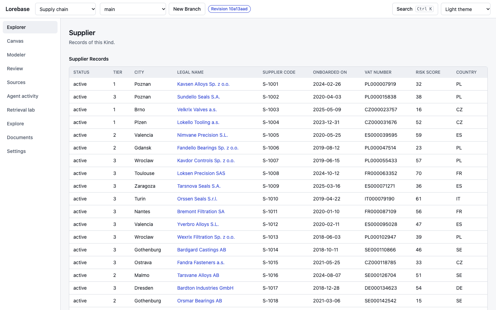

The Records of one Kind as a table, with a column per Attribute, sorting and cursor paging. Each row opens the Record page. Keeper writes integers and decimals as strings; the table shows them as numbers all the same. Live.

### Record page

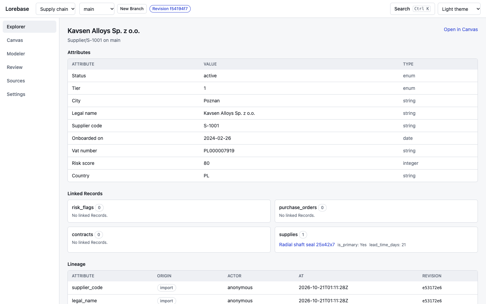

One Record with its Attribute values, the Relations it takes part in (Links in both directions, each one navigable) and its Lineage: for every Attribute, where the value came from, who wrote it and in which Revision. "Open in Canvas" jumps to the graph around the Record. Live.

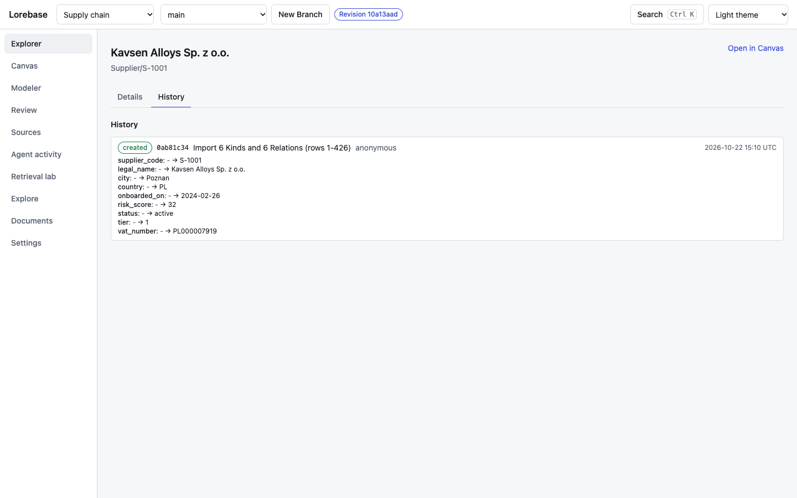

The History tab lists every change of the Record on the Branch, newest first, with the Revision, its message and author, and the values before and after (Keeper's `history` endpoint). Live.

## Search

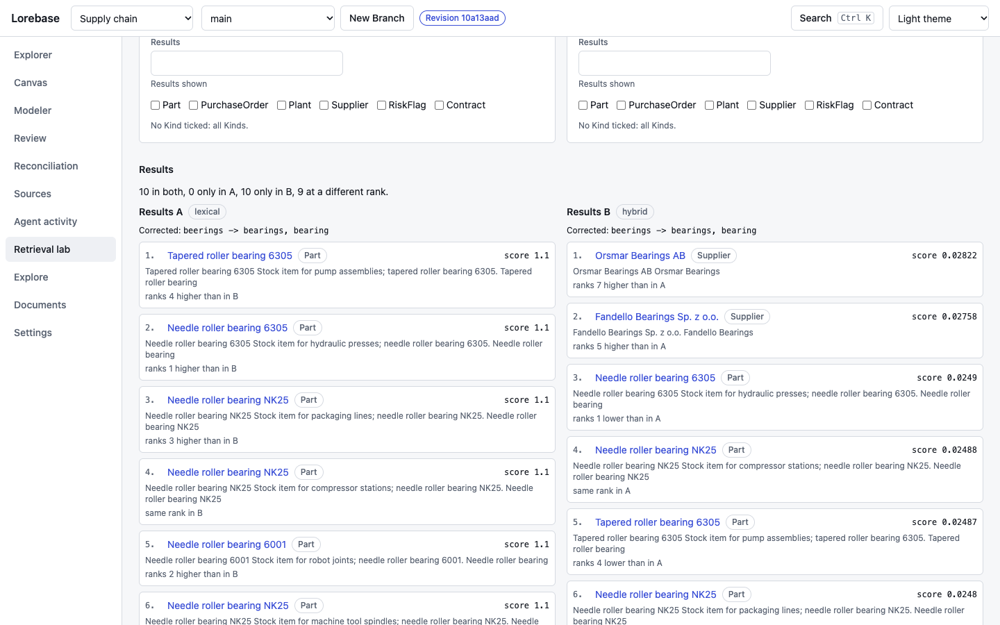

Search tolerates typos and finds by meaning. The question "brevik beerings" is misspelled: the word search corrects it (`beerings -> bearings, bearing`) and ranks the bearings first (set A, lexical); hybrid search (set B) adds the vector match of the question, embedded by the guide service, and ranks the bearing suppliers first. The ranks of both sets are compared line by line. Live.

## Canvas

### Records graph

The neighborhood of a Record drawn as a graph (Keeper's `neighborhood` endpoint): nodes are Records colored by Kind, edges are Links, and a click shows the details of the selected node. Depth and node cap are configuration values. The drawing uses Sigma.js, which needs WebGL 2; where it is missing, the screen shows a message and a list view of the same nodes and edges, which is also available under the graph. Live.

### Schema graph

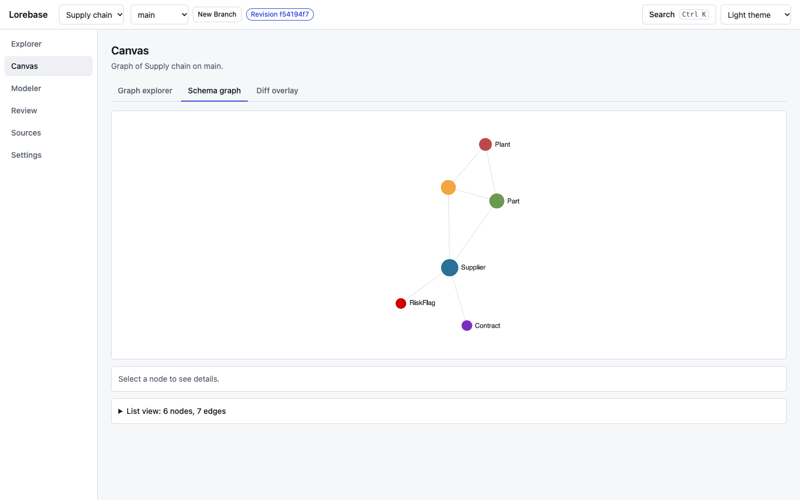

The schema of the Branch as a graph: Kinds as nodes, Relations as edges, with the same selection panel and an "Open in Modeler" link. Live.

## Modeler

### Schema overview

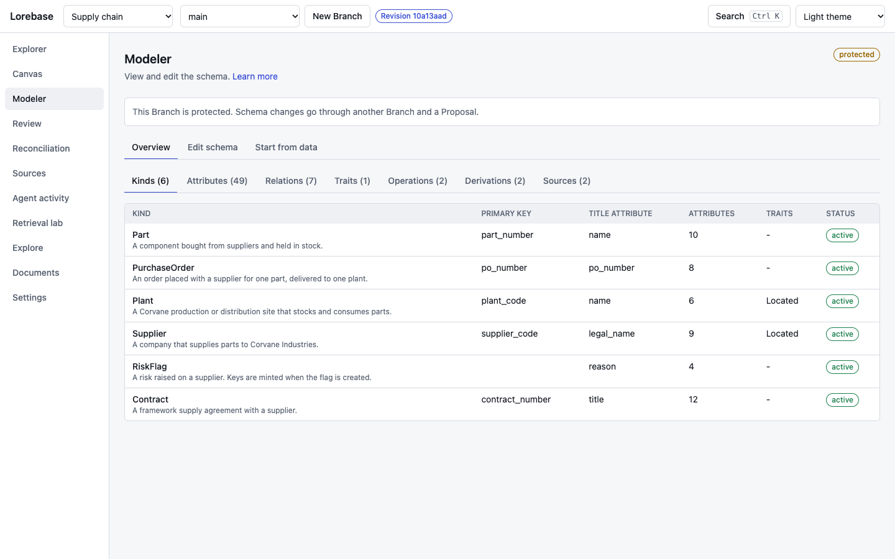

The schema of the current Branch as lists: Kinds, Attributes, Relations, Traits, Operations, Derivations and Sources, with counts. On a protected Branch such as `main` the banner says that schema changes go through another Branch and a Proposal. Live.

### Edit schema

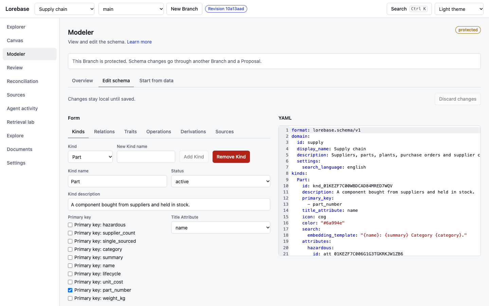

The schema as one document in two synchronized views: a form with a tab per element type and a YAML editor (CodeMirror). A form edit changes only the keys it is about; anything else in the YAML stays. Validation issues point at the field and the YAML line, and include Keeper's own: the editor asks Keeper to dry-run the edited document, so an Attribute without a description, an unknown reference or an expression that does not type check is refused there and shown next to the field. The change set summary shows the commands and the data migrations the dry run reports. On a protected Branch "Open Proposal" creates a Branch, commits the document on it and opens the Proposal against `main`; on any other Branch "Save change set" commits a schema Revision. Live.

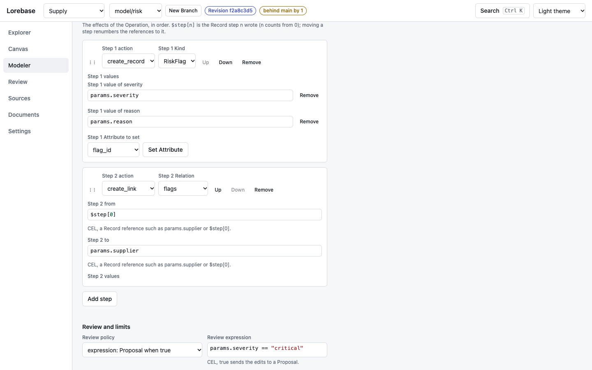

The Operation tab edits parameters, preconditions, steps and the review policy, with CEL expressions in their own editor, and dry-runs the Operation as saved on the Branch. Steps are reordered by dragging the handle or with the Up and Down buttons (the move is announced, and the `$step[n]` references renumber so they keep pointing at the same step). Live.

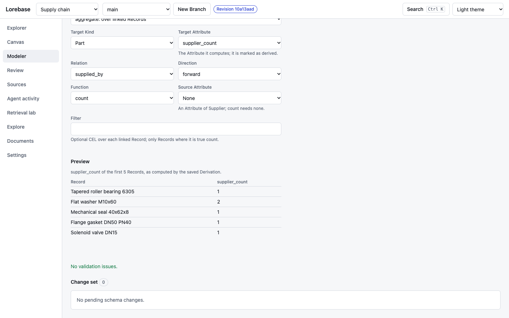

The Derivation tab edits the `expression`, `aggregate` and `path` variants and picks the computed Attribute from the schema. Its preview shows the computed Attribute on the first five Records of the target Kind, read through the ordinary Record read, so Keeper's masking and permissions apply; after an edit "Preview the edited Derivation" asks Keeper to evaluate the Derivation as edited, without saving it (`POST /derivations:preview`). Here `supplier_count`, the number of `supplied_by` Links of each Part. Live.

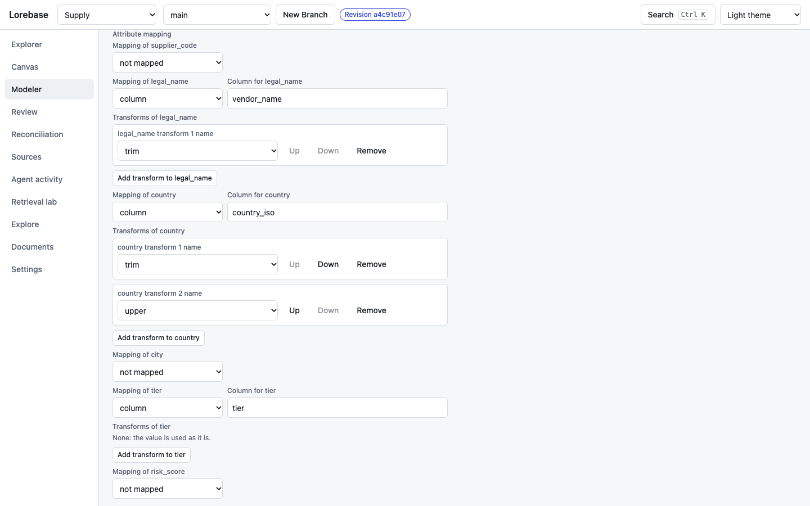

The Source tab shows the fields of each Source type, accepts only `secret://` references for the connection and for credential headers, and edits the mapping to the target Kind: per Attribute a column, a chain of transforms with the arguments each one takes (`cast`, `trim`, `lower`, `upper`, `parse_date`, `concat`, `constant`, `map`, `null_if`), HTTP pagination, sync mode and merge policy. Mock.

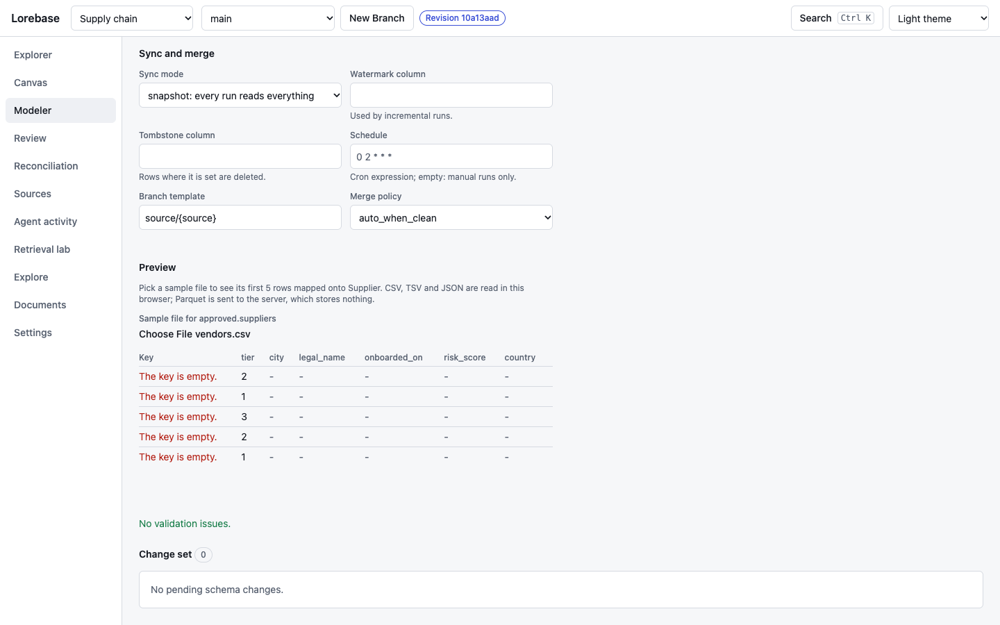

The preview at the end of the Source tab takes a sample file (CSV, TSV, JSON, JSON Lines or Parquet) and shows its first five rows as the mapping, as currently edited, would map them onto the target Kind: the key, the Attributes after their transforms and the coercion to their type, with the reason next to a value that does not fit. CSV, TSV, JSON and JSON Lines files are read in the browser and not uploaded; a Parquet file is sent to Keeper (`POST /domains/{d}/schema:preview`, nothing stored). An Attribute mapped by an `expression` is evaluated by Keeper (`POST /sources:preview`) on the sample rows shown, never with a connection or a secret. Live.

### Start from data

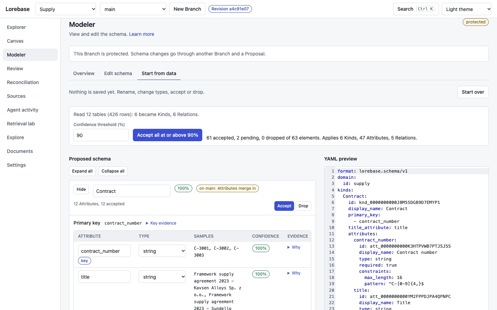

The wizard for a Domain that starts from tables, not from a blank schema. Upload CSV or TSV files (with the file, size and suffix caps of the configuration) or name a Postgres source by its allowlisted secret reference, run the inference, and review what it proposes: Kinds with a confidence badge and the evidence for their primary key, Attributes with their type, sample values and the reasons behind them, Relations with cardinality and inclusion ratio. Rename, change a type, accept or drop each element, or accept everything at or above a confidence threshold; the YAML on the right follows every edit. "Apply as schema change" commits the accepted elements through the same change set panel as the schema editor. The picture shows the twelve CSV files of `examples/supply` after "Accept all at or above 90%". Mock: the inference answer is the recorded output of the real engine on those files (the gold test of `docs/inference.md`).

## Sources

The Sources of the schema with their connection reference, mapping summary, sync mode and merge policy, schedule, last run and its counts, a "Sync now" button, the run history with the error of a failed run and a link to the Proposal a run opened, and the `sources` section of the schema as a YAML editor with validation and a change set. Mock: runs are sample data. Live, runs come from Keeper's Source routes and "Sync now" queues a job for Scribe.

## Documents

Where contracts, notices and reports enter a Domain to be read into Proposals ([extraction](extraction.md)). A drop zone and a picker take the files, with the caps of the configuration stated and enforced, a switch for "Extract after storing" and the extraction tiers, and a form takes a URL for the hosts Keeper allows. The library lists each document with its type, size, who added it, the status of its latest extraction job and a link to the Proposal it opened. A document uploaded under a source key shows its version and status, and its page lists the versions of the key, the open `stale` candidates its evidence raised (linked to the Reconciliation queue) and, for those who hold the permissions, Retire and Purge (typing the document id to confirm). A document opens in a viewer with its jobs (model, prompt version, tokens, cost) and its parsed text, with the evidence of the Proposal's items highlighted. Live: the example documents of `examples/supply`.

## Review

### Proposal list

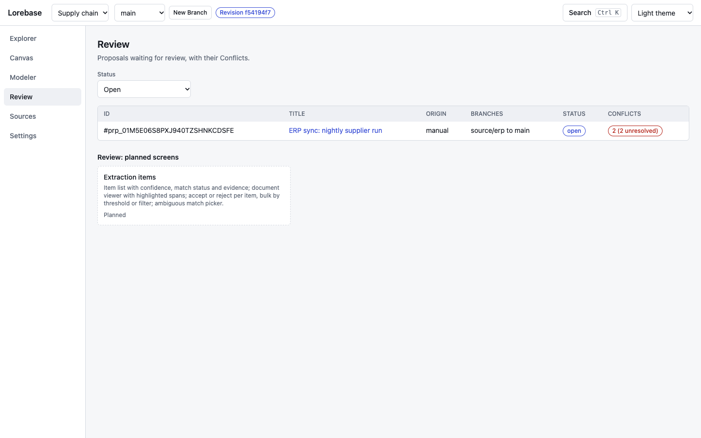

The Proposals of the Domain with origin (manual or extraction), the Branches they merge, status and the number of unresolved Conflicts, filterable by status and, with "Assigned to me", to the Proposals the caller is an assignee of. A Proposal touching Kinds whose schema names stewards shows the steward roles and, for callers who may read principals, its assignees ([design 10.7](design.md#107-stewards)). The Proposal page also has the checks Keeper runs, the reviews with where the approvals stand (with the approvals still needed from stewards, and a warning when too few stewards can give them) and a form to add one. Live.

### Extraction items

The Items tab of an extraction Proposal: new Records, Attribute values and Links read from a document, grouped by type, each with a confidence bar, how it matched the Records of `main` (`matched`, `new`, `ambiguous`), its quote and a link to the quote in the document viewer. Filters narrow the table by status, Kind or Relation, type and confidence; accept, reject and back to pending are staged per item (buttons or `a`, `r`, `u`, with arrow keys or `j` and `k` to move) or in bulk, and "Apply decisions" sends them in one request. Keeper checks the accepted set as a whole: here the new Contract needs its `with_supplier` Link, so accepting one without the other is refused with the reason next to the item. The selected item (right) shows its evidence and inline edits of its values, checked against the schema. Live.

### Schema suggestions

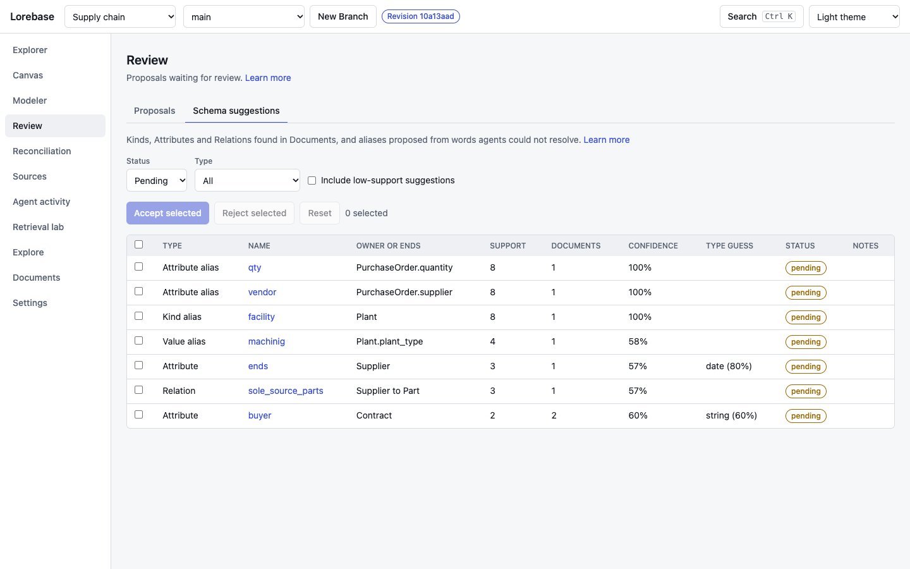

Kinds, Attributes and Relations that documents mention and the schema lacks, with their support (how often and in how many documents), confidence and a type guess; accepted ones go to the Modeler as a change set on a Branch ([extraction](extraction.md#schema-suggestions)). Live.

### Merge attempt and Conflict resolver

Two Branches changed the same values, and the Proposal that merges the second ends up with Conflicts. Conflicts are grouped by type, filterable, and one is selected in the URL; they are named by Kind, key and Attribute, not by internal ids. The resolver shows base, ours and theirs side by side, with the Branch names in the headers and the words each side added or removed marked in text values, and offers only the resolutions that fit the Conflict (take ours, take theirs, revert to base, custom value, which can start from a copy of any side); grouped Conflicts take one value per member. Saving opens the next open Conflict, and outside text fields `o`, `t`, `b`, `e`, `s` or Enter, and `n` do the same from the keyboard. A text value that changed in the same sentences on both Branches is shown passage by passage: each conflicting passage takes ours, theirs, both or the base, or an edit in place, and a live preview shows the composed text against the Attribute's length limits before "Use merged text" saves it. Leaving a Conflict with unsaved changes asks first. "Apply resolutions" asks for confirmation while Conflicts remain, then asks Keeper to merge: while Conflicts remain it answers with the attempt, once every Conflict is resolved and the target has its approvals it creates the merge Revision. Mock.

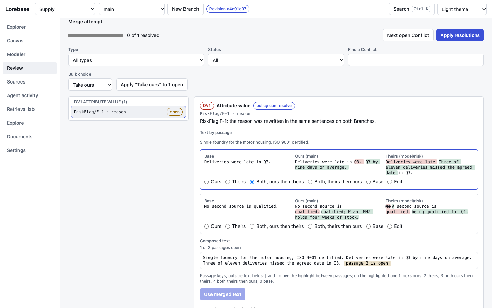

The passage view of a text Conflict: the sentence only one Branch changed is already merged (shown as plain text), and each of the two conflicting passages has its base, ours and theirs with the changed words marked. Here the first passage takes both sides, ours then theirs, the second is still open, and the composed text below marks it as `[passage 2 is open]`. Mock.

## Reconciliation

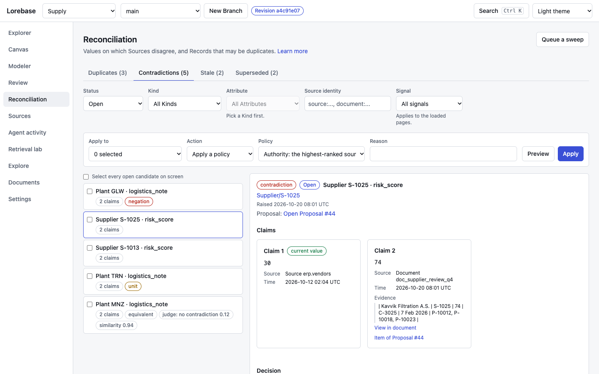

Values on which Sources disagree, and Records that may be duplicates ([design 10.6](design.md#106-reconciliation-of-source-contradictions)). A merge Conflict is two Branches changing one value; a reconciliation candidate is two Sources (a sync, a document, a person, an import) claiming different values for one fact, even when each write merged cleanly. Scribe raises the candidates during extraction, before a Source sync merges and in sweeps ([Scribe](scribe.md#reconciliation)); nothing is changed, hidden or decided because a candidate exists.

The screen lists the candidates of the Branch on screen with a tab and a count per type (duplicates, contradictions, stale and superseded values), filters by status, Kind, Attribute, source identity and signal, and "Assigned to me" for the candidates of the Kinds the caller looks after as a steward (each candidate shows its steward roles and assignees), and ranks negations (`not`, `no`, `never`) first and paraphrases marked `equivalent` last. A candidate shows every claim side by side with its source, time, validity period and evidence passage, with a link to the passage in the document viewer and to the Proposal item it came from. A decision takes a claim, keeps the current value, writes a custom value or applies a policy (`authority`, `newest_wins`, prefer current or incoming), with a preview and a required reason; it is written by the Kind's `update_{kind}` Operation, so permissions, validation and branch protection apply, and on a protected Branch it opens a Proposal. A selection or a filter takes a policy or a dismissal in bulk, a dismissed candidate can be reopened, and "Queue a sweep" asks Scribe for a pass over the Branch. Tab counts stop at `VITE_RECONCILIATION_COUNT_LIMIT` (shown as "500+"), and the signal filter and ranking apply to the pages loaded. Mock.

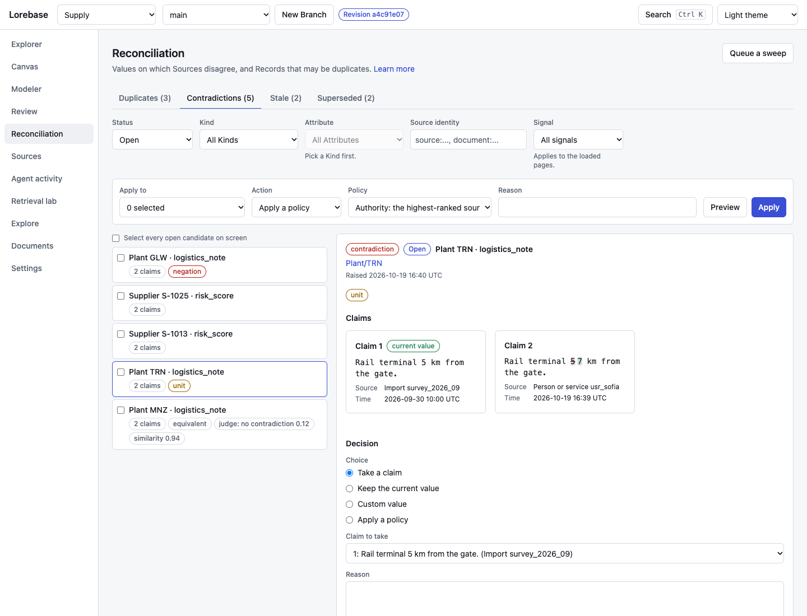

A text contradiction: two claims for the logistics note of a Plant, the incoming one marked word by word against the current value (`5 km` against `57 km`; the `unit` signal says the values were read as quantities and differ). Mock.

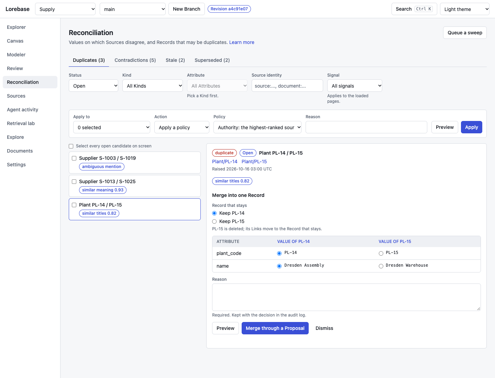

Two Plants with similar titles that may be one. The merge picks the Record that stays and, per differing Attribute, the value to keep; it runs through a Proposal, the Links of the other Record move to the one that stays, and the other Record is deleted. The Record page marks values with open candidates, and the Proposal page lists the candidates of its `reconciliation` check, which a Domain can set to block a merge while contradictions are open. Mock.

## Explore

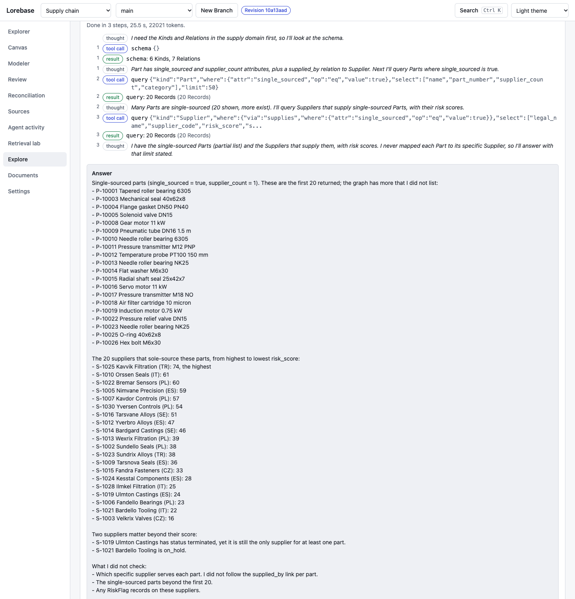

A question to the guide service, the optional exploration assistant, streamed step by step: its reasoning notes, each read it makes in Keeper with the arguments, the result counts, then an answer that cites the Records it was shown, linked to their pages, with "View trace" to the session in Agent activity and the cited Records on the Canvas. When the Domain's schema declares example questions (`domain.examples`), they are offered as buttons above the question field. Live: a real answer, needs `guideUrl` ([guide](guide.md#the-explore-panel-in-the-web-app)).

## Agent activity

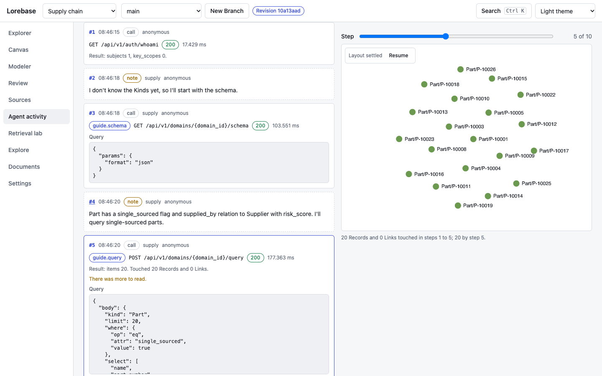

Every call an agent made in a session, step by step: notes, tool calls with their query and latency, the Records and Links each step touched, and the Canvas overlay of what the session has touched up to the selected step ([agent trace](agent-trace.md)). Live: the trace of a guide answer.

## Retrieval lab

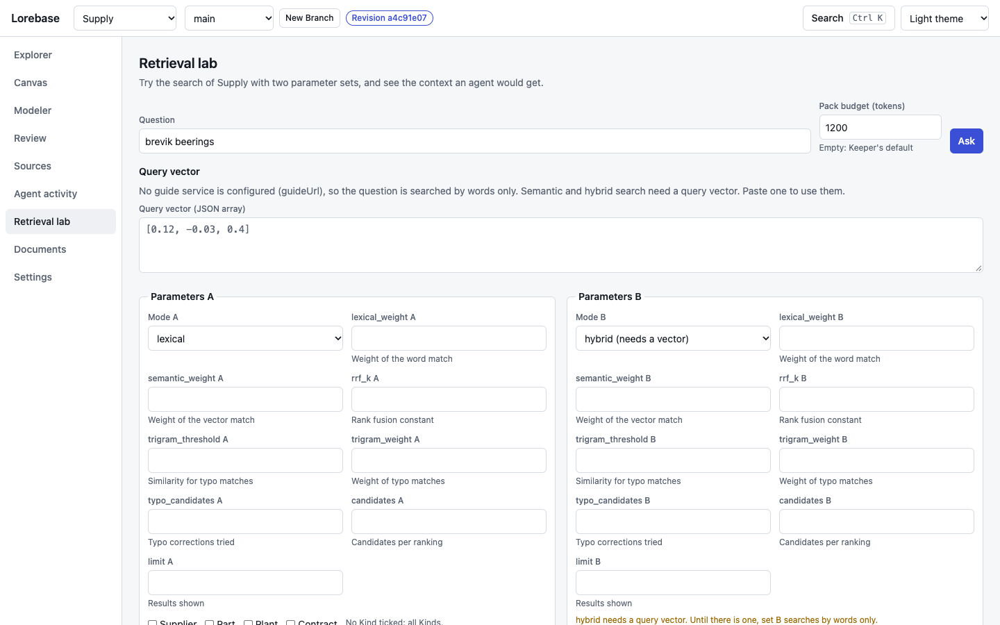

Two sets of search parameters side by side on the same question (mode, weights, typo tolerance, candidates, Kinds), the ranks they produce compared line by line, the context pack an agent would get within a token budget (both searches and the pack can take a lens of the schema), with why each Record is in it, and the Records involved on a graph ([retrieval lab](retrieval-lab.md)). The example questions of the Domain, when it declares any, fill the question in one click; "Ask the guide" opens Explore. Live.

## Settings

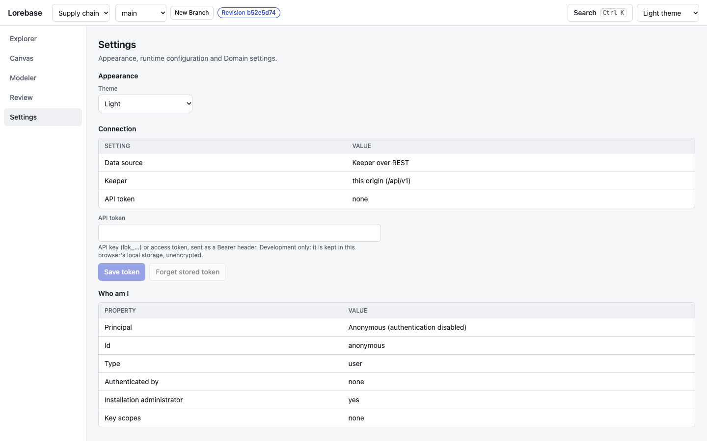

Appearance (system, light or dark theme), the connection (where Keeper is, which API token this browser sends, and who Keeper says the caller is), the settings of the Domain (with any settings the installation ignores) and, for a caller who holds `domain.settings`, its ingestion settings to edit: mode, auto-accept threshold, minimum confidence and rules by source key prefix, with Keeper's refusals shown at the fields ([extraction](extraction.md#ingestion-modes)) and the runtime configuration the app was started with. Three more tabs hold the Admin basics: API keys (create with a role and a lifetime, the secret is shown once, revoke after a confirmation), principals and the grants of the Domain (read only), and the audit log with filters over the loaded entries. Live.

## Dark theme

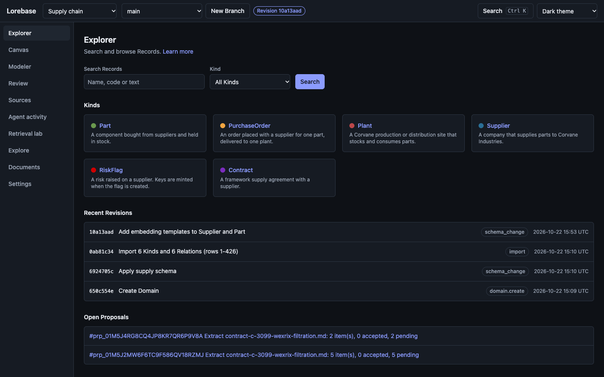

Colors are CSS variables, so the same screens follow the system theme or a forced light or dark choice kept in local storage. Live.
